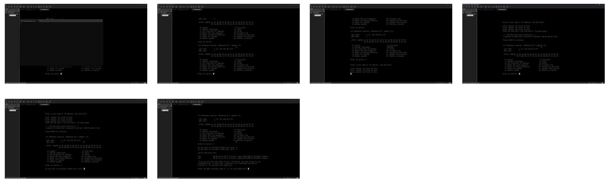
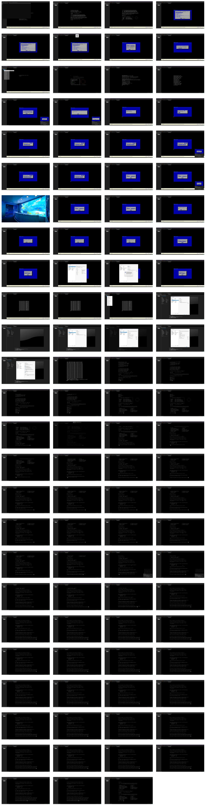
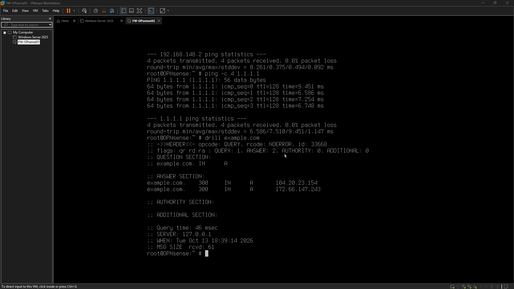
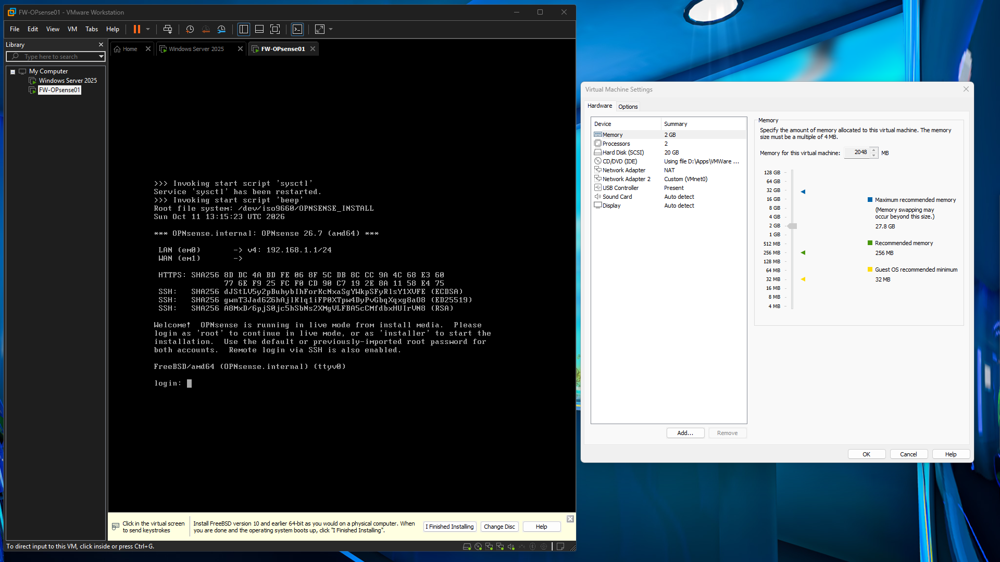

# Networking-Infrastructure-Engineering

Status: In progress

## Project story
This 'Networking-Infrastructure-Engineering' project is actively building out a robust virtualized network environment using OPNsense 26.7. The initial phase successfully established foundational management connectivity by resolving critical IP address conflicts, restoring HTTPS access to the firewall from the host. Building on this, the current focus is on configuring essential network services, specifically laying the groundwork for dynamic IP address management on the LAN segment using Kea DHCPv4. The project is progressing through systematic configuration and validation to ensure a stable and functional core network infrastructure.

### 1. Project story

This project entails the design and implementation of a virtualized network infrastructure centered around OPNsense 26.7. It commenced with establishing a stable management plane, which involved critical troubleshooting to resolve an IP address conflict preventing HTTPS access to the firewall. With management access secured, the current phase is dedicated to configuring core network services. This includes the initial setup of the Kea DHCPv4 service to manage IP address assignments within the isolated LAN environment, ensuring a structured and functional network foundation is in place. The project is actively moving towards client connectivity validation and further service integration.

### 2. Key achievements

*   **Critical IP Conflict Resolution:** Successfully identified and resolved an IP address conflict between the OPNsense LAN interface (192.168.20.1/24) and the VMware VMnet2 host-only adapter, reconfiguring the host to 192.168.20.2/24.
*   **Restored Management Access:** Verified and restored reliable HTTPS management access to the OPNsense firewall from the physical host on port 443.
*   **Core Network Configuration Verification:** Confirmed OPNsense interface assignments (WAN: `em0`@`192.168.148.129/24`, LAN: `em1`@`192.168.20.1/24`) and validated internal routing tables.
*   **DHCP Service Initial Setup:** Performed foundational configuration of the Kea DHCPv4 service on OPNsense, selecting the LAN interface and defining an address pool (192.168.20.100–192.168.20.199) for the 192.168.20.0/24 LAN subnet.

### 3. Lessons learned

*   **Prioritize Foundational Connectivity:** Establishing and thoroughly validating management connectivity is paramount before proceeding with advanced service configurations. Unresolved conflicts at this layer can block subsequent progress.
*   **Systematic Troubleshooting is Key:** When facing connectivity issues in virtualized environments, a methodical approach is essential to distinguish between host-level network configuration problems and guest (firewall) service configuration issues.
*   **Incremental Configuration and Validation:** For complex network services like DHCP, configure settings incrementally and plan for immediate validation of operational status. Delaying validation can complicate debugging when issues arise.
*   **Document Initial State:** Recording existing, even incomplete, configurations before making changes provides a valuable baseline for troubleshooting and understanding the environment's evolution.

### 4. Next steps

*   Apply the configured Kea DHCPv4 settings on OPNsense and validate the service's operational status by testing client IP address assignments on the LAN.
*   Connect a Windows client to the isolated VMnet2 lab network, then validate DHCP addressing, default gateway assignment, and test LAN gateway reachability, including DNS configuration.
*   Record DNS configuration and identify any remaining client connectivity issues.

### 5. Proof points

*   OPNSense LAN DHCP Subnet
*   WAN DHCP Success
*   WAN Default Route Validated
*   Network Topology Plan (Current)
*   WAN External Connectivity
*   WAN DNS Resolution
*   VMware DHCP Investigation
*   OPNsense Live Boot

## Project timeline
### 2026-10-20 • 05:57 to 06:07
- Goal
Verify the existing OPNsense LAN DHCP configuration and record its current state.

- Definition of Done
Confirm whether LAN DHCP is enabled, verify the configured DHCP address pool, record any configuration issue or blocker, identify the next validation step.

- Goal Achieved
❌ No

Summary:
Initial configuration of the Kea DHCPv4 service on OPNsense 26.7 was performed, including verification of network interfaces and creation of a DHCP subnet with an address pool for the LAN network.

Tasks Completed:
1.  Accessed the OPNsense 26.7 web interface through the host-only LAN network.
2.  Verified the LAN interface (192.168.20.1/24) and host adapter (192.168.20.2/24) network configurations.
3.  Inspected Kea DHCPv4 settings, confirming the service was initially disabled with no interface selected.
4.  Inspected subnet configuration, finding zero existing subnet entries.
5.  Created a LAN subnet entry for 192.168.20.0/24 with the address pool 192.168.20.100–192.168.20.199.
6.  Selected the LAN interface for the Kea DHCPv4 service.
7.  Checked the service 'Enabled' option for Kea DHCPv4.

Issues Encountered:
1.  The existing DHCP configuration was incomplete upon inspection.
2.  Required identification of the correct Kea DHCPv4 settings and subnet configuration pages within the OPNsense interface.
3.  Limited session time prevented applying the configuration and validating service operation.

Next Steps:
1.  Apply the configured Kea DHCPv4 settings.
2.  Validate the operation of the DHCPv4 service on the LAN interface by testing client IP address assignments.

Notes:
The work focused on the foundational setup of Kea DHCPv4 to provide IP addresses within the 192.168.20.0/24 network segment. The host-only network configuration was essential for initial access and verification.

- Working Story
None

- Friction and AI Gaps
Existing DHCP configuration was incomplete, the correct Kea DHCPv4 settings and subnet pages needed to be identified, limited session time prevented applying the configuration and validating service operation.

- What the AI Missed
None

- AI Peer Review
Status: Approved
Reviewer: human
Reviewed At: 2026-10-20 06:08:27
Reviewer Notes: The OPNsense WAN interface remains em0 at 192.168.148.129/24, the LAN interface remains em1 at 192.168.20.1/24, the physical Windows host's VMnet2 adapter is 192.168.20.2/24, VMnet2 remains host-only on 192.168.20.0/24. The Kea DHCPv4 subnet entry was created with pool 192.168.20.100–192.168.20.199. The latest screenshot shows LAN selected and the main service Enabled checkbox checked, but the Apply button is still present. Application of these service settings and successful DHCP operation are not yet verified.

- Duration
10 minutes (Planned: 20 minutes)

- Notes
### 2026-10-16 • 05:24 to 05:51
- Goal
Connect a Windows client to the isolated VMnet2 lab network, validate DHCP addressing and default gateway assignment, test LAN gateway reachability, record DNS configuration and identify any remaining client connectivity issues.

- Definition of Done
Windows client connected to VMnet2, DHCP lease and subnet verified, default gateway confirmed as 192.168.20.1, DNS configuration recorded, gateway connectivity tested, results and limitations documented, next technical action identified.

- Goal Achieved
❌ No

Summary:
Systematic network troubleshooting was performed on a virtualized OPNsense 26.7 firewall environment to resolve critical management connectivity issues. The primary problem identified was an IP address conflict between the OPNsense LAN interface (192.168.20.1/24) and the VMware VMnet2 host-only adapter on the Windows host. This conflict was successfully resolved by reconfiguring the host's VMnet2 adapter to 192.168.20.2/24. Post-resolution, OPNsense interface assignments, routing, and HTTPS listener functionality were verified, and successful TCP connectivity to the firewall's web interface on port 443 was established from the physical Windows host. This work preserved the existing domain controller configuration and restored essential HTTPS reachability to the firewall.

Tasks Completed:
*   **OPNsense Interface Verification:** Confirmed OPNsense 26.7 interface assignments:
    *   WAN: `em0` at `192.168.148.129/24`
    *   LAN: `em1` at `192.168.20.1/24`
*   **VMware Network Configuration Review:** Reviewed the VMware `VMnet2` host-only network configuration on the Windows host.
*   **IP Address Conflict Resolution:**
    *   Identified an IP address conflict between the OPNsense LAN interface (`192.168.20.1`) and the Windows host's `VMnet2` adapter.
    *   Resolved the conflict by changing the Windows host's `VMnet2` adapter IP address from `192.168.20.1` to `192.168.20.2`.
*   **OPNsense System Verification:**
    *   Verified OPNsense routing table.
    *   Confirmed OPNsense HTTPS listener is active on the LAN interface.
    *   Confirmed LAN interface status is active.
*   **Connectivity Testing:** Successfully tested TCP connectivity from the physical Windows host to the OPNsense LAN interface (`192.168.20.1`) on port `443` (HTTPS).

Issues Encountered:
*   **IP Address Conflict:** A critical IP address conflict existed where the Windows host's `VMnet2` adapter shared the same IP address (`192.168.20.1`) as the OPNsense LAN interface, preventing proper network communication.
*   **HTTPS Access Timeouts:** Initial attempts to access the OPNsense web interface via HTTPS timed out directly as a symptom of the underlying IP address conflict.
*   **Troubleshooting Complexity:** Distinguishing between host network configuration issues and firewall configuration issues required focused troubleshooting efforts.

Next Steps:
*   Validate DHCP functionality on the OPNsense LAN interface.

Notes:
*   No AI-related errors or misses were identified during this process.
*   The troubleshooting process emphasized systematic verification of virtual network components and firewall configurations.
*   The environment involved OPNsense 26.7, a VMware virtual machine, and a physical Windows host.
*   Preservation of existing domain controller configuration was a key consideration; no changes to the DC were performed or required.

- Working Story
Systematic network troubleshooting, verification of virtual network and interface assignments, identification and correction of an IP address conflict, preservation of the existing domain controller configuration, restoration of HTTPS reachability to the firewall, clear separation between verified results and unfinished validation.

- Friction and AI Gaps
The Windows host adapter initially used the same IP address as the OPNsense LAN interface, initial HTTPS access timed out, distinguishing host network configuration from firewall configuration required additional troubleshooting, time constraints prevented completion of DHCP validation.

- What the AI Missed
None

- AI Peer Review
Status: Approved
Reviewer: human
Reviewed At: 2026-10-16 05:52:08
Reviewer Notes: The OPNsense WAN and LAN interfaces remain configured as intended, the default route through 192.168.148.2 is present, the LAN interface is active, the HTTPS service is listening, the Windows host's VMnet2 adapter now uses 192.168.20.2/24, TCP connectivity to 192.168.20.1:443 succeeds. No firewall rules or domain controller network settings were intentionally changed during this session.

- Duration
26 minutes (Planned: 60 minutes)

- Notes
VMware VMnet2 is configured as host-only with subnet 192.168.20.0/24, the VMware host adapter is connected, VMware's local DHCP service is disabled for VMnet2 because OPNsense is intended to provide DHCP. A dedicated Windows client VM has not been identified or created. DHCP lease validation, client gateway testing, DNS validation, firewall policy testing, and final evidence capture remain incomplete.
### 2026-10-13 • 14:00 to 14:42
- Goal
Audit the actual VMware and OPNsense network configuration, verify virtual NIC-to-network mappings, analyze the existing WAN DHCP packet capture in Wireshark if available, reassess project progress, establish a revised implementation sequence.

- Definition of Done
Produce a verified or explicitly unresolved topology, distinguish configured capabilities from tested capabilities, record Wireshark findings if the capture is available, identify the next evidence-based action, update the project handoff.

- Goal Achieved
✅ Yes

Summary:
This session successfully addressed and resolved critical network connectivity issues for an OPNsense virtual appliance. The primary cause was identified as an incorrect mapping of VMware virtual network adapters to OPNsense WAN/LAN interfaces. After systematically correcting these assignments, full network functionality was restored. WAN DHCP was successfully obtained, routing verified, and external IP connectivity confirmed. DNS resolution was also validated. The session concluded with a documented network topology, establishing a stable and reproducible foundation for subsequent implementation phases.

Tasks Completed:
*   Audited VMware virtual network adapter assignments for the OPNsense VM.
*   Identified and corrected the incorrect OPNsense WAN/LAN interface mapping:
    *   Reassigned the WAN interface to `em0` on `VMnet8`.
    *   Reassigned the LAN interface to `em1` on `VMnet2`.
*   Successfully obtained a WAN DHCP lease: `192.168.148.129/24`.
*   Verified the default gateway: `192.168.148.2`.
*   Confirmed gateway reachability with 4/4 replies and 0% packet loss.
*   Confirmed external IP connectivity to `1.1.1.1` with 4/4 replies and 0% packet loss.
*   Validated DNS resolution for `example.com` through the local resolver.
*   Documented the current network topology and addressing plan.

Issues Encountered:
*   Initial troubleshooting efforts prematurely focused on DHCP behavior before a complete validation of the network topology, including correlating VMware adapter MAC addresses with OPNsense interface names.
*   Incorrect assumptions were made regarding VMware virtual network adapter ordering and the corresponding OPNsense `emX` interface names.
*   The troubleshooting session extended without predefined time boundaries or clear stopping criteria, leading to prolonged diagnostic attempts and increased fatigue.
*   The troubleshooting sequence was inefficient due to a failure to prioritize a systematic topology audit upfront.

Next Steps:
*   Proceed with the next phase of OPNsense configuration and network implementation, building upon the established and verified network foundation.
*   Implement stricter time boundaries and earlier stopping criteria for future troubleshooting sessions to improve efficiency.

Notes:
This session highlighted the critical importance of a systematic infrastructure troubleshooting methodology, particularly the absolute necessity of validating the complete network topology and interface mappings *before* diving into service-specific issues like DHCP. The key to resolution was identifying and correcting the virtual interface mapping error. Establishing a reproducible topology reference and meticulously documenting the current state are essential for future work and maintaining a stable environment. Lessons learned include prioritizing a comprehensive topology audit, correlating MAC addresses, and implementing better session management practices (e.g., time boxing, defined stopping points) to prevent extended, less effective diagnostic efforts.

- Working Story
Systematic infrastructure troubleshooting, validating network topology before investigating individual services, identifying and correcting a virtual interface mapping error, restoring WAN DHCP and routing, proving gateway reachability and external connectivity, validating DNS resolution, establishing a reproducible topology reference, preserving a working state for the next implementation phase.

- Friction and AI Gaps
Troubleshooting DHCP before validating the complete network topology, incorrect assumptions about VMware adapter ordering and OPNsense interface names, extended troubleshooting without a firm time boundary, fatigue from repeated diagnostic attempts.

- What the AI Missed
The initial troubleshooting sequence focused too long on DHCP behavior before matching VMware adapter MAC addresses to OPNsense interfaces, the topology audit should have been performed first, the session needed stronger time boundaries and earlier stopping criteria.

- AI Peer Review
Status: Approved
Reviewer: human
Reviewed At: 2026-10-13 14:43:35
Reviewer Notes: The initial WAN DHCP failure was traced to a mismatch between VMware virtual network assignments and OPNsense interface roles. MAC address comparison established that em0 corresponded to Adapter 1 on VMnet8 and em1 corresponded to Adapter 2 on VMnet2. Reassigning WAN to em0 and LAN to em1 resolved the WAN addressing issue. The routing table showed a default route through 192.168.148.2, gateway and external IP connectivity tests each returned 4/4 replies, and the DNS query for example.com returned two IPv4 addresses. These results validate the firewall's WAN-side foundation but do not yet establish LAN client connectivity, firewall segmentation, or end-to-end client DNS.

- Duration
42 minutes (Planned: 60 minutes)

- Notes
The existing domain controller NS-DC01 remains at 192.168.148.10 on VMnet8, avoid moving or reconfiguring it during the next phase without a deliberate migration plan, preserve the current working OPNsense configuration, use short sessions with one primary objective and explicit stopping criteria.
### 2026-10-12 • 04:27 to 05:39
- Goal
Investigate and troubleshoot the missing IPv4 DHCP lease on the OPNsense WAN interface, identify the cause of the missing DHCP Offer if possible, restore upstream connectivity, validate the default route, document findings and remaining blockers.

- Definition of Done
Confirm the OPNsense WAN interface and VMware virtual network configuration, determine why DHCP Discover requests are not receiving a visible Offer or document the most likely fault boundary, obtain a WAN IPv4 lease and verify the default route if resolved, capture diagnostic evidence and record a reproducible troubleshooting handoff.

- Goal Achieved
❌ No

Summary:
This documentation outlines the initial phase of troubleshooting a persistent WAN DHCP failure experienced by an OPNsense virtual machine within a VMware environment. Despite a systematic approach to verifying both the OPNsense client's behavior and the VMware virtual network configuration, the issue remains unresolved. Limited visibility into the DHCP negotiation process has hindered fault isolation. Recognizing diminishing returns from further configuration checks, the focus is now shifting to evidence-based, packet-level analysis to pinpoint the root cause.

Tasks Completed:
*   Investigated the OPNsense WAN DHCP failure.
*   Verified the OPNsense WAN interface (em1) configuration and confirmed repeated DHCP Discover transmissions.
*   Confirmed the VMware VMnet8 NAT and DHCP configuration.
*   Checked the operational status of the VMware DHCP and NAT services.
*   Restarted the VMware DHCP service without restoring existing leases.
*   Examined Windows DHCP event channels on the host.
*   Reviewed VMware DHCP lease records for any relevant entries.
*   Initiated a PCAP capture for subsequent Wireshark analysis.

Issues Encountered:
*   Repeated configuration checks did not succeed in isolating the fault.
*   Limited visibility into whether the VMware DHCP server was receiving OPNsense DHCP broadcast messages.
*   Initial host-side packet captures proved inconclusive in diagnosing the problem.
*   The WAN DHCP failure for OPNsense persists.
*   A tendency to repeat verification steps without establishing new observation points or distinguishing clearly between confirmed findings and assumptions.

Next Steps:
*   Perform a detailed Wireshark analysis of the captured PCAP file to thoroughly examine DHCP negotiation packets and identify communication breakdowns.
*   Establish a more granular and effective observation point, potentially capturing traffic directly on the VMnet8 interface within the host, or within the guest VM itself (if feasible), to ensure visibility of DHCP Discover requests reaching the VMware DHCP server and its subsequent responses.
*   Based on the packet-level analysis, systematically isolate the fault to either the OPNsense client, the VMware virtual network's routing/bridging, or the VMware DHCP service itself.

Notes:

- Working Story
Systematic troubleshooting of a virtual networking failure, evidence-based fault isolation, verification of DHCP client behavior and virtual network configuration, recognition of diminishing returns and a plan to use packet-level analysis for the next diagnostic step

- Friction and AI Gaps
Repeated configuration checks without isolating the fault, limited visibility into whether VMware DHCP receives OPNsense broadcasts, inconclusive host-side packet captures, unresolved WAN DHCP failure

- What the AI Missed
Repeated checks of settings and service status already verified, insufficiently distinguished confirmed findings from assumptions, did not establish a new observation point before recommending further troubleshooting

- AI Peer Review
Status: Approved
Reviewer: human
Reviewed At: 2026-10-12 05:41:25
Reviewer Notes: 

- Duration
72 minutes (Planned: 60 minutes)

- Notes
WAN DHCP failure remains unresolved, VMware VMnet8 configuration matches the intended subnet and gateway, existing VMware DHCP lease file contains only an old NS-DC01 lease, saved PCAP pending analysis in Wireshark
### 2026-10-11 • 11:44 to 15:04
- Goal
Establish the baseline of the existing VMware homelab network, identify virtual network connections and IP addressing, examine routing and DNS behavior within the lab, identify one genuine networking issue or discrepancy, and establish the foundation for the segmented enterprise network.

- Definition of Done
Existing virtual network topology documented, NS-DC01 network configuration identified, IP addressing and routing understood, DNS resolution tested, connectivity between relevant lab systems assessed, one real issue investigated if present, findings and next steps documented.

- Goal Achieved
❌ No

Summary:
Installed and configured OPNsense 26.7 as the foundation for an isolated enterprise-style virtual network, established the LAN gateway at 192.168.20.1/24 and configured the DHCP pool for future lab clients, assigned WAN and LAN interfaces and verified VMware NAT addressing, investigated missing WAN IPv4 connectivity through interface inspection, routing-table analysis, DHCP lease inspection, and packet capture, identified repeated DHCP Discover requests without a visible DHCP Offer, documented the unresolved WAN DHCP issue and established a targeted troubleshooting plan for the next session.

Tasks Completed:
Installed OPNsense 26.7 on a dedicated virtual machine, configured WAN and LAN interface assignments, created the isolated VMnet2 network using 192.168.20.0/24, assigned the LAN gateway 192.168.20.1/24, configured the LAN DHCP pool from 192.168.20.100 to 192.168.20.199, verified VMware VMnet8 NAT subnet and gateway settings, inspected VMware DHCP pool configuration and service status, inspected OPNsense interface status and routing tables, examined DHCP lease state, captured WAN IPv4 DHCP traffic with tcpdump, identified repeated DHCP Discover requests without a visible DHCP Offer, documented the unresolved WAN connectivity issue and next troubleshooting steps.

Issues Encountered:
WAN failed to obtain an IPv4 address through DHCP despite the virtual interface reporting an active link, repeated DHCP Discover requests were captured without a visible DHCP Offer, the WAN DHCP lease file was empty, the default IPv4 route was absent, the LAN virtual adapter was initially attached to VMnet0 instead of the intended VMnet2 and required correction, initial troubleshooting was slowed by incomplete inventory of the existing virtual network configuration, DHCPv6 log messages initially complicated interpretation of the IPv4 DHCP issue, Gemini AI generation encountered a temporary 503 service availability error and required manual documentation.

Next Steps:
Inventory and validate the existing VMware virtual network configuration before making further changes, investigate why OPNsense WAN (`em1`) sends IPv4 DHCP Discover requests without receiving a visible DHCP Offer, verify VMware NAT and DHCP service behavior, obtain a valid WAN IPv4 lease and confirm the default route, test upstream connectivity, verify OPNsense LAN gateway and DHCP functionality on VMnet2, connect a test client to the isolated lab subnet, validate permitted and blocked traffic through the firewall, capture screenshots and packet evidence at key milestones, document troubleshooting findings and configuration decisions, finalize the network topology diagram and session documentation.

Notes:
OPNsense installation and LAN configuration are complete, WAN is assigned to em1 and connected to VMware NAT, LAN is assigned to em0 on VMnet2, WAN currently has no IPv4 address, the DHCP lease file is empty, IPv4 DHCP Discover requests were captured on em1 without a visible Offer, the cause remains unresolved, do not mark WAN routing or firewall functionality as validated.

- Working Story
Building an isolated virtual network and installing an enterprise-style firewall, translating Network+ concepts into practical interface and subnet configuration, learning to distinguish link state from IP addressing and routing, using packet capture to investigate a real DHCP connectivity failure, identifying the importance of inventory-first engineering, documenting evidence and unresolved issues rather than claiming an unverified success.

- Friction and AI Gaps
WAN DHCP troubleshooting took longer than expected, initial infrastructure assumptions were not fully validated before configuration, the second virtual network adapter was initially attached to VMnet0 instead of VMnet2 and required correction, distinguishing IPv4 DHCP from DHCPv6 log activity required additional investigation, console scrollback and shell diagnostics added friction, the root cause of the missing WAN IPv4 lease remains unidentified.

- What the AI Missed
The initial workflow should have inventoried existing VMware networks, DHCP pools, gateway settings, service state, and adapter mappings before configuring OPNsense, troubleshooting repeated the same checks instead of moving to packet-level evidence sooner, the initial interface investigation did not distinguish DHCPv6 Solicit messages from IPv4 DHCP requests clearly enough, the DHCP pool was initially treated as a potential mismatch even though its range was valid for VMnet8, the cause of the missing WAN DHCP response was not established and must not be presented as a confirmed VMware service fault.

- AI Peer Review
Status: Approved
Reviewer: human
Reviewed At: 2026-10-11 15:08:23
Reviewer Notes: OPNsense installation and LAN configuration are complete, WAN is assigned to em1 and connected to VMware NAT, LAN is assigned to em0 on VMnet2, WAN currently has no IPv4 address, the DHCP lease file is empty, IPv4 DHCP Discover requests were captured on em1 without a visible Offer, the cause remains unresolved, do not mark WAN routing or firewall functionality as validated.

- Duration
178 minutes (Planned: 60 minutes)

- Notes
VMnet2 is configured as Host-only with subnet 192.168.20.0/24 and VMware DHCP disabled, OPNsense LAN is 192.168.20.1/24, the intended OPNsense LAN DHCP pool is 192.168.20.100–192.168.20.199, VMnet8 is configured as NAT with subnet 192.168.148.0/24, VMware NAT gateway is 192.168.148.2, VMware DHCP pool is 192.168.148.128–192.168.148.254, VMware DHCP Service was reported running, WAN adapter settings were confirmed as NAT with Connected and Connect at power on enabled, WAN DHCP response path still requires investigation.
### 2026-10-10 • 15:59
- Summary
Established Project 2 workspace at D:\Projects\Networking-Infrastructure-Engineering, initialized AutoDoc, installed GitHub CLI and authenticated with GitHub, created the public networking-infrastructure-engineering repository, configured the origin remote and main branch, pushed the initial AutoDoc project structure to GitHub, enabled AutoDoc automatic synchronization. Next: finalize README and CHANGELOG, set repository description, verify the initial commit and prepare for Project 2 Session 1.

- Tasks Completed
established repo

- Notes

---

## Session – 15:58 to 16:00
- Goal
Establish the Project 2 GitHub repository, initialize AutoDoc, enable automatic Git synchronization, record repository creation, prepare the initial project documentation, establish a clean starting point for Session 1.

- Definition of Done
Public GitHub repository created, local Git repository connected to the remote, automatic sync enabled, AutoDoc creation session logged, README and CHANGELOG initialized, project description configured, initial changes committed and pushed, repository setup verified.

- Goal Achieved
✅ Yes

Summary:
Successfully established the Networking & Infrastructure Engineering project workspace, including the setup of the public GitHub repository and the initial integration of AutoDoc for documentation generation and synchronization.

Tasks Completed:
*   Created the Networking & Infrastructure Engineering project workspace.
*   Initialized AutoDoc within the project.
*   Installed GitHub CLI and completed authentication with GitHub.
*   Created the public `networking-infrastructure-engineering` GitHub repository.
*   Configured the `origin` remote and `main` branch for the repository.
*   Pushed the initial AutoDoc project structure to the repository.
*   Enabled automatic synchronization for documentation.
*   Generated the first engineering log using AutoDoc.
*   Committed the initial documentation changes to the repository.

Issues Encountered:
*   GitHub CLI was initially unavailable; resolved by refreshing the PowerShell session to update the system PATH after installation.
*   Repository publishing via GitHub CLI was blocked until the CLI was fully installed and authenticated.
*   The AutoDoc session status did not clearly confirm an active session, requiring manual verification.

Next Steps:
None

Notes:
None

- Working Story
None

- Friction and AI Gaps
GitHub CLI was initially unavailable, installation required refreshing the PowerShell session to update PATH, repository publishing was blocked until GitHub CLI was installed and authenticated, the AutoDoc session status did not clearly confirm the active session.

- What the AI Missed
None

- AI Peer Review
Status: Approved
Reviewer: human
Reviewed At: 2026-10-10 16:01:10
Reviewer Notes: Repository creation and initial AutoDoc logging completed successfully, local commit d88f67c created, initial push to GitHub succeeded before the session log was generated, subsequent log commit push status remains unverified, README and CHANGELOG require review, GitHub repository description still needs to be configured.

- Duration
2 minutes (Planned: 5 minutes)

- Notes

## Screenshots and proof
### Highlight: Activity_2026 10 11_142320

This screenshot captures the most important project evidence for the current phase, showing the main state, artifact, or operational view being reviewed. It highlights the key detail the viewer should notice in this stage of the project.
### Highlight: Activity_2026 10 11_140856

This screenshot captures the most important project evidence for the current phase, showing the main state, artifact, or operational view being reviewed. It highlights the key detail the viewer should notice in this stage of the project.
### Highlight: OPNSense LAN DHCP Subnet

This screenshot captures the most important project evidence for the current phase, showing the main state, artifact, or operational view being reviewed. It highlights the key detail the viewer should notice in this stage of the project.

## Trials and tribulations
### 2026-10-20 • 05:57 to 06:07
### Goal
Verify the existing OPNsense LAN DHCP configuration and record its current state.

### Definition of Done
Confirm whether LAN DHCP is enabled, verify the configured DHCP address pool, record any configuration issue or blocker, identify the next validation step.

### Goal Achieved
❌ No

Summary:
Initial configuration of the Kea DHCPv4 service on OPNsense 26.7 was performed, including verification of network interfaces and creation of a DHCP subnet with an address pool for the LAN network.

Tasks Completed:
1.  Accessed the OPNsense 26.7 web interface through the host-only LAN network.
2.  Verified the LAN interface (192.168.20.1/24) and host adapter (192.168.20.2/24) network configurations.
3.  Inspected Kea DHCPv4 settings, confirming the service was initially disabled with no interface selected.
4.  Inspected subnet configuration, finding zero existing subnet entries.
5.  Created a LAN subnet entry for 192.168.20.0/24 with the address pool 192.168.20.100–192.168.20.199.
6.  Selected the LAN interface for the Kea DHCPv4 service.
7.  Checked the service 'Enabled' option for Kea DHCPv4.

Issues Encountered:
1.  The existing DHCP configuration was incomplete upon inspection.
2.  Required identification of the correct Kea DHCPv4 settings and subnet configuration pages within the OPNsense interface.
3.  Limited session time prevented applying the configuration and validating service operation.

Next Steps:
1.  Apply the configured Kea DHCPv4 settings.
2.  Validate the operation of the DHCPv4 service on the LAN interface by testing client IP address assignments.

Notes:
The work focused on the foundational setup of Kea DHCPv4 to provide IP addresses within the 192.168.20.0/24 network segment. The host-only network configuration was essential for initial access and verification.

### Working Story
None

### Friction and AI Gaps
Existing DHCP configuration was incomplete, the correct Kea DHCPv4 settings and subnet pages needed to be identified, limited session time prevented applying the configuration and validating service operation.

### What the AI Missed
None

### AI Peer Review
Status: Approved
Reviewer: human
Reviewed At: 2026-10-20 06:08:27
Reviewer Notes: The OPNsense WAN interface remains em0 at 192.168.148.129/24, the LAN interface remains em1 at 192.168.20.1/24, the physical Windows host's VMnet2 adapter is 192.168.20.2/24, VMnet2 remains host-only on 192.168.20.0/24. The Kea DHCPv4 subnet entry was created with pool 192.168.20.100–192.168.20.199. The latest screenshot shows LAN selected and the main service Enabled checkbox checked, but the Apply button is still present. Application of these service settings and successful DHCP operation are not yet verified.

### Duration
10 minutes (Planned: 20 minutes)

### Notes
### 2026-10-16 • 05:24 to 05:51
### Goal
Connect a Windows client to the isolated VMnet2 lab network, validate DHCP addressing and default gateway assignment, test LAN gateway reachability, record DNS configuration and identify any remaining client connectivity issues.

### Definition of Done
Windows client connected to VMnet2, DHCP lease and subnet verified, default gateway confirmed as 192.168.20.1, DNS configuration recorded, gateway connectivity tested, results and limitations documented, next technical action identified.

### Goal Achieved
❌ No

Summary:
Systematic network troubleshooting was performed on a virtualized OPNsense 26.7 firewall environment to resolve critical management connectivity issues. The primary problem identified was an IP address conflict between the OPNsense LAN interface (192.168.20.1/24) and the VMware VMnet2 host-only adapter on the Windows host. This conflict was successfully resolved by reconfiguring the host's VMnet2 adapter to 192.168.20.2/24. Post-resolution, OPNsense interface assignments, routing, and HTTPS listener functionality were verified, and successful TCP connectivity to the firewall's web interface on port 443 was established from the physical Windows host. This work preserved the existing domain controller configuration and restored essential HTTPS reachability to the firewall.

Tasks Completed:
*   **OPNsense Interface Verification:** Confirmed OPNsense 26.7 interface assignments:
    *   WAN: `em0` at `192.168.148.129/24`
    *   LAN: `em1` at `192.168.20.1/24`
*   **VMware Network Configuration Review:** Reviewed the VMware `VMnet2` host-only network configuration on the Windows host.
*   **IP Address Conflict Resolution:**
    *   Identified an IP address conflict between the OPNsense LAN interface (`192.168.20.1`) and the Windows host's `VMnet2` adapter.
    *   Resolved the conflict by changing the Windows host's `VMnet2` adapter IP address from `192.168.20.1` to `192.168.20.2`.
*   **OPNsense System Verification:**
    *   Verified OPNsense routing table.
    *   Confirmed OPNsense HTTPS listener is active on the LAN interface.
    *   Confirmed LAN interface status is active.
*   **Connectivity Testing:** Successfully tested TCP connectivity from the physical Windows host to the OPNsense LAN interface (`192.168.20.1`) on port `443` (HTTPS).

Issues Encountered:
*   **IP Address Conflict:** A critical IP address conflict existed where the Windows host's `VMnet2` adapter shared the same IP address (`192.168.20.1`) as the OPNsense LAN interface, preventing proper network communication.
*   **HTTPS Access Timeouts:** Initial attempts to access the OPNsense web interface via HTTPS timed out directly as a symptom of the underlying IP address conflict.
*   **Troubleshooting Complexity:** Distinguishing between host network configuration issues and firewall configuration issues required focused troubleshooting efforts.

Next Steps:
*   Validate DHCP functionality on the OPNsense LAN interface.

Notes:
*   No AI-related errors or misses were identified during this process.
*   The troubleshooting process emphasized systematic verification of virtual network components and firewall configurations.
*   The environment involved OPNsense 26.7, a VMware virtual machine, and a physical Windows host.
*   Preservation of existing domain controller configuration was a key consideration; no changes to the DC were performed or required.

### Working Story
Systematic network troubleshooting, verification of virtual network and interface assignments, identification and correction of an IP address conflict, preservation of the existing domain controller configuration, restoration of HTTPS reachability to the firewall, clear separation between verified results and unfinished validation.

### Friction and AI Gaps
The Windows host adapter initially used the same IP address as the OPNsense LAN interface, initial HTTPS access timed out, distinguishing host network configuration from firewall configuration required additional troubleshooting, time constraints prevented completion of DHCP validation.

### What the AI Missed
None

### AI Peer Review
Status: Approved
Reviewer: human
Reviewed At: 2026-10-16 05:52:08
Reviewer Notes: The OPNsense WAN and LAN interfaces remain configured as intended, the default route through 192.168.148.2 is present, the LAN interface is active, the HTTPS service is listening, the Windows host's VMnet2 adapter now uses 192.168.20.2/24, TCP connectivity to 192.168.20.1:443 succeeds. No firewall rules or domain controller network settings were intentionally changed during this session.

### Duration
26 minutes (Planned: 60 minutes)

### Notes
VMware VMnet2 is configured as host-only with subnet 192.168.20.0/24, the VMware host adapter is connected, VMware's local DHCP service is disabled for VMnet2 because OPNsense is intended to provide DHCP. A dedicated Windows client VM has not been identified or created. DHCP lease validation, client gateway testing, DNS validation, firewall policy testing, and final evidence capture remain incomplete.
### 2026-10-13 • 14:00 to 14:42
### Goal
Audit the actual VMware and OPNsense network configuration, verify virtual NIC-to-network mappings, analyze the existing WAN DHCP packet capture in Wireshark if available, reassess project progress, establish a revised implementation sequence.

### Definition of Done
Produce a verified or explicitly unresolved topology, distinguish configured capabilities from tested capabilities, record Wireshark findings if the capture is available, identify the next evidence-based action, update the project handoff.

### Goal Achieved
✅ Yes

Summary:
This session successfully addressed and resolved critical network connectivity issues for an OPNsense virtual appliance. The primary cause was identified as an incorrect mapping of VMware virtual network adapters to OPNsense WAN/LAN interfaces. After systematically correcting these assignments, full network functionality was restored. WAN DHCP was successfully obtained, routing verified, and external IP connectivity confirmed. DNS resolution was also validated. The session concluded with a documented network topology, establishing a stable and reproducible foundation for subsequent implementation phases.

Tasks Completed:
*   Audited VMware virtual network adapter assignments for the OPNsense VM.
*   Identified and corrected the incorrect OPNsense WAN/LAN interface mapping:
    *   Reassigned the WAN interface to `em0` on `VMnet8`.
    *   Reassigned the LAN interface to `em1` on `VMnet2`.
*   Successfully obtained a WAN DHCP lease: `192.168.148.129/24`.
*   Verified the default gateway: `192.168.148.2`.
*   Confirmed gateway reachability with 4/4 replies and 0% packet loss.
*   Confirmed external IP connectivity to `1.1.1.1` with 4/4 replies and 0% packet loss.
*   Validated DNS resolution for `example.com` through the local resolver.
*   Documented the current network topology and addressing plan.

Issues Encountered:
*   Initial troubleshooting efforts prematurely focused on DHCP behavior before a complete validation of the network topology, including correlating VMware adapter MAC addresses with OPNsense interface names.
*   Incorrect assumptions were made regarding VMware virtual network adapter ordering and the corresponding OPNsense `emX` interface names.
*   The troubleshooting session extended without predefined time boundaries or clear stopping criteria, leading to prolonged diagnostic attempts and increased fatigue.
*   The troubleshooting sequence was inefficient due to a failure to prioritize a systematic topology audit upfront.

Next Steps:
*   Proceed with the next phase of OPNsense configuration and network implementation, building upon the established and verified network foundation.
*   Implement stricter time boundaries and earlier stopping criteria for future troubleshooting sessions to improve efficiency.

Notes:
This session highlighted the critical importance of a systematic infrastructure troubleshooting methodology, particularly the absolute necessity of validating the complete network topology and interface mappings *before* diving into service-specific issues like DHCP. The key to resolution was identifying and correcting the virtual interface mapping error. Establishing a reproducible topology reference and meticulously documenting the current state are essential for future work and maintaining a stable environment. Lessons learned include prioritizing a comprehensive topology audit, correlating MAC addresses, and implementing better session management practices (e.g., time boxing, defined stopping points) to prevent extended, less effective diagnostic efforts.

### Working Story
Systematic infrastructure troubleshooting, validating network topology before investigating individual services, identifying and correcting a virtual interface mapping error, restoring WAN DHCP and routing, proving gateway reachability and external connectivity, validating DNS resolution, establishing a reproducible topology reference, preserving a working state for the next implementation phase.

### Friction and AI Gaps
Troubleshooting DHCP before validating the complete network topology, incorrect assumptions about VMware adapter ordering and OPNsense interface names, extended troubleshooting without a firm time boundary, fatigue from repeated diagnostic attempts.

### What the AI Missed
The initial troubleshooting sequence focused too long on DHCP behavior before matching VMware adapter MAC addresses to OPNsense interfaces, the topology audit should have been performed first, the session needed stronger time boundaries and earlier stopping criteria.

### AI Peer Review
Status: Approved
Reviewer: human
Reviewed At: 2026-10-13 14:43:35
Reviewer Notes: The initial WAN DHCP failure was traced to a mismatch between VMware virtual network assignments and OPNsense interface roles. MAC address comparison established that em0 corresponded to Adapter 1 on VMnet8 and em1 corresponded to Adapter 2 on VMnet2. Reassigning WAN to em0 and LAN to em1 resolved the WAN addressing issue. The routing table showed a default route through 192.168.148.2, gateway and external IP connectivity tests each returned 4/4 replies, and the DNS query for example.com returned two IPv4 addresses. These results validate the firewall's WAN-side foundation but do not yet establish LAN client connectivity, firewall segmentation, or end-to-end client DNS.

### Duration
42 minutes (Planned: 60 minutes)

### Notes
The existing domain controller NS-DC01 remains at 192.168.148.10 on VMnet8, avoid moving or reconfiguring it during the next phase without a deliberate migration plan, preserve the current working OPNsense configuration, use short sessions with one primary objective and explicit stopping criteria.
### 2026-10-12 • 04:27 to 05:39
### Goal
Investigate and troubleshoot the missing IPv4 DHCP lease on the OPNsense WAN interface, identify the cause of the missing DHCP Offer if possible, restore upstream connectivity, validate the default route, document findings and remaining blockers.

### Definition of Done
Confirm the OPNsense WAN interface and VMware virtual network configuration, determine why DHCP Discover requests are not receiving a visible Offer or document the most likely fault boundary, obtain a WAN IPv4 lease and verify the default route if resolved, capture diagnostic evidence and record a reproducible troubleshooting handoff.

### Goal Achieved
❌ No

Summary:
This documentation outlines the initial phase of troubleshooting a persistent WAN DHCP failure experienced by an OPNsense virtual machine within a VMware environment. Despite a systematic approach to verifying both the OPNsense client's behavior and the VMware virtual network configuration, the issue remains unresolved. Limited visibility into the DHCP negotiation process has hindered fault isolation. Recognizing diminishing returns from further configuration checks, the focus is now shifting to evidence-based, packet-level analysis to pinpoint the root cause.

Tasks Completed:
*   Investigated the OPNsense WAN DHCP failure.
*   Verified the OPNsense WAN interface (em1) configuration and confirmed repeated DHCP Discover transmissions.
*   Confirmed the VMware VMnet8 NAT and DHCP configuration.
*   Checked the operational status of the VMware DHCP and NAT services.
*   Restarted the VMware DHCP service without restoring existing leases.
*   Examined Windows DHCP event channels on the host.
*   Reviewed VMware DHCP lease records for any relevant entries.
*   Initiated a PCAP capture for subsequent Wireshark analysis.

Issues Encountered:
*   Repeated configuration checks did not succeed in isolating the fault.
*   Limited visibility into whether the VMware DHCP server was receiving OPNsense DHCP broadcast messages.
*   Initial host-side packet captures proved inconclusive in diagnosing the problem.
*   The WAN DHCP failure for OPNsense persists.
*   A tendency to repeat verification steps without establishing new observation points or distinguishing clearly between confirmed findings and assumptions.

Next Steps:
*   Perform a detailed Wireshark analysis of the captured PCAP file to thoroughly examine DHCP negotiation packets and identify communication breakdowns.
*   Establish a more granular and effective observation point, potentially capturing traffic directly on the VMnet8 interface within the host, or within the guest VM itself (if feasible), to ensure visibility of DHCP Discover requests reaching the VMware DHCP server and its subsequent responses.
*   Based on the packet-level analysis, systematically isolate the fault to either the OPNsense client, the VMware virtual network's routing/bridging, or the VMware DHCP service itself.

Notes:

### Working Story
Systematic troubleshooting of a virtual networking failure, evidence-based fault isolation, verification of DHCP client behavior and virtual network configuration, recognition of diminishing returns and a plan to use packet-level analysis for the next diagnostic step

### Friction and AI Gaps
Repeated configuration checks without isolating the fault, limited visibility into whether VMware DHCP receives OPNsense broadcasts, inconclusive host-side packet captures, unresolved WAN DHCP failure

### What the AI Missed
Repeated checks of settings and service status already verified, insufficiently distinguished confirmed findings from assumptions, did not establish a new observation point before recommending further troubleshooting

### AI Peer Review
Status: Approved
Reviewer: human
Reviewed At: 2026-10-12 05:41:25
Reviewer Notes: 

### Duration
72 minutes (Planned: 60 minutes)

### Notes
WAN DHCP failure remains unresolved, VMware VMnet8 configuration matches the intended subnet and gateway, existing VMware DHCP lease file contains only an old NS-DC01 lease, saved PCAP pending analysis in Wireshark
### 2026-10-11 • 11:44 to 15:04
### Goal
Establish the baseline of the existing VMware homelab network, identify virtual network connections and IP addressing, examine routing and DNS behavior within the lab, identify one genuine networking issue or discrepancy, and establish the foundation for the segmented enterprise network.

### Definition of Done
Existing virtual network topology documented, NS-DC01 network configuration identified, IP addressing and routing understood, DNS resolution tested, connectivity between relevant lab systems assessed, one real issue investigated if present, findings and next steps documented.

### Goal Achieved
❌ No

Summary:
Installed and configured OPNsense 26.7 as the foundation for an isolated enterprise-style virtual network, established the LAN gateway at 192.168.20.1/24 and configured the DHCP pool for future lab clients, assigned WAN and LAN interfaces and verified VMware NAT addressing, investigated missing WAN IPv4 connectivity through interface inspection, routing-table analysis, DHCP lease inspection, and packet capture, identified repeated DHCP Discover requests without a visible DHCP Offer, documented the unresolved WAN DHCP issue and established a targeted troubleshooting plan for the next session.

Tasks Completed:
Installed OPNsense 26.7 on a dedicated virtual machine, configured WAN and LAN interface assignments, created the isolated VMnet2 network using 192.168.20.0/24, assigned the LAN gateway 192.168.20.1/24, configured the LAN DHCP pool from 192.168.20.100 to 192.168.20.199, verified VMware VMnet8 NAT subnet and gateway settings, inspected VMware DHCP pool configuration and service status, inspected OPNsense interface status and routing tables, examined DHCP lease state, captured WAN IPv4 DHCP traffic with tcpdump, identified repeated DHCP Discover requests without a visible DHCP Offer, documented the unresolved WAN connectivity issue and next troubleshooting steps.

Issues Encountered:
WAN failed to obtain an IPv4 address through DHCP despite the virtual interface reporting an active link, repeated DHCP Discover requests were captured without a visible DHCP Offer, the WAN DHCP lease file was empty, the default IPv4 route was absent, the LAN virtual adapter was initially attached to VMnet0 instead of the intended VMnet2 and required correction, initial troubleshooting was slowed by incomplete inventory of the existing virtual network configuration, DHCPv6 log messages initially complicated interpretation of the IPv4 DHCP issue, Gemini AI generation encountered a temporary 503 service availability error and required manual documentation.

Next Steps:
Inventory and validate the existing VMware virtual network configuration before making further changes, investigate why OPNsense WAN (`em1`) sends IPv4 DHCP Discover requests without receiving a visible DHCP Offer, verify VMware NAT and DHCP service behavior, obtain a valid WAN IPv4 lease and confirm the default route, test upstream connectivity, verify OPNsense LAN gateway and DHCP functionality on VMnet2, connect a test client to the isolated lab subnet, validate permitted and blocked traffic through the firewall, capture screenshots and packet evidence at key milestones, document troubleshooting findings and configuration decisions, finalize the network topology diagram and session documentation.

Notes:
OPNsense installation and LAN configuration are complete, WAN is assigned to em1 and connected to VMware NAT, LAN is assigned to em0 on VMnet2, WAN currently has no IPv4 address, the DHCP lease file is empty, IPv4 DHCP Discover requests were captured on em1 without a visible Offer, the cause remains unresolved, do not mark WAN routing or firewall functionality as validated.

### Working Story
Building an isolated virtual network and installing an enterprise-style firewall, translating Network+ concepts into practical interface and subnet configuration, learning to distinguish link state from IP addressing and routing, using packet capture to investigate a real DHCP connectivity failure, identifying the importance of inventory-first engineering, documenting evidence and unresolved issues rather than claiming an unverified success.

### Friction and AI Gaps
WAN DHCP troubleshooting took longer than expected, initial infrastructure assumptions were not fully validated before configuration, the second virtual network adapter was initially attached to VMnet0 instead of VMnet2 and required correction, distinguishing IPv4 DHCP from DHCPv6 log activity required additional investigation, console scrollback and shell diagnostics added friction, the root cause of the missing WAN IPv4 lease remains unidentified.

### What the AI Missed
The initial workflow should have inventoried existing VMware networks, DHCP pools, gateway settings, service state, and adapter mappings before configuring OPNsense, troubleshooting repeated the same checks instead of moving to packet-level evidence sooner, the initial interface investigation did not distinguish DHCPv6 Solicit messages from IPv4 DHCP requests clearly enough, the DHCP pool was initially treated as a potential mismatch even though its range was valid for VMnet8, the cause of the missing WAN DHCP response was not established and must not be presented as a confirmed VMware service fault.

### AI Peer Review
Status: Approved
Reviewer: human
Reviewed At: 2026-10-11 15:08:23
Reviewer Notes: OPNsense installation and LAN configuration are complete, WAN is assigned to em1 and connected to VMware NAT, LAN is assigned to em0 on VMnet2, WAN currently has no IPv4 address, the DHCP lease file is empty, IPv4 DHCP Discover requests were captured on em1 without a visible Offer, the cause remains unresolved, do not mark WAN routing or firewall functionality as validated.

### Duration
178 minutes (Planned: 60 minutes)

### Notes
VMnet2 is configured as Host-only with subnet 192.168.20.0/24 and VMware DHCP disabled, OPNsense LAN is 192.168.20.1/24, the intended OPNsense LAN DHCP pool is 192.168.20.100–192.168.20.199, VMnet8 is configured as NAT with subnet 192.168.148.0/24, VMware NAT gateway is 192.168.148.2, VMware DHCP pool is 192.168.148.128–192.168.148.254, VMware DHCP Service was reported running, WAN adapter settings were confirmed as NAT with Connected and Connect at power on enabled, WAN DHCP response path still requires investigation.
### 2026-10-10 • 15:59
### Summary
Established Project 2 workspace at D:\Projects\Networking-Infrastructure-Engineering, initialized AutoDoc, installed GitHub CLI and authenticated with GitHub, created the public networking-infrastructure-engineering repository, configured the origin remote and main branch, pushed the initial AutoDoc project structure to GitHub, enabled AutoDoc automatic synchronization. Next: finalize README and CHANGELOG, set repository description, verify the initial commit and prepare for Project 2 Session 1.

### Tasks Completed
established repo

### Notes

---

## Session – 15:58 to 16:00
### Goal
Establish the Project 2 GitHub repository, initialize AutoDoc, enable automatic Git synchronization, record repository creation, prepare the initial project documentation, establish a clean starting point for Session 1.

### Definition of Done
Public GitHub repository created, local Git repository connected to the remote, automatic sync enabled, AutoDoc creation session logged, README and CHANGELOG initialized, project description configured, initial changes committed and pushed, repository setup verified.

### Goal Achieved
✅ Yes

Summary:
Successfully established the Networking & Infrastructure Engineering project workspace, including the setup of the public GitHub repository and the initial integration of AutoDoc for documentation generation and synchronization.

Tasks Completed:
*   Created the Networking & Infrastructure Engineering project workspace.
*   Initialized AutoDoc within the project.
*   Installed GitHub CLI and completed authentication with GitHub.
*   Created the public `networking-infrastructure-engineering` GitHub repository.
*   Configured the `origin` remote and `main` branch for the repository.
*   Pushed the initial AutoDoc project structure to the repository.
*   Enabled automatic synchronization for documentation.
*   Generated the first engineering log using AutoDoc.
*   Committed the initial documentation changes to the repository.

Issues Encountered:
*   GitHub CLI was initially unavailable; resolved by refreshing the PowerShell session to update the system PATH after installation.
*   Repository publishing via GitHub CLI was blocked until the CLI was fully installed and authenticated.
*   The AutoDoc session status did not clearly confirm an active session, requiring manual verification.

Next Steps:
None

Notes:
None

### Working Story
None

### Friction and AI Gaps
GitHub CLI was initially unavailable, installation required refreshing the PowerShell session to update PATH, repository publishing was blocked until GitHub CLI was installed and authenticated, the AutoDoc session status did not clearly confirm the active session.

### What the AI Missed
None

### AI Peer Review
Status: Approved
Reviewer: human
Reviewed At: 2026-10-10 16:01:10
Reviewer Notes: Repository creation and initial AutoDoc logging completed successfully, local commit d88f67c created, initial push to GitHub succeeded before the session log was generated, subsequent log commit push status remains unverified, README and CHANGELOG require review, GitHub repository description still needs to be configured.

### Duration
2 minutes (Planned: 5 minutes)

### Notes

## Lessons learned
- Keep documentation close to delivery.
- Use screenshots as proof points.
- Write the project story in plain language for future reviewers.

## Next steps
- Continue from the handoff notes and current project status.
- Capture final cleanup or deployment follow-up items as they are completed.

---

# Networking-Infrastructure-Engineering

Status: In progress

## Project story
Here is a concise project summary for 'Networking-Infrastructure-Engineering', with an 'In progress' status.

---

# Networking-Infrastructure-Engineering Project Summary

## 1. Project story

This 'Networking-Infrastructure-Engineering' project is actively building a robust, virtualized network lab centered around an OPNsense firewall. Currently in progress, the work involves establishing foundational network connectivity, resolving critical infrastructure conflicts, and validating core services to support a segregated lab environment. Initial efforts focused on bringing OPNsense WAN online, followed by detailed troubleshooting and configuration of the LAN segment to prepare for client integration. The project is systematically addressing network architecture challenges to ensure a stable and functional base for further development.

## 2. Key achievements

*   **OPNsense WAN Operationalization:** Successfully configured OPNsense for dynamic WAN connectivity (DHCP), validated its default route, external reachability, and DNS resolution capabilities.
*   **Critical IP Conflict Resolution:** Identified and rectified a significant IP address conflict between the OPNsense LAN interface (192.168.20.1/24) and the Windows host's VMnet2 adapter by reconfiguring the host's adapter to 192.168.20.2/24.
*   **Restored Firewall Management Access:** Re-established essential HTTPS management connectivity to the OPNsense web interface from the physical Windows host post-conflict resolution.
*   **Core Network Verification:** Confirmed OPNsense interface assignments (WAN: `em0` at 192.168.148.129/24; LAN: `em1` at 192.168.20.1/24), validated its routing table, and confirmed the HTTPS service is actively listening on the LAN interface.
*   **Preservation of Existing Infrastructure:** Ensured no alterations were made to existing domain controller configurations or unrelated firewall rules, maintaining environment stability during critical network changes.

## 3. Lessons learned

*   **Systematic Diagnostic Importance:** Highlighted the absolute necessity of systematic, layered troubleshooting and thorough verification of all virtual network components and firewall settings in complex virtual environments.
*   **Host-VM Network Synergy:** Emphasized that host-level virtual network adapter configurations are just as critical as guest VM settings, particularly for preventing IP conflicts and ensuring proper network segregation.
*   **Focused Troubleshooting Strategy:** Gained experience in differentiating and isolating issues originating from the host network versus those within the virtualized firewall configuration, streamlining diagnostic efforts.
*   **Phased Validation in Complex Systems:** Reinforced the value of a phased approach to validation, acknowledging that comprehensive testing (e.g., DHCP functionality) may span multiple sessions due to underlying issues or time constraints.

## 4. Next steps

The immediate priority is to validate DHCP functionality on the OPNsense LAN interface. Following this, future steps will include:

*   Identifying or creating a dedicated Windows client VM and integrating it into the VMnet2 lab network.
*   Validating DHCP lease assignment, default gateway, and DNS configuration from the client VM's perspective.
*   Testing LAN gateway reachability, firewall policy effectiveness, and external connectivity from the client.
*   Capturing final evidence of successful client integration and overall network functionality.

## 5. Proof points

*   **Detailed Engineering Log (2026-10-16):** Provides comprehensive documentation of the IP conflict's identification, systematic resolution steps, and subsequent successful HTTPS management connectivity verification from the host.
*   **AI Peer Review Confirmation (2026-10-16):** Offers independent verification of OPNsense interface status, default route presence, HTTPS service listener, the Windows host's VMnet2 IP address change, and successful TCP connectivity to the OPNsense LAN management interface (192.168.20.1:443).
*   **Initial WAN Setup Screenshots (2026-10-13):** Captions like "WAN DHCP Success", "WAN Default Route Validated", "WAN External Connectivity", and "WAN DNS Resolution" visibly demonstrate the successful initial configuration and validation of OPNsense's external network connectivity.
*   **Network Topology Plan Screenshot (2026-10-13):** "Network Topology Plan (Current)" illustrates ongoing architectural planning and design for the environment.

## Project timeline
### 2026-10-16 • 05:24 to 05:51
- Goal
Connect a Windows client to the isolated VMnet2 lab network, validate DHCP addressing and default gateway assignment, test LAN gateway reachability, record DNS configuration and identify any remaining client connectivity issues.

- Definition of Done
Windows client connected to VMnet2, DHCP lease and subnet verified, default gateway confirmed as 192.168.20.1, DNS configuration recorded, gateway connectivity tested, results and limitations documented, next technical action identified.

- Goal Achieved
❌ No

Summary:
Systematic network troubleshooting was performed on a virtualized OPNsense 26.7 firewall environment to resolve critical management connectivity issues. The primary problem identified was an IP address conflict between the OPNsense LAN interface (192.168.20.1/24) and the VMware VMnet2 host-only adapter on the Windows host. This conflict was successfully resolved by reconfiguring the host's VMnet2 adapter to 192.168.20.2/24. Post-resolution, OPNsense interface assignments, routing, and HTTPS listener functionality were verified, and successful TCP connectivity to the firewall's web interface on port 443 was established from the physical Windows host. This work preserved the existing domain controller configuration and restored essential HTTPS reachability to the firewall.

Tasks Completed:
*   **OPNsense Interface Verification:** Confirmed OPNsense 26.7 interface assignments:
    *   WAN: `em0` at `192.168.148.129/24`
    *   LAN: `em1` at `192.168.20.1/24`
*   **VMware Network Configuration Review:** Reviewed the VMware `VMnet2` host-only network configuration on the Windows host.
*   **IP Address Conflict Resolution:**
    *   Identified an IP address conflict between the OPNsense LAN interface (`192.168.20.1`) and the Windows host's `VMnet2` adapter.
    *   Resolved the conflict by changing the Windows host's `VMnet2` adapter IP address from `192.168.20.1` to `192.168.20.2`.
*   **OPNsense System Verification:**
    *   Verified OPNsense routing table.
    *   Confirmed OPNsense HTTPS listener is active on the LAN interface.
    *   Confirmed LAN interface status is active.
*   **Connectivity Testing:** Successfully tested TCP connectivity from the physical Windows host to the OPNsense LAN interface (`192.168.20.1`) on port `443` (HTTPS).

Issues Encountered:
*   **IP Address Conflict:** A critical IP address conflict existed where the Windows host's `VMnet2` adapter shared the same IP address (`192.168.20.1`) as the OPNsense LAN interface, preventing proper network communication.
*   **HTTPS Access Timeouts:** Initial attempts to access the OPNsense web interface via HTTPS timed out directly as a symptom of the underlying IP address conflict.
*   **Troubleshooting Complexity:** Distinguishing between host network configuration issues and firewall configuration issues required focused troubleshooting efforts.

Next Steps:
*   Validate DHCP functionality on the OPNsense LAN interface.

Notes:
*   No AI-related errors or misses were identified during this process.
*   The troubleshooting process emphasized systematic verification of virtual network components and firewall configurations.
*   The environment involved OPNsense 26.7, a VMware virtual machine, and a physical Windows host.
*   Preservation of existing domain controller configuration was a key consideration; no changes to the DC were performed or required.

- Working Story
Systematic network troubleshooting, verification of virtual network and interface assignments, identification and correction of an IP address conflict, preservation of the existing domain controller configuration, restoration of HTTPS reachability to the firewall, clear separation between verified results and unfinished validation.

- Friction and AI Gaps
The Windows host adapter initially used the same IP address as the OPNsense LAN interface, initial HTTPS access timed out, distinguishing host network configuration from firewall configuration required additional troubleshooting, time constraints prevented completion of DHCP validation.

- What the AI Missed
None

- AI Peer Review
Status: Approved
Reviewer: human
Reviewed At: 2026-10-16 05:52:08
Reviewer Notes: The OPNsense WAN and LAN interfaces remain configured as intended, the default route through 192.168.148.2 is present, the LAN interface is active, the HTTPS service is listening, the Windows host's VMnet2 adapter now uses 192.168.20.2/24, TCP connectivity to 192.168.20.1:443 succeeds. No firewall rules or domain controller network settings were intentionally changed during this session.

- Duration
26 minutes (Planned: 60 minutes)

- Notes
VMware VMnet2 is configured as host-only with subnet 192.168.20.0/24, the VMware host adapter is connected, VMware's local DHCP service is disabled for VMnet2 because OPNsense is intended to provide DHCP. A dedicated Windows client VM has not been identified or created. DHCP lease validation, client gateway testing, DNS validation, firewall policy testing, and final evidence capture remain incomplete.
### 2026-10-13 • 14:00 to 14:42
- Goal
Audit the actual VMware and OPNsense network configuration, verify virtual NIC-to-network mappings, analyze the existing WAN DHCP packet capture in Wireshark if available, reassess project progress, establish a revised implementation sequence.

- Definition of Done
Produce a verified or explicitly unresolved topology, distinguish configured capabilities from tested capabilities, record Wireshark findings if the capture is available, identify the next evidence-based action, update the project handoff.

- Goal Achieved
✅ Yes

Summary:
This session successfully addressed and resolved critical network connectivity issues for an OPNsense virtual appliance. The primary cause was identified as an incorrect mapping of VMware virtual network adapters to OPNsense WAN/LAN interfaces. After systematically correcting these assignments, full network functionality was restored. WAN DHCP was successfully obtained, routing verified, and external IP connectivity confirmed. DNS resolution was also validated. The session concluded with a documented network topology, establishing a stable and reproducible foundation for subsequent implementation phases.

Tasks Completed:
*   Audited VMware virtual network adapter assignments for the OPNsense VM.
*   Identified and corrected the incorrect OPNsense WAN/LAN interface mapping:
    *   Reassigned the WAN interface to `em0` on `VMnet8`.
    *   Reassigned the LAN interface to `em1` on `VMnet2`.
*   Successfully obtained a WAN DHCP lease: `192.168.148.129/24`.
*   Verified the default gateway: `192.168.148.2`.
*   Confirmed gateway reachability with 4/4 replies and 0% packet loss.
*   Confirmed external IP connectivity to `1.1.1.1` with 4/4 replies and 0% packet loss.
*   Validated DNS resolution for `example.com` through the local resolver.
*   Documented the current network topology and addressing plan.

Issues Encountered:
*   Initial troubleshooting efforts prematurely focused on DHCP behavior before a complete validation of the network topology, including correlating VMware adapter MAC addresses with OPNsense interface names.
*   Incorrect assumptions were made regarding VMware virtual network adapter ordering and the corresponding OPNsense `emX` interface names.
*   The troubleshooting session extended without predefined time boundaries or clear stopping criteria, leading to prolonged diagnostic attempts and increased fatigue.
*   The troubleshooting sequence was inefficient due to a failure to prioritize a systematic topology audit upfront.

Next Steps:
*   Proceed with the next phase of OPNsense configuration and network implementation, building upon the established and verified network foundation.
*   Implement stricter time boundaries and earlier stopping criteria for future troubleshooting sessions to improve efficiency.

Notes:
This session highlighted the critical importance of a systematic infrastructure troubleshooting methodology, particularly the absolute necessity of validating the complete network topology and interface mappings *before* diving into service-specific issues like DHCP. The key to resolution was identifying and correcting the virtual interface mapping error. Establishing a reproducible topology reference and meticulously documenting the current state are essential for future work and maintaining a stable environment. Lessons learned include prioritizing a comprehensive topology audit, correlating MAC addresses, and implementing better session management practices (e.g., time boxing, defined stopping points) to prevent extended, less effective diagnostic efforts.

- Working Story
Systematic infrastructure troubleshooting, validating network topology before investigating individual services, identifying and correcting a virtual interface mapping error, restoring WAN DHCP and routing, proving gateway reachability and external connectivity, validating DNS resolution, establishing a reproducible topology reference, preserving a working state for the next implementation phase.

- Friction and AI Gaps
Troubleshooting DHCP before validating the complete network topology, incorrect assumptions about VMware adapter ordering and OPNsense interface names, extended troubleshooting without a firm time boundary, fatigue from repeated diagnostic attempts.

- What the AI Missed
The initial troubleshooting sequence focused too long on DHCP behavior before matching VMware adapter MAC addresses to OPNsense interfaces, the topology audit should have been performed first, the session needed stronger time boundaries and earlier stopping criteria.

- AI Peer Review
Status: Approved
Reviewer: human
Reviewed At: 2026-10-13 14:43:35
Reviewer Notes: The initial WAN DHCP failure was traced to a mismatch between VMware virtual network assignments and OPNsense interface roles. MAC address comparison established that em0 corresponded to Adapter 1 on VMnet8 and em1 corresponded to Adapter 2 on VMnet2. Reassigning WAN to em0 and LAN to em1 resolved the WAN addressing issue. The routing table showed a default route through 192.168.148.2, gateway and external IP connectivity tests each returned 4/4 replies, and the DNS query for example.com returned two IPv4 addresses. These results validate the firewall's WAN-side foundation but do not yet establish LAN client connectivity, firewall segmentation, or end-to-end client DNS.

- Duration
42 minutes (Planned: 60 minutes)

- Notes
The existing domain controller NS-DC01 remains at 192.168.148.10 on VMnet8, avoid moving or reconfiguring it during the next phase without a deliberate migration plan, preserve the current working OPNsense configuration, use short sessions with one primary objective and explicit stopping criteria.
### 2026-10-12 • 04:27 to 05:39
- Goal
Investigate and troubleshoot the missing IPv4 DHCP lease on the OPNsense WAN interface, identify the cause of the missing DHCP Offer if possible, restore upstream connectivity, validate the default route, document findings and remaining blockers.

- Definition of Done
Confirm the OPNsense WAN interface and VMware virtual network configuration, determine why DHCP Discover requests are not receiving a visible Offer or document the most likely fault boundary, obtain a WAN IPv4 lease and verify the default route if resolved, capture diagnostic evidence and record a reproducible troubleshooting handoff.

- Goal Achieved
❌ No

Summary:
This documentation outlines the initial phase of troubleshooting a persistent WAN DHCP failure experienced by an OPNsense virtual machine within a VMware environment. Despite a systematic approach to verifying both the OPNsense client's behavior and the VMware virtual network configuration, the issue remains unresolved. Limited visibility into the DHCP negotiation process has hindered fault isolation. Recognizing diminishing returns from further configuration checks, the focus is now shifting to evidence-based, packet-level analysis to pinpoint the root cause.

Tasks Completed:
*   Investigated the OPNsense WAN DHCP failure.
*   Verified the OPNsense WAN interface (em1) configuration and confirmed repeated DHCP Discover transmissions.
*   Confirmed the VMware VMnet8 NAT and DHCP configuration.
*   Checked the operational status of the VMware DHCP and NAT services.
*   Restarted the VMware DHCP service without restoring existing leases.
*   Examined Windows DHCP event channels on the host.
*   Reviewed VMware DHCP lease records for any relevant entries.
*   Initiated a PCAP capture for subsequent Wireshark analysis.

Issues Encountered:
*   Repeated configuration checks did not succeed in isolating the fault.
*   Limited visibility into whether the VMware DHCP server was receiving OPNsense DHCP broadcast messages.
*   Initial host-side packet captures proved inconclusive in diagnosing the problem.
*   The WAN DHCP failure for OPNsense persists.
*   A tendency to repeat verification steps without establishing new observation points or distinguishing clearly between confirmed findings and assumptions.

Next Steps:
*   Perform a detailed Wireshark analysis of the captured PCAP file to thoroughly examine DHCP negotiation packets and identify communication breakdowns.
*   Establish a more granular and effective observation point, potentially capturing traffic directly on the VMnet8 interface within the host, or within the guest VM itself (if feasible), to ensure visibility of DHCP Discover requests reaching the VMware DHCP server and its subsequent responses.
*   Based on the packet-level analysis, systematically isolate the fault to either the OPNsense client, the VMware virtual network's routing/bridging, or the VMware DHCP service itself.

Notes:

- Working Story
Systematic troubleshooting of a virtual networking failure, evidence-based fault isolation, verification of DHCP client behavior and virtual network configuration, recognition of diminishing returns and a plan to use packet-level analysis for the next diagnostic step

- Friction and AI Gaps
Repeated configuration checks without isolating the fault, limited visibility into whether VMware DHCP receives OPNsense broadcasts, inconclusive host-side packet captures, unresolved WAN DHCP failure

- What the AI Missed
Repeated checks of settings and service status already verified, insufficiently distinguished confirmed findings from assumptions, did not establish a new observation point before recommending further troubleshooting

- AI Peer Review
Status: Approved
Reviewer: human
Reviewed At: 2026-10-12 05:41:25
Reviewer Notes: 

- Duration
72 minutes (Planned: 60 minutes)

- Notes
WAN DHCP failure remains unresolved, VMware VMnet8 configuration matches the intended subnet and gateway, existing VMware DHCP lease file contains only an old NS-DC01 lease, saved PCAP pending analysis in Wireshark
### 2026-10-11 • 11:44 to 15:04
- Goal
Establish the baseline of the existing VMware homelab network, identify virtual network connections and IP addressing, examine routing and DNS behavior within the lab, identify one genuine networking issue or discrepancy, and establish the foundation for the segmented enterprise network.

- Definition of Done
Existing virtual network topology documented, NS-DC01 network configuration identified, IP addressing and routing understood, DNS resolution tested, connectivity between relevant lab systems assessed, one real issue investigated if present, findings and next steps documented.

- Goal Achieved
❌ No

Summary:
Installed and configured OPNsense 26.7 as the foundation for an isolated enterprise-style virtual network, established the LAN gateway at 192.168.20.1/24 and configured the DHCP pool for future lab clients, assigned WAN and LAN interfaces and verified VMware NAT addressing, investigated missing WAN IPv4 connectivity through interface inspection, routing-table analysis, DHCP lease inspection, and packet capture, identified repeated DHCP Discover requests without a visible DHCP Offer, documented the unresolved WAN DHCP issue and established a targeted troubleshooting plan for the next session.

Tasks Completed:
Installed OPNsense 26.7 on a dedicated virtual machine, configured WAN and LAN interface assignments, created the isolated VMnet2 network using 192.168.20.0/24, assigned the LAN gateway 192.168.20.1/24, configured the LAN DHCP pool from 192.168.20.100 to 192.168.20.199, verified VMware VMnet8 NAT subnet and gateway settings, inspected VMware DHCP pool configuration and service status, inspected OPNsense interface status and routing tables, examined DHCP lease state, captured WAN IPv4 DHCP traffic with tcpdump, identified repeated DHCP Discover requests without a visible DHCP Offer, documented the unresolved WAN connectivity issue and next troubleshooting steps.

Issues Encountered:
WAN failed to obtain an IPv4 address through DHCP despite the virtual interface reporting an active link, repeated DHCP Discover requests were captured without a visible DHCP Offer, the WAN DHCP lease file was empty, the default IPv4 route was absent, the LAN virtual adapter was initially attached to VMnet0 instead of the intended VMnet2 and required correction, initial troubleshooting was slowed by incomplete inventory of the existing virtual network configuration, DHCPv6 log messages initially complicated interpretation of the IPv4 DHCP issue, Gemini AI generation encountered a temporary 503 service availability error and required manual documentation.

Next Steps:
Inventory and validate the existing VMware virtual network configuration before making further changes, investigate why OPNsense WAN (`em1`) sends IPv4 DHCP Discover requests without receiving a visible DHCP Offer, verify VMware NAT and DHCP service behavior, obtain a valid WAN IPv4 lease and confirm the default route, test upstream connectivity, verify OPNsense LAN gateway and DHCP functionality on VMnet2, connect a test client to the isolated lab subnet, validate permitted and blocked traffic through the firewall, capture screenshots and packet evidence at key milestones, document troubleshooting findings and configuration decisions, finalize the network topology diagram and session documentation.

Notes:
OPNsense installation and LAN configuration are complete, WAN is assigned to em1 and connected to VMware NAT, LAN is assigned to em0 on VMnet2, WAN currently has no IPv4 address, the DHCP lease file is empty, IPv4 DHCP Discover requests were captured on em1 without a visible Offer, the cause remains unresolved, do not mark WAN routing or firewall functionality as validated.

- Working Story
Building an isolated virtual network and installing an enterprise-style firewall, translating Network+ concepts into practical interface and subnet configuration, learning to distinguish link state from IP addressing and routing, using packet capture to investigate a real DHCP connectivity failure, identifying the importance of inventory-first engineering, documenting evidence and unresolved issues rather than claiming an unverified success.

- Friction and AI Gaps
WAN DHCP troubleshooting took longer than expected, initial infrastructure assumptions were not fully validated before configuration, the second virtual network adapter was initially attached to VMnet0 instead of VMnet2 and required correction, distinguishing IPv4 DHCP from DHCPv6 log activity required additional investigation, console scrollback and shell diagnostics added friction, the root cause of the missing WAN IPv4 lease remains unidentified.

- What the AI Missed
The initial workflow should have inventoried existing VMware networks, DHCP pools, gateway settings, service state, and adapter mappings before configuring OPNsense, troubleshooting repeated the same checks instead of moving to packet-level evidence sooner, the initial interface investigation did not distinguish DHCPv6 Solicit messages from IPv4 DHCP requests clearly enough, the DHCP pool was initially treated as a potential mismatch even though its range was valid for VMnet8, the cause of the missing WAN DHCP response was not established and must not be presented as a confirmed VMware service fault.

- AI Peer Review
Status: Approved
Reviewer: human
Reviewed At: 2026-10-11 15:08:23
Reviewer Notes: OPNsense installation and LAN configuration are complete, WAN is assigned to em1 and connected to VMware NAT, LAN is assigned to em0 on VMnet2, WAN currently has no IPv4 address, the DHCP lease file is empty, IPv4 DHCP Discover requests were captured on em1 without a visible Offer, the cause remains unresolved, do not mark WAN routing or firewall functionality as validated.

- Duration
178 minutes (Planned: 60 minutes)

- Notes
VMnet2 is configured as Host-only with subnet 192.168.20.0/24 and VMware DHCP disabled, OPNsense LAN is 192.168.20.1/24, the intended OPNsense LAN DHCP pool is 192.168.20.100–192.168.20.199, VMnet8 is configured as NAT with subnet 192.168.148.0/24, VMware NAT gateway is 192.168.148.2, VMware DHCP pool is 192.168.148.128–192.168.148.254, VMware DHCP Service was reported running, WAN adapter settings were confirmed as NAT with Connected and Connect at power on enabled, WAN DHCP response path still requires investigation.
### 2026-10-10 • 15:59
- Summary
Established Project 2 workspace at D:\Projects\Networking-Infrastructure-Engineering, initialized AutoDoc, installed GitHub CLI and authenticated with GitHub, created the public networking-infrastructure-engineering repository, configured the origin remote and main branch, pushed the initial AutoDoc project structure to GitHub, enabled AutoDoc automatic synchronization. Next: finalize README and CHANGELOG, set repository description, verify the initial commit and prepare for Project 2 Session 1.

- Tasks Completed
established repo

- Notes

---

## Session – 15:58 to 16:00
- Goal
Establish the Project 2 GitHub repository, initialize AutoDoc, enable automatic Git synchronization, record repository creation, prepare the initial project documentation, establish a clean starting point for Session 1.

- Definition of Done
Public GitHub repository created, local Git repository connected to the remote, automatic sync enabled, AutoDoc creation session logged, README and CHANGELOG initialized, project description configured, initial changes committed and pushed, repository setup verified.

- Goal Achieved
✅ Yes

Summary:
Successfully established the Networking & Infrastructure Engineering project workspace, including the setup of the public GitHub repository and the initial integration of AutoDoc for documentation generation and synchronization.

Tasks Completed:
*   Created the Networking & Infrastructure Engineering project workspace.
*   Initialized AutoDoc within the project.
*   Installed GitHub CLI and completed authentication with GitHub.
*   Created the public `networking-infrastructure-engineering` GitHub repository.
*   Configured the `origin` remote and `main` branch for the repository.
*   Pushed the initial AutoDoc project structure to the repository.
*   Enabled automatic synchronization for documentation.
*   Generated the first engineering log using AutoDoc.
*   Committed the initial documentation changes to the repository.

Issues Encountered:
*   GitHub CLI was initially unavailable; resolved by refreshing the PowerShell session to update the system PATH after installation.
*   Repository publishing via GitHub CLI was blocked until the CLI was fully installed and authenticated.
*   The AutoDoc session status did not clearly confirm an active session, requiring manual verification.

Next Steps:
None

Notes:
None

- Working Story
None

- Friction and AI Gaps
GitHub CLI was initially unavailable, installation required refreshing the PowerShell session to update PATH, repository publishing was blocked until GitHub CLI was installed and authenticated, the AutoDoc session status did not clearly confirm the active session.

- What the AI Missed
None

- AI Peer Review
Status: Approved
Reviewer: human
Reviewed At: 2026-10-10 16:01:10
Reviewer Notes: Repository creation and initial AutoDoc logging completed successfully, local commit d88f67c created, initial push to GitHub succeeded before the session log was generated, subsequent log commit push status remains unverified, README and CHANGELOG require review, GitHub repository description still needs to be configured.

- Duration
2 minutes (Planned: 5 minutes)

- Notes

## Screenshots and proof
### Highlight: Activity_2026 10 11_142320

This screenshot captures the most important project evidence for the current phase, showing the main state, artifact, or operational view being reviewed. It highlights the key detail the viewer should notice in this stage of the project.
### Highlight: Activity_2026 10 11_140856

This screenshot captures the most important project evidence for the current phase, showing the main state, artifact, or operational view being reviewed. It highlights the key detail the viewer should notice in this stage of the project.
### Highlight: WAN DNS Resolution

This screenshot captures the most important project evidence for the current phase, showing the main state, artifact, or operational view being reviewed. It highlights the key detail the viewer should notice in this stage of the project.

## Trials and tribulations
### 2026-10-16 • 05:24 to 05:51
### Goal
Connect a Windows client to the isolated VMnet2 lab network, validate DHCP addressing and default gateway assignment, test LAN gateway reachability, record DNS configuration and identify any remaining client connectivity issues.

### Definition of Done
Windows client connected to VMnet2, DHCP lease and subnet verified, default gateway confirmed as 192.168.20.1, DNS configuration recorded, gateway connectivity tested, results and limitations documented, next technical action identified.

### Goal Achieved
❌ No

Summary:
Systematic network troubleshooting was performed on a virtualized OPNsense 26.7 firewall environment to resolve critical management connectivity issues. The primary problem identified was an IP address conflict between the OPNsense LAN interface (192.168.20.1/24) and the VMware VMnet2 host-only adapter on the Windows host. This conflict was successfully resolved by reconfiguring the host's VMnet2 adapter to 192.168.20.2/24. Post-resolution, OPNsense interface assignments, routing, and HTTPS listener functionality were verified, and successful TCP connectivity to the firewall's web interface on port 443 was established from the physical Windows host. This work preserved the existing domain controller configuration and restored essential HTTPS reachability to the firewall.

Tasks Completed:
*   **OPNsense Interface Verification:** Confirmed OPNsense 26.7 interface assignments:
    *   WAN: `em0` at `192.168.148.129/24`
    *   LAN: `em1` at `192.168.20.1/24`
*   **VMware Network Configuration Review:** Reviewed the VMware `VMnet2` host-only network configuration on the Windows host.
*   **IP Address Conflict Resolution:**
    *   Identified an IP address conflict between the OPNsense LAN interface (`192.168.20.1`) and the Windows host's `VMnet2` adapter.
    *   Resolved the conflict by changing the Windows host's `VMnet2` adapter IP address from `192.168.20.1` to `192.168.20.2`.
*   **OPNsense System Verification:**
    *   Verified OPNsense routing table.
    *   Confirmed OPNsense HTTPS listener is active on the LAN interface.
    *   Confirmed LAN interface status is active.
*   **Connectivity Testing:** Successfully tested TCP connectivity from the physical Windows host to the OPNsense LAN interface (`192.168.20.1`) on port `443` (HTTPS).

Issues Encountered:
*   **IP Address Conflict:** A critical IP address conflict existed where the Windows host's `VMnet2` adapter shared the same IP address (`192.168.20.1`) as the OPNsense LAN interface, preventing proper network communication.
*   **HTTPS Access Timeouts:** Initial attempts to access the OPNsense web interface via HTTPS timed out directly as a symptom of the underlying IP address conflict.
*   **Troubleshooting Complexity:** Distinguishing between host network configuration issues and firewall configuration issues required focused troubleshooting efforts.

Next Steps:
*   Validate DHCP functionality on the OPNsense LAN interface.

Notes:
*   No AI-related errors or misses were identified during this process.
*   The troubleshooting process emphasized systematic verification of virtual network components and firewall configurations.
*   The environment involved OPNsense 26.7, a VMware virtual machine, and a physical Windows host.
*   Preservation of existing domain controller configuration was a key consideration; no changes to the DC were performed or required.

### Working Story
Systematic network troubleshooting, verification of virtual network and interface assignments, identification and correction of an IP address conflict, preservation of the existing domain controller configuration, restoration of HTTPS reachability to the firewall, clear separation between verified results and unfinished validation.

### Friction and AI Gaps
The Windows host adapter initially used the same IP address as the OPNsense LAN interface, initial HTTPS access timed out, distinguishing host network configuration from firewall configuration required additional troubleshooting, time constraints prevented completion of DHCP validation.

### What the AI Missed
None

### AI Peer Review
Status: Approved
Reviewer: human
Reviewed At: 2026-10-16 05:52:08
Reviewer Notes: The OPNsense WAN and LAN interfaces remain configured as intended, the default route through 192.168.148.2 is present, the LAN interface is active, the HTTPS service is listening, the Windows host's VMnet2 adapter now uses 192.168.20.2/24, TCP connectivity to 192.168.20.1:443 succeeds. No firewall rules or domain controller network settings were intentionally changed during this session.

### Duration
26 minutes (Planned: 60 minutes)

### Notes
VMware VMnet2 is configured as host-only with subnet 192.168.20.0/24, the VMware host adapter is connected, VMware's local DHCP service is disabled for VMnet2 because OPNsense is intended to provide DHCP. A dedicated Windows client VM has not been identified or created. DHCP lease validation, client gateway testing, DNS validation, firewall policy testing, and final evidence capture remain incomplete.
### 2026-10-13 • 14:00 to 14:42
### Goal
Audit the actual VMware and OPNsense network configuration, verify virtual NIC-to-network mappings, analyze the existing WAN DHCP packet capture in Wireshark if available, reassess project progress, establish a revised implementation sequence.

### Definition of Done
Produce a verified or explicitly unresolved topology, distinguish configured capabilities from tested capabilities, record Wireshark findings if the capture is available, identify the next evidence-based action, update the project handoff.

### Goal Achieved
✅ Yes

Summary:
This session successfully addressed and resolved critical network connectivity issues for an OPNsense virtual appliance. The primary cause was identified as an incorrect mapping of VMware virtual network adapters to OPNsense WAN/LAN interfaces. After systematically correcting these assignments, full network functionality was restored. WAN DHCP was successfully obtained, routing verified, and external IP connectivity confirmed. DNS resolution was also validated. The session concluded with a documented network topology, establishing a stable and reproducible foundation for subsequent implementation phases.

Tasks Completed:
*   Audited VMware virtual network adapter assignments for the OPNsense VM.
*   Identified and corrected the incorrect OPNsense WAN/LAN interface mapping:
    *   Reassigned the WAN interface to `em0` on `VMnet8`.
    *   Reassigned the LAN interface to `em1` on `VMnet2`.
*   Successfully obtained a WAN DHCP lease: `192.168.148.129/24`.
*   Verified the default gateway: `192.168.148.2`.
*   Confirmed gateway reachability with 4/4 replies and 0% packet loss.
*   Confirmed external IP connectivity to `1.1.1.1` with 4/4 replies and 0% packet loss.
*   Validated DNS resolution for `example.com` through the local resolver.
*   Documented the current network topology and addressing plan.

Issues Encountered:
*   Initial troubleshooting efforts prematurely focused on DHCP behavior before a complete validation of the network topology, including correlating VMware adapter MAC addresses with OPNsense interface names.
*   Incorrect assumptions were made regarding VMware virtual network adapter ordering and the corresponding OPNsense `emX` interface names.
*   The troubleshooting session extended without predefined time boundaries or clear stopping criteria, leading to prolonged diagnostic attempts and increased fatigue.
*   The troubleshooting sequence was inefficient due to a failure to prioritize a systematic topology audit upfront.

Next Steps:
*   Proceed with the next phase of OPNsense configuration and network implementation, building upon the established and verified network foundation.
*   Implement stricter time boundaries and earlier stopping criteria for future troubleshooting sessions to improve efficiency.

Notes:
This session highlighted the critical importance of a systematic infrastructure troubleshooting methodology, particularly the absolute necessity of validating the complete network topology and interface mappings *before* diving into service-specific issues like DHCP. The key to resolution was identifying and correcting the virtual interface mapping error. Establishing a reproducible topology reference and meticulously documenting the current state are essential for future work and maintaining a stable environment. Lessons learned include prioritizing a comprehensive topology audit, correlating MAC addresses, and implementing better session management practices (e.g., time boxing, defined stopping points) to prevent extended, less effective diagnostic efforts.

### Working Story
Systematic infrastructure troubleshooting, validating network topology before investigating individual services, identifying and correcting a virtual interface mapping error, restoring WAN DHCP and routing, proving gateway reachability and external connectivity, validating DNS resolution, establishing a reproducible topology reference, preserving a working state for the next implementation phase.

### Friction and AI Gaps
Troubleshooting DHCP before validating the complete network topology, incorrect assumptions about VMware adapter ordering and OPNsense interface names, extended troubleshooting without a firm time boundary, fatigue from repeated diagnostic attempts.

### What the AI Missed
The initial troubleshooting sequence focused too long on DHCP behavior before matching VMware adapter MAC addresses to OPNsense interfaces, the topology audit should have been performed first, the session needed stronger time boundaries and earlier stopping criteria.

### AI Peer Review
Status: Approved
Reviewer: human
Reviewed At: 2026-10-13 14:43:35
Reviewer Notes: The initial WAN DHCP failure was traced to a mismatch between VMware virtual network assignments and OPNsense interface roles. MAC address comparison established that em0 corresponded to Adapter 1 on VMnet8 and em1 corresponded to Adapter 2 on VMnet2. Reassigning WAN to em0 and LAN to em1 resolved the WAN addressing issue. The routing table showed a default route through 192.168.148.2, gateway and external IP connectivity tests each returned 4/4 replies, and the DNS query for example.com returned two IPv4 addresses. These results validate the firewall's WAN-side foundation but do not yet establish LAN client connectivity, firewall segmentation, or end-to-end client DNS.

### Duration
42 minutes (Planned: 60 minutes)

### Notes
The existing domain controller NS-DC01 remains at 192.168.148.10 on VMnet8, avoid moving or reconfiguring it during the next phase without a deliberate migration plan, preserve the current working OPNsense configuration, use short sessions with one primary objective and explicit stopping criteria.
### 2026-10-12 • 04:27 to 05:39
### Goal
Investigate and troubleshoot the missing IPv4 DHCP lease on the OPNsense WAN interface, identify the cause of the missing DHCP Offer if possible, restore upstream connectivity, validate the default route, document findings and remaining blockers.

### Definition of Done
Confirm the OPNsense WAN interface and VMware virtual network configuration, determine why DHCP Discover requests are not receiving a visible Offer or document the most likely fault boundary, obtain a WAN IPv4 lease and verify the default route if resolved, capture diagnostic evidence and record a reproducible troubleshooting handoff.

### Goal Achieved
❌ No

Summary:
This documentation outlines the initial phase of troubleshooting a persistent WAN DHCP failure experienced by an OPNsense virtual machine within a VMware environment. Despite a systematic approach to verifying both the OPNsense client's behavior and the VMware virtual network configuration, the issue remains unresolved. Limited visibility into the DHCP negotiation process has hindered fault isolation. Recognizing diminishing returns from further configuration checks, the focus is now shifting to evidence-based, packet-level analysis to pinpoint the root cause.

Tasks Completed:
*   Investigated the OPNsense WAN DHCP failure.
*   Verified the OPNsense WAN interface (em1) configuration and confirmed repeated DHCP Discover transmissions.
*   Confirmed the VMware VMnet8 NAT and DHCP configuration.
*   Checked the operational status of the VMware DHCP and NAT services.
*   Restarted the VMware DHCP service without restoring existing leases.
*   Examined Windows DHCP event channels on the host.
*   Reviewed VMware DHCP lease records for any relevant entries.
*   Initiated a PCAP capture for subsequent Wireshark analysis.

Issues Encountered:
*   Repeated configuration checks did not succeed in isolating the fault.
*   Limited visibility into whether the VMware DHCP server was receiving OPNsense DHCP broadcast messages.
*   Initial host-side packet captures proved inconclusive in diagnosing the problem.
*   The WAN DHCP failure for OPNsense persists.
*   A tendency to repeat verification steps without establishing new observation points or distinguishing clearly between confirmed findings and assumptions.

Next Steps:
*   Perform a detailed Wireshark analysis of the captured PCAP file to thoroughly examine DHCP negotiation packets and identify communication breakdowns.
*   Establish a more granular and effective observation point, potentially capturing traffic directly on the VMnet8 interface within the host, or within the guest VM itself (if feasible), to ensure visibility of DHCP Discover requests reaching the VMware DHCP server and its subsequent responses.
*   Based on the packet-level analysis, systematically isolate the fault to either the OPNsense client, the VMware virtual network's routing/bridging, or the VMware DHCP service itself.

Notes:

### Working Story
Systematic troubleshooting of a virtual networking failure, evidence-based fault isolation, verification of DHCP client behavior and virtual network configuration, recognition of diminishing returns and a plan to use packet-level analysis for the next diagnostic step

### Friction and AI Gaps
Repeated configuration checks without isolating the fault, limited visibility into whether VMware DHCP receives OPNsense broadcasts, inconclusive host-side packet captures, unresolved WAN DHCP failure

### What the AI Missed
Repeated checks of settings and service status already verified, insufficiently distinguished confirmed findings from assumptions, did not establish a new observation point before recommending further troubleshooting

### AI Peer Review
Status: Approved
Reviewer: human
Reviewed At: 2026-10-12 05:41:25
Reviewer Notes: 

### Duration
72 minutes (Planned: 60 minutes)

### Notes
WAN DHCP failure remains unresolved, VMware VMnet8 configuration matches the intended subnet and gateway, existing VMware DHCP lease file contains only an old NS-DC01 lease, saved PCAP pending analysis in Wireshark
### 2026-10-11 • 11:44 to 15:04
### Goal
Establish the baseline of the existing VMware homelab network, identify virtual network connections and IP addressing, examine routing and DNS behavior within the lab, identify one genuine networking issue or discrepancy, and establish the foundation for the segmented enterprise network.

### Definition of Done
Existing virtual network topology documented, NS-DC01 network configuration identified, IP addressing and routing understood, DNS resolution tested, connectivity between relevant lab systems assessed, one real issue investigated if present, findings and next steps documented.

### Goal Achieved
❌ No

Summary:
Installed and configured OPNsense 26.7 as the foundation for an isolated enterprise-style virtual network, established the LAN gateway at 192.168.20.1/24 and configured the DHCP pool for future lab clients, assigned WAN and LAN interfaces and verified VMware NAT addressing, investigated missing WAN IPv4 connectivity through interface inspection, routing-table analysis, DHCP lease inspection, and packet capture, identified repeated DHCP Discover requests without a visible DHCP Offer, documented the unresolved WAN DHCP issue and established a targeted troubleshooting plan for the next session.

Tasks Completed:
Installed OPNsense 26.7 on a dedicated virtual machine, configured WAN and LAN interface assignments, created the isolated VMnet2 network using 192.168.20.0/24, assigned the LAN gateway 192.168.20.1/24, configured the LAN DHCP pool from 192.168.20.100 to 192.168.20.199, verified VMware VMnet8 NAT subnet and gateway settings, inspected VMware DHCP pool configuration and service status, inspected OPNsense interface status and routing tables, examined DHCP lease state, captured WAN IPv4 DHCP traffic with tcpdump, identified repeated DHCP Discover requests without a visible DHCP Offer, documented the unresolved WAN connectivity issue and next troubleshooting steps.

Issues Encountered:
WAN failed to obtain an IPv4 address through DHCP despite the virtual interface reporting an active link, repeated DHCP Discover requests were captured without a visible DHCP Offer, the WAN DHCP lease file was empty, the default IPv4 route was absent, the LAN virtual adapter was initially attached to VMnet0 instead of the intended VMnet2 and required correction, initial troubleshooting was slowed by incomplete inventory of the existing virtual network configuration, DHCPv6 log messages initially complicated interpretation of the IPv4 DHCP issue, Gemini AI generation encountered a temporary 503 service availability error and required manual documentation.

Next Steps:
Inventory and validate the existing VMware virtual network configuration before making further changes, investigate why OPNsense WAN (`em1`) sends IPv4 DHCP Discover requests without receiving a visible DHCP Offer, verify VMware NAT and DHCP service behavior, obtain a valid WAN IPv4 lease and confirm the default route, test upstream connectivity, verify OPNsense LAN gateway and DHCP functionality on VMnet2, connect a test client to the isolated lab subnet, validate permitted and blocked traffic through the firewall, capture screenshots and packet evidence at key milestones, document troubleshooting findings and configuration decisions, finalize the network topology diagram and session documentation.

Notes:
OPNsense installation and LAN configuration are complete, WAN is assigned to em1 and connected to VMware NAT, LAN is assigned to em0 on VMnet2, WAN currently has no IPv4 address, the DHCP lease file is empty, IPv4 DHCP Discover requests were captured on em1 without a visible Offer, the cause remains unresolved, do not mark WAN routing or firewall functionality as validated.

### Working Story
Building an isolated virtual network and installing an enterprise-style firewall, translating Network+ concepts into practical interface and subnet configuration, learning to distinguish link state from IP addressing and routing, using packet capture to investigate a real DHCP connectivity failure, identifying the importance of inventory-first engineering, documenting evidence and unresolved issues rather than claiming an unverified success.

### Friction and AI Gaps
WAN DHCP troubleshooting took longer than expected, initial infrastructure assumptions were not fully validated before configuration, the second virtual network adapter was initially attached to VMnet0 instead of VMnet2 and required correction, distinguishing IPv4 DHCP from DHCPv6 log activity required additional investigation, console scrollback and shell diagnostics added friction, the root cause of the missing WAN IPv4 lease remains unidentified.

### What the AI Missed
The initial workflow should have inventoried existing VMware networks, DHCP pools, gateway settings, service state, and adapter mappings before configuring OPNsense, troubleshooting repeated the same checks instead of moving to packet-level evidence sooner, the initial interface investigation did not distinguish DHCPv6 Solicit messages from IPv4 DHCP requests clearly enough, the DHCP pool was initially treated as a potential mismatch even though its range was valid for VMnet8, the cause of the missing WAN DHCP response was not established and must not be presented as a confirmed VMware service fault.

### AI Peer Review
Status: Approved
Reviewer: human
Reviewed At: 2026-10-11 15:08:23
Reviewer Notes: OPNsense installation and LAN configuration are complete, WAN is assigned to em1 and connected to VMware NAT, LAN is assigned to em0 on VMnet2, WAN currently has no IPv4 address, the DHCP lease file is empty, IPv4 DHCP Discover requests were captured on em1 without a visible Offer, the cause remains unresolved, do not mark WAN routing or firewall functionality as validated.

### Duration
178 minutes (Planned: 60 minutes)

### Notes
VMnet2 is configured as Host-only with subnet 192.168.20.0/24 and VMware DHCP disabled, OPNsense LAN is 192.168.20.1/24, the intended OPNsense LAN DHCP pool is 192.168.20.100–192.168.20.199, VMnet8 is configured as NAT with subnet 192.168.148.0/24, VMware NAT gateway is 192.168.148.2, VMware DHCP pool is 192.168.148.128–192.168.148.254, VMware DHCP Service was reported running, WAN adapter settings were confirmed as NAT with Connected and Connect at power on enabled, WAN DHCP response path still requires investigation.
### 2026-10-10 • 15:59
### Summary
Established Project 2 workspace at D:\Projects\Networking-Infrastructure-Engineering, initialized AutoDoc, installed GitHub CLI and authenticated with GitHub, created the public networking-infrastructure-engineering repository, configured the origin remote and main branch, pushed the initial AutoDoc project structure to GitHub, enabled AutoDoc automatic synchronization. Next: finalize README and CHANGELOG, set repository description, verify the initial commit and prepare for Project 2 Session 1.

### Tasks Completed
established repo

### Notes

---

## Session – 15:58 to 16:00
### Goal
Establish the Project 2 GitHub repository, initialize AutoDoc, enable automatic Git synchronization, record repository creation, prepare the initial project documentation, establish a clean starting point for Session 1.

### Definition of Done
Public GitHub repository created, local Git repository connected to the remote, automatic sync enabled, AutoDoc creation session logged, README and CHANGELOG initialized, project description configured, initial changes committed and pushed, repository setup verified.

### Goal Achieved
✅ Yes

Summary:
Successfully established the Networking & Infrastructure Engineering project workspace, including the setup of the public GitHub repository and the initial integration of AutoDoc for documentation generation and synchronization.

Tasks Completed:
*   Created the Networking & Infrastructure Engineering project workspace.
*   Initialized AutoDoc within the project.
*   Installed GitHub CLI and completed authentication with GitHub.
*   Created the public `networking-infrastructure-engineering` GitHub repository.
*   Configured the `origin` remote and `main` branch for the repository.
*   Pushed the initial AutoDoc project structure to the repository.
*   Enabled automatic synchronization for documentation.
*   Generated the first engineering log using AutoDoc.
*   Committed the initial documentation changes to the repository.

Issues Encountered:
*   GitHub CLI was initially unavailable; resolved by refreshing the PowerShell session to update the system PATH after installation.
*   Repository publishing via GitHub CLI was blocked until the CLI was fully installed and authenticated.
*   The AutoDoc session status did not clearly confirm an active session, requiring manual verification.

Next Steps:
None

Notes:
None

### Working Story
None

### Friction and AI Gaps
GitHub CLI was initially unavailable, installation required refreshing the PowerShell session to update PATH, repository publishing was blocked until GitHub CLI was installed and authenticated, the AutoDoc session status did not clearly confirm the active session.

### What the AI Missed
None

### AI Peer Review
Status: Approved
Reviewer: human
Reviewed At: 2026-10-10 16:01:10
Reviewer Notes: Repository creation and initial AutoDoc logging completed successfully, local commit d88f67c created, initial push to GitHub succeeded before the session log was generated, subsequent log commit push status remains unverified, README and CHANGELOG require review, GitHub repository description still needs to be configured.

### Duration
2 minutes (Planned: 5 minutes)

### Notes

## Lessons learned
- Keep documentation close to delivery.
- Use screenshots as proof points.
- Write the project story in plain language for future reviewers.

## Next steps
- Continue from the handoff notes and current project status.
- Capture final cleanup or deployment follow-up items as they are completed.

---

# Networking-Infrastructure-Engineering

Status: In progress

## Project story
This summary outlines the current progress and key insights from the ongoing 'Networking-Infrastructure-Engineering' project.

---

# Networking-Infrastructure-Engineering: Project Summary

## 1. Project Story

This 'Networking-Infrastructure-Engineering' project is currently in progress, focused on establishing a robust and verifiable network foundation using OPNsense within a VMware virtualized environment. The initial phase successfully addressed critical connectivity challenges, specifically resolving an incorrect virtual network adapter mapping that prevented the OPNsense firewall from obtaining WAN access. By systematically auditing and correcting the VMware-to-OPNsense interface assignments, a stable WAN DHCP lease was secured, routing was validated, and both external IP connectivity and DNS resolution were confirmed. This foundational work establishes a critical baseline for subsequent network implementation phases, ensuring a reproducible and functional environment.

## 2. Key Achievements

*   **Resolved Core Connectivity Issues:** Successfully identified and rectified an incorrect OPNsense WAN/LAN interface mapping within the VMware environment, which was the root cause of initial network failures.
*   **Established WAN Functionality:** Achieved successful WAN DHCP lease acquisition, verified the default gateway, and confirmed full external IP connectivity.
*   **Validated Core Network Services:** Confirmed robust DNS resolution for external domains through the local resolver.
*   **Documented Topology:** Created a documented network topology plan, providing a clear reference for the current state and future expansion.
*   **Systematic Troubleshooting Applied:** Demonstrated effective infrastructure troubleshooting methodology by correlating virtual adapter MAC addresses with OPNsense interfaces to isolate the problem.

## 3. Lessons Learned

*   **Prioritize Topology Validation:** The paramount importance of conducting a comprehensive network topology audit, including correlating virtual network adapter assignments (e.g., VMware vNICs to OPNsense `emX` interfaces and their MAC addresses), *before* troubleshooting service-specific issues like DHCP.
*   **Systematic Approach:** Adopting a systematic infrastructure troubleshooting methodology is crucial to avoid premature assumptions and inefficient diagnostic efforts.
*   **Session Management:** The need for stricter time boundaries and clear stopping criteria for troubleshooting sessions to enhance efficiency and prevent fatigue from prolonged, less focused efforts.

## 4. Next Steps

*   Proceed with the subsequent phases of OPNsense configuration and broader network implementation, building upon the now-verified and stable network foundation.
*   Integrate lessons learned regarding session management by implementing stricter time boundaries and earlier stopping criteria for future troubleshooting and development activities.

## 5. Proof Points

*   **WAN DHCP Success:** Screenshot `2026-10-13_142955_wan-dhcp-success.png` confirms the successful acquisition of a WAN DHCP lease (`192.168.148.129/24`).
*   **Validated Default Route:** Screenshot `2026-10-13_143146_wan-default-route-validated.png` confirms the default route via `192.168.148.2`, with successful gateway reachability (4/4 replies).
*   **Current Network Topology:** Screenshot `2026-10-13_143619_network-topology-plan-current.png` depicts the documented network topology.
*   **External Connectivity:** Screenshot `2026-10-13_143905_wan-external-connectivity.png` demonstrates successful external IP connectivity to `1.1.1.1` (4/4 replies).
*   **DNS Resolution:** Screenshot `2026-10-13_144046_wan-dns-resolution.png` validates successful DNS resolution for `example.com`.
*   **Interface Correction:** Resolution achieved by reassigning OPNsense WAN interface to `em0` on `VMnet8` and LAN interface to `em1` on `VMnet2`, based on MAC address correlation.

## Project timeline
### 2026-10-13 • 14:00 to 14:42
- Goal
Audit the actual VMware and OPNsense network configuration, verify virtual NIC-to-network mappings, analyze the existing WAN DHCP packet capture in Wireshark if available, reassess project progress, establish a revised implementation sequence.

- Definition of Done
Produce a verified or explicitly unresolved topology, distinguish configured capabilities from tested capabilities, record Wireshark findings if the capture is available, identify the next evidence-based action, update the project handoff.

- Goal Achieved
✅ Yes

Summary:
This session successfully addressed and resolved critical network connectivity issues for an OPNsense virtual appliance. The primary cause was identified as an incorrect mapping of VMware virtual network adapters to OPNsense WAN/LAN interfaces. After systematically correcting these assignments, full network functionality was restored. WAN DHCP was successfully obtained, routing verified, and external IP connectivity confirmed. DNS resolution was also validated. The session concluded with a documented network topology, establishing a stable and reproducible foundation for subsequent implementation phases.

Tasks Completed:
*   Audited VMware virtual network adapter assignments for the OPNsense VM.
*   Identified and corrected the incorrect OPNsense WAN/LAN interface mapping:
    *   Reassigned the WAN interface to `em0` on `VMnet8`.
    *   Reassigned the LAN interface to `em1` on `VMnet2`.
*   Successfully obtained a WAN DHCP lease: `192.168.148.129/24`.
*   Verified the default gateway: `192.168.148.2`.
*   Confirmed gateway reachability with 4/4 replies and 0% packet loss.
*   Confirmed external IP connectivity to `1.1.1.1` with 4/4 replies and 0% packet loss.
*   Validated DNS resolution for `example.com` through the local resolver.
*   Documented the current network topology and addressing plan.

Issues Encountered:
*   Initial troubleshooting efforts prematurely focused on DHCP behavior before a complete validation of the network topology, including correlating VMware adapter MAC addresses with OPNsense interface names.
*   Incorrect assumptions were made regarding VMware virtual network adapter ordering and the corresponding OPNsense `emX` interface names.
*   The troubleshooting session extended without predefined time boundaries or clear stopping criteria, leading to prolonged diagnostic attempts and increased fatigue.
*   The troubleshooting sequence was inefficient due to a failure to prioritize a systematic topology audit upfront.

Next Steps:
*   Proceed with the next phase of OPNsense configuration and network implementation, building upon the established and verified network foundation.
*   Implement stricter time boundaries and earlier stopping criteria for future troubleshooting sessions to improve efficiency.

Notes:
This session highlighted the critical importance of a systematic infrastructure troubleshooting methodology, particularly the absolute necessity of validating the complete network topology and interface mappings *before* diving into service-specific issues like DHCP. The key to resolution was identifying and correcting the virtual interface mapping error. Establishing a reproducible topology reference and meticulously documenting the current state are essential for future work and maintaining a stable environment. Lessons learned include prioritizing a comprehensive topology audit, correlating MAC addresses, and implementing better session management practices (e.g., time boxing, defined stopping points) to prevent extended, less effective diagnostic efforts.

- Working Story
Systematic infrastructure troubleshooting, validating network topology before investigating individual services, identifying and correcting a virtual interface mapping error, restoring WAN DHCP and routing, proving gateway reachability and external connectivity, validating DNS resolution, establishing a reproducible topology reference, preserving a working state for the next implementation phase.

- Friction and AI Gaps
Troubleshooting DHCP before validating the complete network topology, incorrect assumptions about VMware adapter ordering and OPNsense interface names, extended troubleshooting without a firm time boundary, fatigue from repeated diagnostic attempts.

- What the AI Missed
The initial troubleshooting sequence focused too long on DHCP behavior before matching VMware adapter MAC addresses to OPNsense interfaces, the topology audit should have been performed first, the session needed stronger time boundaries and earlier stopping criteria.

- AI Peer Review
Status: Approved
Reviewer: human
Reviewed At: 2026-10-13 14:43:35
Reviewer Notes: The initial WAN DHCP failure was traced to a mismatch between VMware virtual network assignments and OPNsense interface roles. MAC address comparison established that em0 corresponded to Adapter 1 on VMnet8 and em1 corresponded to Adapter 2 on VMnet2. Reassigning WAN to em0 and LAN to em1 resolved the WAN addressing issue. The routing table showed a default route through 192.168.148.2, gateway and external IP connectivity tests each returned 4/4 replies, and the DNS query for example.com returned two IPv4 addresses. These results validate the firewall's WAN-side foundation but do not yet establish LAN client connectivity, firewall segmentation, or end-to-end client DNS.

- Duration
42 minutes (Planned: 60 minutes)

- Notes
The existing domain controller NS-DC01 remains at 192.168.148.10 on VMnet8, avoid moving or reconfiguring it during the next phase without a deliberate migration plan, preserve the current working OPNsense configuration, use short sessions with one primary objective and explicit stopping criteria.
### 2026-10-12 • 04:27 to 05:39
- Goal
Investigate and troubleshoot the missing IPv4 DHCP lease on the OPNsense WAN interface, identify the cause of the missing DHCP Offer if possible, restore upstream connectivity, validate the default route, document findings and remaining blockers.

- Definition of Done
Confirm the OPNsense WAN interface and VMware virtual network configuration, determine why DHCP Discover requests are not receiving a visible Offer or document the most likely fault boundary, obtain a WAN IPv4 lease and verify the default route if resolved, capture diagnostic evidence and record a reproducible troubleshooting handoff.

- Goal Achieved
❌ No

Summary:
This documentation outlines the initial phase of troubleshooting a persistent WAN DHCP failure experienced by an OPNsense virtual machine within a VMware environment. Despite a systematic approach to verifying both the OPNsense client's behavior and the VMware virtual network configuration, the issue remains unresolved. Limited visibility into the DHCP negotiation process has hindered fault isolation. Recognizing diminishing returns from further configuration checks, the focus is now shifting to evidence-based, packet-level analysis to pinpoint the root cause.

Tasks Completed:
*   Investigated the OPNsense WAN DHCP failure.
*   Verified the OPNsense WAN interface (em1) configuration and confirmed repeated DHCP Discover transmissions.
*   Confirmed the VMware VMnet8 NAT and DHCP configuration.
*   Checked the operational status of the VMware DHCP and NAT services.
*   Restarted the VMware DHCP service without restoring existing leases.
*   Examined Windows DHCP event channels on the host.
*   Reviewed VMware DHCP lease records for any relevant entries.
*   Initiated a PCAP capture for subsequent Wireshark analysis.

Issues Encountered:
*   Repeated configuration checks did not succeed in isolating the fault.
*   Limited visibility into whether the VMware DHCP server was receiving OPNsense DHCP broadcast messages.
*   Initial host-side packet captures proved inconclusive in diagnosing the problem.
*   The WAN DHCP failure for OPNsense persists.
*   A tendency to repeat verification steps without establishing new observation points or distinguishing clearly between confirmed findings and assumptions.

Next Steps:
*   Perform a detailed Wireshark analysis of the captured PCAP file to thoroughly examine DHCP negotiation packets and identify communication breakdowns.
*   Establish a more granular and effective observation point, potentially capturing traffic directly on the VMnet8 interface within the host, or within the guest VM itself (if feasible), to ensure visibility of DHCP Discover requests reaching the VMware DHCP server and its subsequent responses.
*   Based on the packet-level analysis, systematically isolate the fault to either the OPNsense client, the VMware virtual network's routing/bridging, or the VMware DHCP service itself.

Notes:

- Working Story
Systematic troubleshooting of a virtual networking failure, evidence-based fault isolation, verification of DHCP client behavior and virtual network configuration, recognition of diminishing returns and a plan to use packet-level analysis for the next diagnostic step

- Friction and AI Gaps
Repeated configuration checks without isolating the fault, limited visibility into whether VMware DHCP receives OPNsense broadcasts, inconclusive host-side packet captures, unresolved WAN DHCP failure

- What the AI Missed
Repeated checks of settings and service status already verified, insufficiently distinguished confirmed findings from assumptions, did not establish a new observation point before recommending further troubleshooting

- AI Peer Review
Status: Approved
Reviewer: human
Reviewed At: 2026-10-12 05:41:25
Reviewer Notes: 

- Duration
72 minutes (Planned: 60 minutes)

- Notes
WAN DHCP failure remains unresolved, VMware VMnet8 configuration matches the intended subnet and gateway, existing VMware DHCP lease file contains only an old NS-DC01 lease, saved PCAP pending analysis in Wireshark
### 2026-10-11 • 11:44 to 15:04
- Goal
Establish the baseline of the existing VMware homelab network, identify virtual network connections and IP addressing, examine routing and DNS behavior within the lab, identify one genuine networking issue or discrepancy, and establish the foundation for the segmented enterprise network.

- Definition of Done
Existing virtual network topology documented, NS-DC01 network configuration identified, IP addressing and routing understood, DNS resolution tested, connectivity between relevant lab systems assessed, one real issue investigated if present, findings and next steps documented.

- Goal Achieved
❌ No

Summary:
Installed and configured OPNsense 26.7 as the foundation for an isolated enterprise-style virtual network, established the LAN gateway at 192.168.20.1/24 and configured the DHCP pool for future lab clients, assigned WAN and LAN interfaces and verified VMware NAT addressing, investigated missing WAN IPv4 connectivity through interface inspection, routing-table analysis, DHCP lease inspection, and packet capture, identified repeated DHCP Discover requests without a visible DHCP Offer, documented the unresolved WAN DHCP issue and established a targeted troubleshooting plan for the next session.

Tasks Completed:
Installed OPNsense 26.7 on a dedicated virtual machine, configured WAN and LAN interface assignments, created the isolated VMnet2 network using 192.168.20.0/24, assigned the LAN gateway 192.168.20.1/24, configured the LAN DHCP pool from 192.168.20.100 to 192.168.20.199, verified VMware VMnet8 NAT subnet and gateway settings, inspected VMware DHCP pool configuration and service status, inspected OPNsense interface status and routing tables, examined DHCP lease state, captured WAN IPv4 DHCP traffic with tcpdump, identified repeated DHCP Discover requests without a visible DHCP Offer, documented the unresolved WAN connectivity issue and next troubleshooting steps.

Issues Encountered:
WAN failed to obtain an IPv4 address through DHCP despite the virtual interface reporting an active link, repeated DHCP Discover requests were captured without a visible DHCP Offer, the WAN DHCP lease file was empty, the default IPv4 route was absent, the LAN virtual adapter was initially attached to VMnet0 instead of the intended VMnet2 and required correction, initial troubleshooting was slowed by incomplete inventory of the existing virtual network configuration, DHCPv6 log messages initially complicated interpretation of the IPv4 DHCP issue, Gemini AI generation encountered a temporary 503 service availability error and required manual documentation.

Next Steps:
Inventory and validate the existing VMware virtual network configuration before making further changes, investigate why OPNsense WAN (`em1`) sends IPv4 DHCP Discover requests without receiving a visible DHCP Offer, verify VMware NAT and DHCP service behavior, obtain a valid WAN IPv4 lease and confirm the default route, test upstream connectivity, verify OPNsense LAN gateway and DHCP functionality on VMnet2, connect a test client to the isolated lab subnet, validate permitted and blocked traffic through the firewall, capture screenshots and packet evidence at key milestones, document troubleshooting findings and configuration decisions, finalize the network topology diagram and session documentation.

Notes:
OPNsense installation and LAN configuration are complete, WAN is assigned to em1 and connected to VMware NAT, LAN is assigned to em0 on VMnet2, WAN currently has no IPv4 address, the DHCP lease file is empty, IPv4 DHCP Discover requests were captured on em1 without a visible Offer, the cause remains unresolved, do not mark WAN routing or firewall functionality as validated.

- Working Story
Building an isolated virtual network and installing an enterprise-style firewall, translating Network+ concepts into practical interface and subnet configuration, learning to distinguish link state from IP addressing and routing, using packet capture to investigate a real DHCP connectivity failure, identifying the importance of inventory-first engineering, documenting evidence and unresolved issues rather than claiming an unverified success.

- Friction and AI Gaps
WAN DHCP troubleshooting took longer than expected, initial infrastructure assumptions were not fully validated before configuration, the second virtual network adapter was initially attached to VMnet0 instead of VMnet2 and required correction, distinguishing IPv4 DHCP from DHCPv6 log activity required additional investigation, console scrollback and shell diagnostics added friction, the root cause of the missing WAN IPv4 lease remains unidentified.

- What the AI Missed
The initial workflow should have inventoried existing VMware networks, DHCP pools, gateway settings, service state, and adapter mappings before configuring OPNsense, troubleshooting repeated the same checks instead of moving to packet-level evidence sooner, the initial interface investigation did not distinguish DHCPv6 Solicit messages from IPv4 DHCP requests clearly enough, the DHCP pool was initially treated as a potential mismatch even though its range was valid for VMnet8, the cause of the missing WAN DHCP response was not established and must not be presented as a confirmed VMware service fault.

- AI Peer Review
Status: Approved
Reviewer: human
Reviewed At: 2026-10-11 15:08:23
Reviewer Notes: OPNsense installation and LAN configuration are complete, WAN is assigned to em1 and connected to VMware NAT, LAN is assigned to em0 on VMnet2, WAN currently has no IPv4 address, the DHCP lease file is empty, IPv4 DHCP Discover requests were captured on em1 without a visible Offer, the cause remains unresolved, do not mark WAN routing or firewall functionality as validated.

- Duration
178 minutes (Planned: 60 minutes)

- Notes
VMnet2 is configured as Host-only with subnet 192.168.20.0/24 and VMware DHCP disabled, OPNsense LAN is 192.168.20.1/24, the intended OPNsense LAN DHCP pool is 192.168.20.100–192.168.20.199, VMnet8 is configured as NAT with subnet 192.168.148.0/24, VMware NAT gateway is 192.168.148.2, VMware DHCP pool is 192.168.148.128–192.168.148.254, VMware DHCP Service was reported running, WAN adapter settings were confirmed as NAT with Connected and Connect at power on enabled, WAN DHCP response path still requires investigation.
### 2026-10-10 • 15:59
- Summary
Established Project 2 workspace at D:\Projects\Networking-Infrastructure-Engineering, initialized AutoDoc, installed GitHub CLI and authenticated with GitHub, created the public networking-infrastructure-engineering repository, configured the origin remote and main branch, pushed the initial AutoDoc project structure to GitHub, enabled AutoDoc automatic synchronization. Next: finalize README and CHANGELOG, set repository description, verify the initial commit and prepare for Project 2 Session 1.

- Tasks Completed
established repo

- Notes

---

## Session – 15:58 to 16:00
- Goal
Establish the Project 2 GitHub repository, initialize AutoDoc, enable automatic Git synchronization, record repository creation, prepare the initial project documentation, establish a clean starting point for Session 1.

- Definition of Done
Public GitHub repository created, local Git repository connected to the remote, automatic sync enabled, AutoDoc creation session logged, README and CHANGELOG initialized, project description configured, initial changes committed and pushed, repository setup verified.

- Goal Achieved
✅ Yes

Summary:
Successfully established the Networking & Infrastructure Engineering project workspace, including the setup of the public GitHub repository and the initial integration of AutoDoc for documentation generation and synchronization.

Tasks Completed:
*   Created the Networking & Infrastructure Engineering project workspace.
*   Initialized AutoDoc within the project.
*   Installed GitHub CLI and completed authentication with GitHub.
*   Created the public `networking-infrastructure-engineering` GitHub repository.
*   Configured the `origin` remote and `main` branch for the repository.
*   Pushed the initial AutoDoc project structure to the repository.
*   Enabled automatic synchronization for documentation.
*   Generated the first engineering log using AutoDoc.
*   Committed the initial documentation changes to the repository.

Issues Encountered:
*   GitHub CLI was initially unavailable; resolved by refreshing the PowerShell session to update the system PATH after installation.
*   Repository publishing via GitHub CLI was blocked until the CLI was fully installed and authenticated.
*   The AutoDoc session status did not clearly confirm an active session, requiring manual verification.

Next Steps:
None

Notes:
None

- Working Story
None

- Friction and AI Gaps
GitHub CLI was initially unavailable, installation required refreshing the PowerShell session to update PATH, repository publishing was blocked until GitHub CLI was installed and authenticated, the AutoDoc session status did not clearly confirm the active session.

- What the AI Missed
None

- AI Peer Review
Status: Approved
Reviewer: human
Reviewed At: 2026-10-10 16:01:10
Reviewer Notes: Repository creation and initial AutoDoc logging completed successfully, local commit d88f67c created, initial push to GitHub succeeded before the session log was generated, subsequent log commit push status remains unverified, README and CHANGELOG require review, GitHub repository description still needs to be configured.

- Duration
2 minutes (Planned: 5 minutes)

- Notes

## Screenshots and proof
### Highlight: Activity_2026 10 11_142320

This screenshot captures the most important project evidence for the current phase, showing the main state, artifact, or operational view being reviewed. It highlights the key detail the viewer should notice in this stage of the project.
### Highlight: Activity_2026 10 11_140856

This screenshot captures the most important project evidence for the current phase, showing the main state, artifact, or operational view being reviewed. It highlights the key detail the viewer should notice in this stage of the project.
### Highlight: WAN DNS Resolution

This screenshot captures the most important project evidence for the current phase, showing the main state, artifact, or operational view being reviewed. It highlights the key detail the viewer should notice in this stage of the project.

## Trials and tribulations
### 2026-10-13 • 14:00 to 14:42
### Goal
Audit the actual VMware and OPNsense network configuration, verify virtual NIC-to-network mappings, analyze the existing WAN DHCP packet capture in Wireshark if available, reassess project progress, establish a revised implementation sequence.

### Definition of Done
Produce a verified or explicitly unresolved topology, distinguish configured capabilities from tested capabilities, record Wireshark findings if the capture is available, identify the next evidence-based action, update the project handoff.

### Goal Achieved
✅ Yes

Summary:
This session successfully addressed and resolved critical network connectivity issues for an OPNsense virtual appliance. The primary cause was identified as an incorrect mapping of VMware virtual network adapters to OPNsense WAN/LAN interfaces. After systematically correcting these assignments, full network functionality was restored. WAN DHCP was successfully obtained, routing verified, and external IP connectivity confirmed. DNS resolution was also validated. The session concluded with a documented network topology, establishing a stable and reproducible foundation for subsequent implementation phases.

Tasks Completed:
*   Audited VMware virtual network adapter assignments for the OPNsense VM.
*   Identified and corrected the incorrect OPNsense WAN/LAN interface mapping:
    *   Reassigned the WAN interface to `em0` on `VMnet8`.
    *   Reassigned the LAN interface to `em1` on `VMnet2`.
*   Successfully obtained a WAN DHCP lease: `192.168.148.129/24`.
*   Verified the default gateway: `192.168.148.2`.
*   Confirmed gateway reachability with 4/4 replies and 0% packet loss.
*   Confirmed external IP connectivity to `1.1.1.1` with 4/4 replies and 0% packet loss.
*   Validated DNS resolution for `example.com` through the local resolver.
*   Documented the current network topology and addressing plan.

Issues Encountered:
*   Initial troubleshooting efforts prematurely focused on DHCP behavior before a complete validation of the network topology, including correlating VMware adapter MAC addresses with OPNsense interface names.
*   Incorrect assumptions were made regarding VMware virtual network adapter ordering and the corresponding OPNsense `emX` interface names.
*   The troubleshooting session extended without predefined time boundaries or clear stopping criteria, leading to prolonged diagnostic attempts and increased fatigue.
*   The troubleshooting sequence was inefficient due to a failure to prioritize a systematic topology audit upfront.

Next Steps:
*   Proceed with the next phase of OPNsense configuration and network implementation, building upon the established and verified network foundation.
*   Implement stricter time boundaries and earlier stopping criteria for future troubleshooting sessions to improve efficiency.

Notes:
This session highlighted the critical importance of a systematic infrastructure troubleshooting methodology, particularly the absolute necessity of validating the complete network topology and interface mappings *before* diving into service-specific issues like DHCP. The key to resolution was identifying and correcting the virtual interface mapping error. Establishing a reproducible topology reference and meticulously documenting the current state are essential for future work and maintaining a stable environment. Lessons learned include prioritizing a comprehensive topology audit, correlating MAC addresses, and implementing better session management practices (e.g., time boxing, defined stopping points) to prevent extended, less effective diagnostic efforts.

### Working Story
Systematic infrastructure troubleshooting, validating network topology before investigating individual services, identifying and correcting a virtual interface mapping error, restoring WAN DHCP and routing, proving gateway reachability and external connectivity, validating DNS resolution, establishing a reproducible topology reference, preserving a working state for the next implementation phase.

### Friction and AI Gaps
Troubleshooting DHCP before validating the complete network topology, incorrect assumptions about VMware adapter ordering and OPNsense interface names, extended troubleshooting without a firm time boundary, fatigue from repeated diagnostic attempts.

### What the AI Missed
The initial troubleshooting sequence focused too long on DHCP behavior before matching VMware adapter MAC addresses to OPNsense interfaces, the topology audit should have been performed first, the session needed stronger time boundaries and earlier stopping criteria.

### AI Peer Review
Status: Approved
Reviewer: human
Reviewed At: 2026-10-13 14:43:35
Reviewer Notes: The initial WAN DHCP failure was traced to a mismatch between VMware virtual network assignments and OPNsense interface roles. MAC address comparison established that em0 corresponded to Adapter 1 on VMnet8 and em1 corresponded to Adapter 2 on VMnet2. Reassigning WAN to em0 and LAN to em1 resolved the WAN addressing issue. The routing table showed a default route through 192.168.148.2, gateway and external IP connectivity tests each returned 4/4 replies, and the DNS query for example.com returned two IPv4 addresses. These results validate the firewall's WAN-side foundation but do not yet establish LAN client connectivity, firewall segmentation, or end-to-end client DNS.

### Duration
42 minutes (Planned: 60 minutes)

### Notes
The existing domain controller NS-DC01 remains at 192.168.148.10 on VMnet8, avoid moving or reconfiguring it during the next phase without a deliberate migration plan, preserve the current working OPNsense configuration, use short sessions with one primary objective and explicit stopping criteria.
### 2026-10-12 • 04:27 to 05:39
### Goal
Investigate and troubleshoot the missing IPv4 DHCP lease on the OPNsense WAN interface, identify the cause of the missing DHCP Offer if possible, restore upstream connectivity, validate the default route, document findings and remaining blockers.

### Definition of Done
Confirm the OPNsense WAN interface and VMware virtual network configuration, determine why DHCP Discover requests are not receiving a visible Offer or document the most likely fault boundary, obtain a WAN IPv4 lease and verify the default route if resolved, capture diagnostic evidence and record a reproducible troubleshooting handoff.

### Goal Achieved
❌ No

Summary:
This documentation outlines the initial phase of troubleshooting a persistent WAN DHCP failure experienced by an OPNsense virtual machine within a VMware environment. Despite a systematic approach to verifying both the OPNsense client's behavior and the VMware virtual network configuration, the issue remains unresolved. Limited visibility into the DHCP negotiation process has hindered fault isolation. Recognizing diminishing returns from further configuration checks, the focus is now shifting to evidence-based, packet-level analysis to pinpoint the root cause.

Tasks Completed:
*   Investigated the OPNsense WAN DHCP failure.
*   Verified the OPNsense WAN interface (em1) configuration and confirmed repeated DHCP Discover transmissions.
*   Confirmed the VMware VMnet8 NAT and DHCP configuration.
*   Checked the operational status of the VMware DHCP and NAT services.
*   Restarted the VMware DHCP service without restoring existing leases.
*   Examined Windows DHCP event channels on the host.
*   Reviewed VMware DHCP lease records for any relevant entries.
*   Initiated a PCAP capture for subsequent Wireshark analysis.

Issues Encountered:
*   Repeated configuration checks did not succeed in isolating the fault.
*   Limited visibility into whether the VMware DHCP server was receiving OPNsense DHCP broadcast messages.
*   Initial host-side packet captures proved inconclusive in diagnosing the problem.
*   The WAN DHCP failure for OPNsense persists.
*   A tendency to repeat verification steps without establishing new observation points or distinguishing clearly between confirmed findings and assumptions.

Next Steps:
*   Perform a detailed Wireshark analysis of the captured PCAP file to thoroughly examine DHCP negotiation packets and identify communication breakdowns.
*   Establish a more granular and effective observation point, potentially capturing traffic directly on the VMnet8 interface within the host, or within the guest VM itself (if feasible), to ensure visibility of DHCP Discover requests reaching the VMware DHCP server and its subsequent responses.
*   Based on the packet-level analysis, systematically isolate the fault to either the OPNsense client, the VMware virtual network's routing/bridging, or the VMware DHCP service itself.

Notes:

### Working Story
Systematic troubleshooting of a virtual networking failure, evidence-based fault isolation, verification of DHCP client behavior and virtual network configuration, recognition of diminishing returns and a plan to use packet-level analysis for the next diagnostic step

### Friction and AI Gaps
Repeated configuration checks without isolating the fault, limited visibility into whether VMware DHCP receives OPNsense broadcasts, inconclusive host-side packet captures, unresolved WAN DHCP failure

### What the AI Missed
Repeated checks of settings and service status already verified, insufficiently distinguished confirmed findings from assumptions, did not establish a new observation point before recommending further troubleshooting

### AI Peer Review
Status: Approved
Reviewer: human
Reviewed At: 2026-10-12 05:41:25
Reviewer Notes: 

### Duration
72 minutes (Planned: 60 minutes)

### Notes
WAN DHCP failure remains unresolved, VMware VMnet8 configuration matches the intended subnet and gateway, existing VMware DHCP lease file contains only an old NS-DC01 lease, saved PCAP pending analysis in Wireshark
### 2026-10-11 • 11:44 to 15:04
### Goal
Establish the baseline of the existing VMware homelab network, identify virtual network connections and IP addressing, examine routing and DNS behavior within the lab, identify one genuine networking issue or discrepancy, and establish the foundation for the segmented enterprise network.

### Definition of Done
Existing virtual network topology documented, NS-DC01 network configuration identified, IP addressing and routing understood, DNS resolution tested, connectivity between relevant lab systems assessed, one real issue investigated if present, findings and next steps documented.

### Goal Achieved
❌ No

Summary:
Installed and configured OPNsense 26.7 as the foundation for an isolated enterprise-style virtual network, established the LAN gateway at 192.168.20.1/24 and configured the DHCP pool for future lab clients, assigned WAN and LAN interfaces and verified VMware NAT addressing, investigated missing WAN IPv4 connectivity through interface inspection, routing-table analysis, DHCP lease inspection, and packet capture, identified repeated DHCP Discover requests without a visible DHCP Offer, documented the unresolved WAN DHCP issue and established a targeted troubleshooting plan for the next session.

Tasks Completed:
Installed OPNsense 26.7 on a dedicated virtual machine, configured WAN and LAN interface assignments, created the isolated VMnet2 network using 192.168.20.0/24, assigned the LAN gateway 192.168.20.1/24, configured the LAN DHCP pool from 192.168.20.100 to 192.168.20.199, verified VMware VMnet8 NAT subnet and gateway settings, inspected VMware DHCP pool configuration and service status, inspected OPNsense interface status and routing tables, examined DHCP lease state, captured WAN IPv4 DHCP traffic with tcpdump, identified repeated DHCP Discover requests without a visible DHCP Offer, documented the unresolved WAN connectivity issue and next troubleshooting steps.

Issues Encountered:
WAN failed to obtain an IPv4 address through DHCP despite the virtual interface reporting an active link, repeated DHCP Discover requests were captured without a visible DHCP Offer, the WAN DHCP lease file was empty, the default IPv4 route was absent, the LAN virtual adapter was initially attached to VMnet0 instead of the intended VMnet2 and required correction, initial troubleshooting was slowed by incomplete inventory of the existing virtual network configuration, DHCPv6 log messages initially complicated interpretation of the IPv4 DHCP issue, Gemini AI generation encountered a temporary 503 service availability error and required manual documentation.

Next Steps:
Inventory and validate the existing VMware virtual network configuration before making further changes, investigate why OPNsense WAN (`em1`) sends IPv4 DHCP Discover requests without receiving a visible DHCP Offer, verify VMware NAT and DHCP service behavior, obtain a valid WAN IPv4 lease and confirm the default route, test upstream connectivity, verify OPNsense LAN gateway and DHCP functionality on VMnet2, connect a test client to the isolated lab subnet, validate permitted and blocked traffic through the firewall, capture screenshots and packet evidence at key milestones, document troubleshooting findings and configuration decisions, finalize the network topology diagram and session documentation.

Notes:
OPNsense installation and LAN configuration are complete, WAN is assigned to em1 and connected to VMware NAT, LAN is assigned to em0 on VMnet2, WAN currently has no IPv4 address, the DHCP lease file is empty, IPv4 DHCP Discover requests were captured on em1 without a visible Offer, the cause remains unresolved, do not mark WAN routing or firewall functionality as validated.

### Working Story
Building an isolated virtual network and installing an enterprise-style firewall, translating Network+ concepts into practical interface and subnet configuration, learning to distinguish link state from IP addressing and routing, using packet capture to investigate a real DHCP connectivity failure, identifying the importance of inventory-first engineering, documenting evidence and unresolved issues rather than claiming an unverified success.

### Friction and AI Gaps
WAN DHCP troubleshooting took longer than expected, initial infrastructure assumptions were not fully validated before configuration, the second virtual network adapter was initially attached to VMnet0 instead of VMnet2 and required correction, distinguishing IPv4 DHCP from DHCPv6 log activity required additional investigation, console scrollback and shell diagnostics added friction, the root cause of the missing WAN IPv4 lease remains unidentified.

### What the AI Missed
The initial workflow should have inventoried existing VMware networks, DHCP pools, gateway settings, service state, and adapter mappings before configuring OPNsense, troubleshooting repeated the same checks instead of moving to packet-level evidence sooner, the initial interface investigation did not distinguish DHCPv6 Solicit messages from IPv4 DHCP requests clearly enough, the DHCP pool was initially treated as a potential mismatch even though its range was valid for VMnet8, the cause of the missing WAN DHCP response was not established and must not be presented as a confirmed VMware service fault.

### AI Peer Review
Status: Approved
Reviewer: human
Reviewed At: 2026-10-11 15:08:23
Reviewer Notes: OPNsense installation and LAN configuration are complete, WAN is assigned to em1 and connected to VMware NAT, LAN is assigned to em0 on VMnet2, WAN currently has no IPv4 address, the DHCP lease file is empty, IPv4 DHCP Discover requests were captured on em1 without a visible Offer, the cause remains unresolved, do not mark WAN routing or firewall functionality as validated.

### Duration
178 minutes (Planned: 60 minutes)

### Notes
VMnet2 is configured as Host-only with subnet 192.168.20.0/24 and VMware DHCP disabled, OPNsense LAN is 192.168.20.1/24, the intended OPNsense LAN DHCP pool is 192.168.20.100–192.168.20.199, VMnet8 is configured as NAT with subnet 192.168.148.0/24, VMware NAT gateway is 192.168.148.2, VMware DHCP pool is 192.168.148.128–192.168.148.254, VMware DHCP Service was reported running, WAN adapter settings were confirmed as NAT with Connected and Connect at power on enabled, WAN DHCP response path still requires investigation.
### 2026-10-10 • 15:59
### Summary
Established Project 2 workspace at D:\Projects\Networking-Infrastructure-Engineering, initialized AutoDoc, installed GitHub CLI and authenticated with GitHub, created the public networking-infrastructure-engineering repository, configured the origin remote and main branch, pushed the initial AutoDoc project structure to GitHub, enabled AutoDoc automatic synchronization. Next: finalize README and CHANGELOG, set repository description, verify the initial commit and prepare for Project 2 Session 1.

### Tasks Completed
established repo

### Notes

---

## Session – 15:58 to 16:00
### Goal
Establish the Project 2 GitHub repository, initialize AutoDoc, enable automatic Git synchronization, record repository creation, prepare the initial project documentation, establish a clean starting point for Session 1.

### Definition of Done
Public GitHub repository created, local Git repository connected to the remote, automatic sync enabled, AutoDoc creation session logged, README and CHANGELOG initialized, project description configured, initial changes committed and pushed, repository setup verified.

### Goal Achieved
✅ Yes

Summary:
Successfully established the Networking & Infrastructure Engineering project workspace, including the setup of the public GitHub repository and the initial integration of AutoDoc for documentation generation and synchronization.

Tasks Completed:
*   Created the Networking & Infrastructure Engineering project workspace.
*   Initialized AutoDoc within the project.
*   Installed GitHub CLI and completed authentication with GitHub.
*   Created the public `networking-infrastructure-engineering` GitHub repository.
*   Configured the `origin` remote and `main` branch for the repository.
*   Pushed the initial AutoDoc project structure to the repository.
*   Enabled automatic synchronization for documentation.
*   Generated the first engineering log using AutoDoc.
*   Committed the initial documentation changes to the repository.

Issues Encountered:
*   GitHub CLI was initially unavailable; resolved by refreshing the PowerShell session to update the system PATH after installation.
*   Repository publishing via GitHub CLI was blocked until the CLI was fully installed and authenticated.
*   The AutoDoc session status did not clearly confirm an active session, requiring manual verification.

Next Steps:
None

Notes:
None

### Working Story
None

### Friction and AI Gaps
GitHub CLI was initially unavailable, installation required refreshing the PowerShell session to update PATH, repository publishing was blocked until GitHub CLI was installed and authenticated, the AutoDoc session status did not clearly confirm the active session.

### What the AI Missed
None

### AI Peer Review
Status: Approved
Reviewer: human
Reviewed At: 2026-10-10 16:01:10
Reviewer Notes: Repository creation and initial AutoDoc logging completed successfully, local commit d88f67c created, initial push to GitHub succeeded before the session log was generated, subsequent log commit push status remains unverified, README and CHANGELOG require review, GitHub repository description still needs to be configured.

### Duration
2 minutes (Planned: 5 minutes)

### Notes

## Lessons learned
- Keep documentation close to delivery.
- Use screenshots as proof points.
- Write the project story in plain language for future reviewers.

## Next steps
- Continue from the handoff notes and current project status.
- Capture final cleanup or deployment follow-up items as they are completed.

---

# Networking-Infrastructure-Engineering

Status: In progress

## Project story
## Project Summary: Networking-Infrastructure-Engineering

### 1. Project Story
This project is focused on establishing a robust, segmented enterprise-style virtual network within a VMware homelab environment, with OPNsense configured as the core perimeter firewall and router. The foundational work has included the successful installation and initial configuration of OPNsense 26.7, setting up its internal LAN gateway (192.168.20.1/24), and defining a DHCP pool for future lab clients.

A primary challenge encountered is a persistent WAN DHCP failure on the OPNsense virtual machine, preventing it from obtaining an IPv4 lease and thus lacking upstream internet connectivity. Initial systematic troubleshooting involved verifying OPNsense's client behavior, inspecting VMware's virtual network configurations (specifically VMnet8 NAT and DHCP services), and checking host-side network settings. Despite these efforts, DHCP Discover requests from OPNsense are not receiving visible offers, and limited visibility into the DHCP negotiation process has hindered fault isolation. The project is currently pivoting towards a more detailed, evidence-based approach, utilizing packet-level analysis with Wireshark and establishing more granular observation points to definitively pinpoint the root cause of the WAN connectivity issue. This ongoing work aims to resolve the foundational networking challenge before proceeding with further network segmentation and service deployment.

### 2. Key Achievements
*   Successfully installed and performed initial configuration of OPNsense 26.7 as the intended network perimeter firewall for an isolated enterprise-style virtual network.
*   Configured the OPNsense LAN interface (192.168.20.1/24) and established a DHCP pool for future lab clients, laying the groundwork for internal network services.
*   Systematically investigated a persistent WAN DHCP failure, which included verifying OPNsense WAN interface configuration, confirming VMware VMnet8 NAT and DHCP settings, and checking the operational status of VMware's DHCP and NAT services.
*   Initiated diagnostic packet captures (PCAP files) for subsequent detailed Wireshark analysis, marking a strategic shift from configuration checks to evidence-based packet-level fault isolation.

### 3. Lessons Learned
*   **Importance of Granular Observation Points:** Initial troubleshooting efforts revealed that limited visibility into the DHCP negotiation process (e.g., whether DHCP Discover messages reached the VMware DHCP server) hindered fault isolation. Establishing more precise observation points for packet capture is critical for effective diagnosis.
*   **Recognizing Diminishing Returns:** Repeated configuration checks without new data or insights quickly yield diminishing returns. A methodical pivot to deeper, evidence-based analysis (like Wireshark) is crucial when initial verification steps prove inconclusive.
*   **Distinguishing Verified Findings from Assumptions:** It is essential to clearly delineate confirmed facts from assumptions during troubleshooting to avoid repeating checks on known-good components or chasing non-existent problems.

### 4. Next Steps
*   Perform a detailed Wireshark analysis of the captured PCAP file to thoroughly examine DHCP negotiation packets and pinpoint communication breakdowns between OPNsense and the VMware DHCP server.
*   Establish more granular and effective observation points for packet capture, potentially directly on the VMnet8 interface within the host or within the guest VM itself, to ensure comprehensive visibility of DHCP Discover requests reaching the VMware DHCP server and its subsequent responses.
*   Based on the packet-level analysis, systematically isolate the fault to either the OPNsense client configuration, the VMware virtual network's routing/bridging, or the VMware DHCP service itself.
*   Resolve the WAN DHCP failure to restore upstream connectivity for OPNsense, enabling the progression to further network segmentation and service deployment within the homelab environment.

### 5. Proof Points
*   **Screenshot: OPNsense Live Boot** (2026-10-11): Visually demonstrates the successful initial boot and installation phase of the OPNsense firewall.
*   **Screenshot: VMware DHCP Investigation** (2026-10-12): Provides visual context of the troubleshooting environment, indicating active investigation into the WAN DHCP issue.
*   **Log Entry 2026-10-11 - Summary:** "Installed and configured OPNsense 26.7 as the foundation... established the LAN gateway at 192.168.20.1/24... investigated missing WAN IPv4 connectivity... identified repeated DHCP Discover requests without a visible DHCP Offer."
*   **Log Entry 2026-10-12 - Tasks Completed:** "Investigated the OPNsense WAN DHCP failure... Verified the OPNsense WAN interface (em1) configuration... Confirmed the VMware VMnet8 NAT and DHCP configuration... Initiated a PCAP capture for subsequent Wireshark analysis."
*   **Log Entry 2026-10-12 - Next Steps:** "Perform a detailed Wireshark analysis of the captured PCAP file... Establish a more granular and effective observation point... Systematically isolate the fault to either the OPNsense client, the VMware virtual network's routing/bridging, or the VMware DHCP service itself."

## Project timeline
### 2026-10-12 • 04:27 to 05:39
- Goal
Investigate and troubleshoot the missing IPv4 DHCP lease on the OPNsense WAN interface, identify the cause of the missing DHCP Offer if possible, restore upstream connectivity, validate the default route, document findings and remaining blockers.

- Definition of Done
Confirm the OPNsense WAN interface and VMware virtual network configuration, determine why DHCP Discover requests are not receiving a visible Offer or document the most likely fault boundary, obtain a WAN IPv4 lease and verify the default route if resolved, capture diagnostic evidence and record a reproducible troubleshooting handoff.

- Goal Achieved
❌ No

Summary:
This documentation outlines the initial phase of troubleshooting a persistent WAN DHCP failure experienced by an OPNsense virtual machine within a VMware environment. Despite a systematic approach to verifying both the OPNsense client's behavior and the VMware virtual network configuration, the issue remains unresolved. Limited visibility into the DHCP negotiation process has hindered fault isolation. Recognizing diminishing returns from further configuration checks, the focus is now shifting to evidence-based, packet-level analysis to pinpoint the root cause.

Tasks Completed:
*   Investigated the OPNsense WAN DHCP failure.
*   Verified the OPNsense WAN interface (em1) configuration and confirmed repeated DHCP Discover transmissions.
*   Confirmed the VMware VMnet8 NAT and DHCP configuration.
*   Checked the operational status of the VMware DHCP and NAT services.
*   Restarted the VMware DHCP service without restoring existing leases.
*   Examined Windows DHCP event channels on the host.
*   Reviewed VMware DHCP lease records for any relevant entries.
*   Initiated a PCAP capture for subsequent Wireshark analysis.

Issues Encountered:
*   Repeated configuration checks did not succeed in isolating the fault.
*   Limited visibility into whether the VMware DHCP server was receiving OPNsense DHCP broadcast messages.
*   Initial host-side packet captures proved inconclusive in diagnosing the problem.
*   The WAN DHCP failure for OPNsense persists.
*   A tendency to repeat verification steps without establishing new observation points or distinguishing clearly between confirmed findings and assumptions.

Next Steps:
*   Perform a detailed Wireshark analysis of the captured PCAP file to thoroughly examine DHCP negotiation packets and identify communication breakdowns.
*   Establish a more granular and effective observation point, potentially capturing traffic directly on the VMnet8 interface within the host, or within the guest VM itself (if feasible), to ensure visibility of DHCP Discover requests reaching the VMware DHCP server and its subsequent responses.
*   Based on the packet-level analysis, systematically isolate the fault to either the OPNsense client, the VMware virtual network's routing/bridging, or the VMware DHCP service itself.

Notes:

- Working Story
Systematic troubleshooting of a virtual networking failure, evidence-based fault isolation, verification of DHCP client behavior and virtual network configuration, recognition of diminishing returns and a plan to use packet-level analysis for the next diagnostic step

- Friction and AI Gaps
Repeated configuration checks without isolating the fault, limited visibility into whether VMware DHCP receives OPNsense broadcasts, inconclusive host-side packet captures, unresolved WAN DHCP failure

- What the AI Missed
Repeated checks of settings and service status already verified, insufficiently distinguished confirmed findings from assumptions, did not establish a new observation point before recommending further troubleshooting

- AI Peer Review
Status: Approved
Reviewer: human
Reviewed At: 2026-10-12 05:41:25
Reviewer Notes: 

- Duration
72 minutes (Planned: 60 minutes)

- Notes
WAN DHCP failure remains unresolved, VMware VMnet8 configuration matches the intended subnet and gateway, existing VMware DHCP lease file contains only an old NS-DC01 lease, saved PCAP pending analysis in Wireshark
### 2026-10-11 • 11:44 to 15:04
- Goal
Establish the baseline of the existing VMware homelab network, identify virtual network connections and IP addressing, examine routing and DNS behavior within the lab, identify one genuine networking issue or discrepancy, and establish the foundation for the segmented enterprise network.

- Definition of Done
Existing virtual network topology documented, NS-DC01 network configuration identified, IP addressing and routing understood, DNS resolution tested, connectivity between relevant lab systems assessed, one real issue investigated if present, findings and next steps documented.

- Goal Achieved
❌ No

Summary:
Installed and configured OPNsense 26.7 as the foundation for an isolated enterprise-style virtual network, established the LAN gateway at 192.168.20.1/24 and configured the DHCP pool for future lab clients, assigned WAN and LAN interfaces and verified VMware NAT addressing, investigated missing WAN IPv4 connectivity through interface inspection, routing-table analysis, DHCP lease inspection, and packet capture, identified repeated DHCP Discover requests without a visible DHCP Offer, documented the unresolved WAN DHCP issue and established a targeted troubleshooting plan for the next session.

Tasks Completed:
Installed OPNsense 26.7 on a dedicated virtual machine, configured WAN and LAN interface assignments, created the isolated VMnet2 network using 192.168.20.0/24, assigned the LAN gateway 192.168.20.1/24, configured the LAN DHCP pool from 192.168.20.100 to 192.168.20.199, verified VMware VMnet8 NAT subnet and gateway settings, inspected VMware DHCP pool configuration and service status, inspected OPNsense interface status and routing tables, examined DHCP lease state, captured WAN IPv4 DHCP traffic with tcpdump, identified repeated DHCP Discover requests without a visible DHCP Offer, documented the unresolved WAN connectivity issue and next troubleshooting steps.

Issues Encountered:
WAN failed to obtain an IPv4 address through DHCP despite the virtual interface reporting an active link, repeated DHCP Discover requests were captured without a visible DHCP Offer, the WAN DHCP lease file was empty, the default IPv4 route was absent, the LAN virtual adapter was initially attached to VMnet0 instead of the intended VMnet2 and required correction, initial troubleshooting was slowed by incomplete inventory of the existing virtual network configuration, DHCPv6 log messages initially complicated interpretation of the IPv4 DHCP issue, Gemini AI generation encountered a temporary 503 service availability error and required manual documentation.

Next Steps:
Inventory and validate the existing VMware virtual network configuration before making further changes, investigate why OPNsense WAN (`em1`) sends IPv4 DHCP Discover requests without receiving a visible DHCP Offer, verify VMware NAT and DHCP service behavior, obtain a valid WAN IPv4 lease and confirm the default route, test upstream connectivity, verify OPNsense LAN gateway and DHCP functionality on VMnet2, connect a test client to the isolated lab subnet, validate permitted and blocked traffic through the firewall, capture screenshots and packet evidence at key milestones, document troubleshooting findings and configuration decisions, finalize the network topology diagram and session documentation.

Notes:
OPNsense installation and LAN configuration are complete, WAN is assigned to em1 and connected to VMware NAT, LAN is assigned to em0 on VMnet2, WAN currently has no IPv4 address, the DHCP lease file is empty, IPv4 DHCP Discover requests were captured on em1 without a visible Offer, the cause remains unresolved, do not mark WAN routing or firewall functionality as validated.

- Working Story
Building an isolated virtual network and installing an enterprise-style firewall, translating Network+ concepts into practical interface and subnet configuration, learning to distinguish link state from IP addressing and routing, using packet capture to investigate a real DHCP connectivity failure, identifying the importance of inventory-first engineering, documenting evidence and unresolved issues rather than claiming an unverified success.

- Friction and AI Gaps
WAN DHCP troubleshooting took longer than expected, initial infrastructure assumptions were not fully validated before configuration, the second virtual network adapter was initially attached to VMnet0 instead of VMnet2 and required correction, distinguishing IPv4 DHCP from DHCPv6 log activity required additional investigation, console scrollback and shell diagnostics added friction, the root cause of the missing WAN IPv4 lease remains unidentified.

- What the AI Missed
The initial workflow should have inventoried existing VMware networks, DHCP pools, gateway settings, service state, and adapter mappings before configuring OPNsense, troubleshooting repeated the same checks instead of moving to packet-level evidence sooner, the initial interface investigation did not distinguish DHCPv6 Solicit messages from IPv4 DHCP requests clearly enough, the DHCP pool was initially treated as a potential mismatch even though its range was valid for VMnet8, the cause of the missing WAN DHCP response was not established and must not be presented as a confirmed VMware service fault.

- AI Peer Review
Status: Approved
Reviewer: human
Reviewed At: 2026-10-11 15:08:23
Reviewer Notes: OPNsense installation and LAN configuration are complete, WAN is assigned to em1 and connected to VMware NAT, LAN is assigned to em0 on VMnet2, WAN currently has no IPv4 address, the DHCP lease file is empty, IPv4 DHCP Discover requests were captured on em1 without a visible Offer, the cause remains unresolved, do not mark WAN routing or firewall functionality as validated.

- Duration
178 minutes (Planned: 60 minutes)

- Notes
VMnet2 is configured as Host-only with subnet 192.168.20.0/24 and VMware DHCP disabled, OPNsense LAN is 192.168.20.1/24, the intended OPNsense LAN DHCP pool is 192.168.20.100–192.168.20.199, VMnet8 is configured as NAT with subnet 192.168.148.0/24, VMware NAT gateway is 192.168.148.2, VMware DHCP pool is 192.168.148.128–192.168.148.254, VMware DHCP Service was reported running, WAN adapter settings were confirmed as NAT with Connected and Connect at power on enabled, WAN DHCP response path still requires investigation.
### 2026-10-10 • 15:59
- Summary
Established Project 2 workspace at D:\Projects\Networking-Infrastructure-Engineering, initialized AutoDoc, installed GitHub CLI and authenticated with GitHub, created the public networking-infrastructure-engineering repository, configured the origin remote and main branch, pushed the initial AutoDoc project structure to GitHub, enabled AutoDoc automatic synchronization. Next: finalize README and CHANGELOG, set repository description, verify the initial commit and prepare for Project 2 Session 1.

- Tasks Completed
established repo

- Notes

---

## Session – 15:58 to 16:00
- Goal
Establish the Project 2 GitHub repository, initialize AutoDoc, enable automatic Git synchronization, record repository creation, prepare the initial project documentation, establish a clean starting point for Session 1.

- Definition of Done
Public GitHub repository created, local Git repository connected to the remote, automatic sync enabled, AutoDoc creation session logged, README and CHANGELOG initialized, project description configured, initial changes committed and pushed, repository setup verified.

- Goal Achieved
✅ Yes

Summary:
Successfully established the Networking & Infrastructure Engineering project workspace, including the setup of the public GitHub repository and the initial integration of AutoDoc for documentation generation and synchronization.

Tasks Completed:
*   Created the Networking & Infrastructure Engineering project workspace.
*   Initialized AutoDoc within the project.
*   Installed GitHub CLI and completed authentication with GitHub.
*   Created the public `networking-infrastructure-engineering` GitHub repository.
*   Configured the `origin` remote and `main` branch for the repository.
*   Pushed the initial AutoDoc project structure to the repository.
*   Enabled automatic synchronization for documentation.
*   Generated the first engineering log using AutoDoc.
*   Committed the initial documentation changes to the repository.

Issues Encountered:
*   GitHub CLI was initially unavailable; resolved by refreshing the PowerShell session to update the system PATH after installation.
*   Repository publishing via GitHub CLI was blocked until the CLI was fully installed and authenticated.
*   The AutoDoc session status did not clearly confirm an active session, requiring manual verification.

Next Steps:
None

Notes:
None

- Working Story
None

- Friction and AI Gaps
GitHub CLI was initially unavailable, installation required refreshing the PowerShell session to update PATH, repository publishing was blocked until GitHub CLI was installed and authenticated, the AutoDoc session status did not clearly confirm the active session.

- What the AI Missed
None

- AI Peer Review
Status: Approved
Reviewer: human
Reviewed At: 2026-10-10 16:01:10
Reviewer Notes: Repository creation and initial AutoDoc logging completed successfully, local commit d88f67c created, initial push to GitHub succeeded before the session log was generated, subsequent log commit push status remains unverified, README and CHANGELOG require review, GitHub repository description still needs to be configured.

- Duration
2 minutes (Planned: 5 minutes)

- Notes

## Screenshots and proof
### Highlight: Activity_2026 10 11_142320

This screenshot captures the most important project evidence for the current phase, showing the main state, artifact, or operational view being reviewed. It highlights the key detail the viewer should notice in this stage of the project.
### Highlight: Activity_2026 10 11_140856

This screenshot captures the most important project evidence for the current phase, showing the main state, artifact, or operational view being reviewed. It highlights the key detail the viewer should notice in this stage of the project.
### Highlight: VMware DHCP Investigation

This screenshot captures the most important project evidence for the current phase, showing the main state, artifact, or operational view being reviewed. It highlights the key detail the viewer should notice in this stage of the project.

## Trials and tribulations
### 2026-10-12 • 04:27 to 05:39
### Goal
Investigate and troubleshoot the missing IPv4 DHCP lease on the OPNsense WAN interface, identify the cause of the missing DHCP Offer if possible, restore upstream connectivity, validate the default route, document findings and remaining blockers.

### Definition of Done
Confirm the OPNsense WAN interface and VMware virtual network configuration, determine why DHCP Discover requests are not receiving a visible Offer or document the most likely fault boundary, obtain a WAN IPv4 lease and verify the default route if resolved, capture diagnostic evidence and record a reproducible troubleshooting handoff.

### Goal Achieved
❌ No

Summary:
This documentation outlines the initial phase of troubleshooting a persistent WAN DHCP failure experienced by an OPNsense virtual machine within a VMware environment. Despite a systematic approach to verifying both the OPNsense client's behavior and the VMware virtual network configuration, the issue remains unresolved. Limited visibility into the DHCP negotiation process has hindered fault isolation. Recognizing diminishing returns from further configuration checks, the focus is now shifting to evidence-based, packet-level analysis to pinpoint the root cause.

Tasks Completed:
*   Investigated the OPNsense WAN DHCP failure.
*   Verified the OPNsense WAN interface (em1) configuration and confirmed repeated DHCP Discover transmissions.
*   Confirmed the VMware VMnet8 NAT and DHCP configuration.
*   Checked the operational status of the VMware DHCP and NAT services.
*   Restarted the VMware DHCP service without restoring existing leases.
*   Examined Windows DHCP event channels on the host.
*   Reviewed VMware DHCP lease records for any relevant entries.
*   Initiated a PCAP capture for subsequent Wireshark analysis.

Issues Encountered:
*   Repeated configuration checks did not succeed in isolating the fault.
*   Limited visibility into whether the VMware DHCP server was receiving OPNsense DHCP broadcast messages.
*   Initial host-side packet captures proved inconclusive in diagnosing the problem.
*   The WAN DHCP failure for OPNsense persists.
*   A tendency to repeat verification steps without establishing new observation points or distinguishing clearly between confirmed findings and assumptions.

Next Steps:
*   Perform a detailed Wireshark analysis of the captured PCAP file to thoroughly examine DHCP negotiation packets and identify communication breakdowns.
*   Establish a more granular and effective observation point, potentially capturing traffic directly on the VMnet8 interface within the host, or within the guest VM itself (if feasible), to ensure visibility of DHCP Discover requests reaching the VMware DHCP server and its subsequent responses.
*   Based on the packet-level analysis, systematically isolate the fault to either the OPNsense client, the VMware virtual network's routing/bridging, or the VMware DHCP service itself.

Notes:

### Working Story
Systematic troubleshooting of a virtual networking failure, evidence-based fault isolation, verification of DHCP client behavior and virtual network configuration, recognition of diminishing returns and a plan to use packet-level analysis for the next diagnostic step

### Friction and AI Gaps
Repeated configuration checks without isolating the fault, limited visibility into whether VMware DHCP receives OPNsense broadcasts, inconclusive host-side packet captures, unresolved WAN DHCP failure

### What the AI Missed
Repeated checks of settings and service status already verified, insufficiently distinguished confirmed findings from assumptions, did not establish a new observation point before recommending further troubleshooting

### AI Peer Review
Status: Approved
Reviewer: human
Reviewed At: 2026-10-12 05:41:25
Reviewer Notes: 

### Duration
72 minutes (Planned: 60 minutes)

### Notes
WAN DHCP failure remains unresolved, VMware VMnet8 configuration matches the intended subnet and gateway, existing VMware DHCP lease file contains only an old NS-DC01 lease, saved PCAP pending analysis in Wireshark
### 2026-10-11 • 11:44 to 15:04
### Goal
Establish the baseline of the existing VMware homelab network, identify virtual network connections and IP addressing, examine routing and DNS behavior within the lab, identify one genuine networking issue or discrepancy, and establish the foundation for the segmented enterprise network.

### Definition of Done
Existing virtual network topology documented, NS-DC01 network configuration identified, IP addressing and routing understood, DNS resolution tested, connectivity between relevant lab systems assessed, one real issue investigated if present, findings and next steps documented.

### Goal Achieved
❌ No

Summary:
Installed and configured OPNsense 26.7 as the foundation for an isolated enterprise-style virtual network, established the LAN gateway at 192.168.20.1/24 and configured the DHCP pool for future lab clients, assigned WAN and LAN interfaces and verified VMware NAT addressing, investigated missing WAN IPv4 connectivity through interface inspection, routing-table analysis, DHCP lease inspection, and packet capture, identified repeated DHCP Discover requests without a visible DHCP Offer, documented the unresolved WAN DHCP issue and established a targeted troubleshooting plan for the next session.

Tasks Completed:
Installed OPNsense 26.7 on a dedicated virtual machine, configured WAN and LAN interface assignments, created the isolated VMnet2 network using 192.168.20.0/24, assigned the LAN gateway 192.168.20.1/24, configured the LAN DHCP pool from 192.168.20.100 to 192.168.20.199, verified VMware VMnet8 NAT subnet and gateway settings, inspected VMware DHCP pool configuration and service status, inspected OPNsense interface status and routing tables, examined DHCP lease state, captured WAN IPv4 DHCP traffic with tcpdump, identified repeated DHCP Discover requests without a visible DHCP Offer, documented the unresolved WAN connectivity issue and next troubleshooting steps.

Issues Encountered:
WAN failed to obtain an IPv4 address through DHCP despite the virtual interface reporting an active link, repeated DHCP Discover requests were captured without a visible DHCP Offer, the WAN DHCP lease file was empty, the default IPv4 route was absent, the LAN virtual adapter was initially attached to VMnet0 instead of the intended VMnet2 and required correction, initial troubleshooting was slowed by incomplete inventory of the existing virtual network configuration, DHCPv6 log messages initially complicated interpretation of the IPv4 DHCP issue, Gemini AI generation encountered a temporary 503 service availability error and required manual documentation.

Next Steps:
Inventory and validate the existing VMware virtual network configuration before making further changes, investigate why OPNsense WAN (`em1`) sends IPv4 DHCP Discover requests without receiving a visible DHCP Offer, verify VMware NAT and DHCP service behavior, obtain a valid WAN IPv4 lease and confirm the default route, test upstream connectivity, verify OPNsense LAN gateway and DHCP functionality on VMnet2, connect a test client to the isolated lab subnet, validate permitted and blocked traffic through the firewall, capture screenshots and packet evidence at key milestones, document troubleshooting findings and configuration decisions, finalize the network topology diagram and session documentation.

Notes:
OPNsense installation and LAN configuration are complete, WAN is assigned to em1 and connected to VMware NAT, LAN is assigned to em0 on VMnet2, WAN currently has no IPv4 address, the DHCP lease file is empty, IPv4 DHCP Discover requests were captured on em1 without a visible Offer, the cause remains unresolved, do not mark WAN routing or firewall functionality as validated.

### Working Story
Building an isolated virtual network and installing an enterprise-style firewall, translating Network+ concepts into practical interface and subnet configuration, learning to distinguish link state from IP addressing and routing, using packet capture to investigate a real DHCP connectivity failure, identifying the importance of inventory-first engineering, documenting evidence and unresolved issues rather than claiming an unverified success.

### Friction and AI Gaps
WAN DHCP troubleshooting took longer than expected, initial infrastructure assumptions were not fully validated before configuration, the second virtual network adapter was initially attached to VMnet0 instead of VMnet2 and required correction, distinguishing IPv4 DHCP from DHCPv6 log activity required additional investigation, console scrollback and shell diagnostics added friction, the root cause of the missing WAN IPv4 lease remains unidentified.

### What the AI Missed
The initial workflow should have inventoried existing VMware networks, DHCP pools, gateway settings, service state, and adapter mappings before configuring OPNsense, troubleshooting repeated the same checks instead of moving to packet-level evidence sooner, the initial interface investigation did not distinguish DHCPv6 Solicit messages from IPv4 DHCP requests clearly enough, the DHCP pool was initially treated as a potential mismatch even though its range was valid for VMnet8, the cause of the missing WAN DHCP response was not established and must not be presented as a confirmed VMware service fault.

### AI Peer Review
Status: Approved
Reviewer: human
Reviewed At: 2026-10-11 15:08:23
Reviewer Notes: OPNsense installation and LAN configuration are complete, WAN is assigned to em1 and connected to VMware NAT, LAN is assigned to em0 on VMnet2, WAN currently has no IPv4 address, the DHCP lease file is empty, IPv4 DHCP Discover requests were captured on em1 without a visible Offer, the cause remains unresolved, do not mark WAN routing or firewall functionality as validated.

### Duration
178 minutes (Planned: 60 minutes)

### Notes
VMnet2 is configured as Host-only with subnet 192.168.20.0/24 and VMware DHCP disabled, OPNsense LAN is 192.168.20.1/24, the intended OPNsense LAN DHCP pool is 192.168.20.100–192.168.20.199, VMnet8 is configured as NAT with subnet 192.168.148.0/24, VMware NAT gateway is 192.168.148.2, VMware DHCP pool is 192.168.148.128–192.168.148.254, VMware DHCP Service was reported running, WAN adapter settings were confirmed as NAT with Connected and Connect at power on enabled, WAN DHCP response path still requires investigation.
### 2026-10-10 • 15:59
### Summary
Established Project 2 workspace at D:\Projects\Networking-Infrastructure-Engineering, initialized AutoDoc, installed GitHub CLI and authenticated with GitHub, created the public networking-infrastructure-engineering repository, configured the origin remote and main branch, pushed the initial AutoDoc project structure to GitHub, enabled AutoDoc automatic synchronization. Next: finalize README and CHANGELOG, set repository description, verify the initial commit and prepare for Project 2 Session 1.

### Tasks Completed
established repo

### Notes

---

## Session – 15:58 to 16:00
### Goal
Establish the Project 2 GitHub repository, initialize AutoDoc, enable automatic Git synchronization, record repository creation, prepare the initial project documentation, establish a clean starting point for Session 1.

### Definition of Done
Public GitHub repository created, local Git repository connected to the remote, automatic sync enabled, AutoDoc creation session logged, README and CHANGELOG initialized, project description configured, initial changes committed and pushed, repository setup verified.

### Goal Achieved
✅ Yes

Summary:
Successfully established the Networking & Infrastructure Engineering project workspace, including the setup of the public GitHub repository and the initial integration of AutoDoc for documentation generation and synchronization.

Tasks Completed:
*   Created the Networking & Infrastructure Engineering project workspace.
*   Initialized AutoDoc within the project.
*   Installed GitHub CLI and completed authentication with GitHub.
*   Created the public `networking-infrastructure-engineering` GitHub repository.
*   Configured the `origin` remote and `main` branch for the repository.
*   Pushed the initial AutoDoc project structure to the repository.
*   Enabled automatic synchronization for documentation.
*   Generated the first engineering log using AutoDoc.
*   Committed the initial documentation changes to the repository.

Issues Encountered:
*   GitHub CLI was initially unavailable; resolved by refreshing the PowerShell session to update the system PATH after installation.
*   Repository publishing via GitHub CLI was blocked until the CLI was fully installed and authenticated.
*   The AutoDoc session status did not clearly confirm an active session, requiring manual verification.

Next Steps:
None

Notes:
None

### Working Story
None

### Friction and AI Gaps
GitHub CLI was initially unavailable, installation required refreshing the PowerShell session to update PATH, repository publishing was blocked until GitHub CLI was installed and authenticated, the AutoDoc session status did not clearly confirm the active session.

### What the AI Missed
None

### AI Peer Review
Status: Approved
Reviewer: human
Reviewed At: 2026-10-10 16:01:10
Reviewer Notes: Repository creation and initial AutoDoc logging completed successfully, local commit d88f67c created, initial push to GitHub succeeded before the session log was generated, subsequent log commit push status remains unverified, README and CHANGELOG require review, GitHub repository description still needs to be configured.

### Duration
2 minutes (Planned: 5 minutes)

### Notes

## Lessons learned
- Keep documentation close to delivery.
- Use screenshots as proof points.
- Write the project story in plain language for future reviewers.

## Next steps
- Continue from the handoff notes and current project status.
- Capture final cleanup or deployment follow-up items as they are completed.

---

# Networking-Infrastructure-Engineering

Status: In progress

## Project story
This project is currently **In progress**.

---

## 1. Project story

This ongoing project, 'Networking-Infrastructure-Engineering', focuses on building a robust, segmented enterprise-style virtual network within a VMware homelab environment. The foundational work has begun with the installation and initial configuration of OPNsense 26.7, serving as the core firewall and router for a new, isolated network segment. The objective is to apply practical networking concepts to establish a secure and well-defined network architecture, moving from initial setup to real-world troubleshooting of connectivity challenges. The process emphasizes methodical engineering, documentation, and continuous learning from encountered issues, ensuring a solid understanding of network operations from the ground up.

## 2. Key achievements

*   **Firewall Foundation Established:** Successfully installed and initially configured OPNsense 26.7 as the virtual network's gateway, demonstrating proficiency in setting up a professional-grade firewall distribution.
*   **Isolated Network Segment Defined:** Created and assigned the LAN interface to an isolated virtual network (VMnet2) with a defined subnet (192.168.20.0/24) and DHCP pool, laying the groundwork for future lab clients.
*   **Structured Troubleshooting Applied:** Demonstrated a methodical approach to diagnosing a critical WAN connectivity issue by inspecting interface status, routing tables, DHCP lease states, and performing packet capture (tcpdump).
*   **Problem Identification & Documentation:** Clearly identified the core issue—repeated IPv4 DHCP Discover requests on the WAN without a visible DHCP Offer—and meticulously documented the unresolved problem with a targeted troubleshooting plan for subsequent sessions.

## 3. Lessons learned

*   **Pre-configuration Inventory is Critical:** The importance of thoroughly inventorying existing virtual network configurations (VMware networks, DHCP pools, gateway settings, and service status) *before* introducing new components to prevent delays and misconfigurations.
*   **Distinguish Link State from IP Addressing:** Recognized the need to differentiate between an active physical link and successful IP address assignment, underscoring that link status alone does not guarantee full network connectivity.
*   **Leverage Packet-Level Evidence:** Highlighted the value of moving to packet capture (tcpdump) for in-depth diagnostics when higher-level troubleshooting steps (interface inspection, routing tables) do not reveal the root cause of connectivity issues.
*   **Accurate Reporting of Unresolved Issues:** Emphasized the professional practice of documenting genuine challenges and incomplete tasks, rather than implying completion for work still in progress, fostering transparency and a realistic view of project status.

## 4. Next steps

The immediate next steps are focused on resolving the critical WAN connectivity issue and validating the foundational network services:

*   **Resolve WAN DHCP Issue:** Systematically investigate and resolve why OPNsense's WAN interface (`em1`) is not receiving an IPv4 DHCP Offer from the VMware NAT service. This includes validating VMware's NAT and DHCP service configurations and behavior.
*   **Establish Upstream Connectivity:** Secure a valid WAN IPv4 lease and confirm the default route to enable upstream internet connectivity for the OPNsense firewall.
*   **Validate LAN Functionality:** Fully test OPNsense's LAN gateway (192.168.20.1/24) and DHCP server functionality on VMnet2.
*   **Integrate Test Client:** Connect a test client to the newly established isolated lab subnet and validate permitted and blocked traffic through the OPNsense firewall.
*   **Comprehensive Documentation:** Finalize the network topology diagram and detailed session documentation, including screenshots and packet capture evidence at key milestones and configuration decisions.

## 5. Proof points

*   **Screenshots:**
    *   `OPNsense Live Boot`: Visual evidence of the initial firewall installation.
    *   `Passive activity capture` (multiple instances): Demonstrates active engagement and focused work during problem-solving sessions.
*   **Log Entries (2026-10-11):**
    *   "Installed and configured OPNsense 26.7 as the foundation for an isolated enterprise-style virtual network..."
    *   "Investigated missing WAN IPv4 connectivity through interface inspection, routing-table analysis, DHCP lease inspection, and packet capture..."
    *   "Identified repeated DHCP Discover requests without a visible DHCP Offer, documented the unresolved WAN DHCP issue and established a targeted troubleshooting plan..."
    *   The detailed "Issues Encountered" and "Next Steps" sections explicitly reflect the encountered challenges and the plan to address them, validating the ongoing nature of the work and the structured problem-solving approach.

## Project timeline
### 2026-10-11 • 11:44 to 15:04
- Goal
Establish the baseline of the existing VMware homelab network, identify virtual network connections and IP addressing, examine routing and DNS behavior within the lab, identify one genuine networking issue or discrepancy, and establish the foundation for the segmented enterprise network.

- Definition of Done
Existing virtual network topology documented, NS-DC01 network configuration identified, IP addressing and routing understood, DNS resolution tested, connectivity between relevant lab systems assessed, one real issue investigated if present, findings and next steps documented.

- Goal Achieved
❌ No

Summary:
Installed and configured OPNsense 26.7 as the foundation for an isolated enterprise-style virtual network, established the LAN gateway at 192.168.20.1/24 and configured the DHCP pool for future lab clients, assigned WAN and LAN interfaces and verified VMware NAT addressing, investigated missing WAN IPv4 connectivity through interface inspection, routing-table analysis, DHCP lease inspection, and packet capture, identified repeated DHCP Discover requests without a visible DHCP Offer, documented the unresolved WAN DHCP issue and established a targeted troubleshooting plan for the next session.

Tasks Completed:
Installed OPNsense 26.7 on a dedicated virtual machine, configured WAN and LAN interface assignments, created the isolated VMnet2 network using 192.168.20.0/24, assigned the LAN gateway 192.168.20.1/24, configured the LAN DHCP pool from 192.168.20.100 to 192.168.20.199, verified VMware VMnet8 NAT subnet and gateway settings, inspected VMware DHCP pool configuration and service status, inspected OPNsense interface status and routing tables, examined DHCP lease state, captured WAN IPv4 DHCP traffic with tcpdump, identified repeated DHCP Discover requests without a visible DHCP Offer, documented the unresolved WAN connectivity issue and next troubleshooting steps.

Issues Encountered:
WAN failed to obtain an IPv4 address through DHCP despite the virtual interface reporting an active link, repeated DHCP Discover requests were captured without a visible DHCP Offer, the WAN DHCP lease file was empty, the default IPv4 route was absent, the LAN virtual adapter was initially attached to VMnet0 instead of the intended VMnet2 and required correction, initial troubleshooting was slowed by incomplete inventory of the existing virtual network configuration, DHCPv6 log messages initially complicated interpretation of the IPv4 DHCP issue, Gemini AI generation encountered a temporary 503 service availability error and required manual documentation.

Next Steps:
Inventory and validate the existing VMware virtual network configuration before making further changes, investigate why OPNsense WAN (`em1`) sends IPv4 DHCP Discover requests without receiving a visible DHCP Offer, verify VMware NAT and DHCP service behavior, obtain a valid WAN IPv4 lease and confirm the default route, test upstream connectivity, verify OPNsense LAN gateway and DHCP functionality on VMnet2, connect a test client to the isolated lab subnet, validate permitted and blocked traffic through the firewall, capture screenshots and packet evidence at key milestones, document troubleshooting findings and configuration decisions, finalize the network topology diagram and session documentation.

Notes:
OPNsense installation and LAN configuration are complete, WAN is assigned to em1 and connected to VMware NAT, LAN is assigned to em0 on VMnet2, WAN currently has no IPv4 address, the DHCP lease file is empty, IPv4 DHCP Discover requests were captured on em1 without a visible Offer, the cause remains unresolved, do not mark WAN routing or firewall functionality as validated.

- Working Story
Building an isolated virtual network and installing an enterprise-style firewall, translating Network+ concepts into practical interface and subnet configuration, learning to distinguish link state from IP addressing and routing, using packet capture to investigate a real DHCP connectivity failure, identifying the importance of inventory-first engineering, documenting evidence and unresolved issues rather than claiming an unverified success.

- Friction and AI Gaps
WAN DHCP troubleshooting took longer than expected, initial infrastructure assumptions were not fully validated before configuration, the second virtual network adapter was initially attached to VMnet0 instead of VMnet2 and required correction, distinguishing IPv4 DHCP from DHCPv6 log activity required additional investigation, console scrollback and shell diagnostics added friction, the root cause of the missing WAN IPv4 lease remains unidentified.

- What the AI Missed
The initial workflow should have inventoried existing VMware networks, DHCP pools, gateway settings, service state, and adapter mappings before configuring OPNsense, troubleshooting repeated the same checks instead of moving to packet-level evidence sooner, the initial interface investigation did not distinguish DHCPv6 Solicit messages from IPv4 DHCP requests clearly enough, the DHCP pool was initially treated as a potential mismatch even though its range was valid for VMnet8, the cause of the missing WAN DHCP response was not established and must not be presented as a confirmed VMware service fault.

- AI Peer Review
Status: Approved
Reviewer: human
Reviewed At: 2026-10-11 15:08:23
Reviewer Notes: OPNsense installation and LAN configuration are complete, WAN is assigned to em1 and connected to VMware NAT, LAN is assigned to em0 on VMnet2, WAN currently has no IPv4 address, the DHCP lease file is empty, IPv4 DHCP Discover requests were captured on em1 without a visible Offer, the cause remains unresolved, do not mark WAN routing or firewall functionality as validated.

- Duration
178 minutes (Planned: 60 minutes)

- Notes
VMnet2 is configured as Host-only with subnet 192.168.20.0/24 and VMware DHCP disabled, OPNsense LAN is 192.168.20.1/24, the intended OPNsense LAN DHCP pool is 192.168.20.100–192.168.20.199, VMnet8 is configured as NAT with subnet 192.168.148.0/24, VMware NAT gateway is 192.168.148.2, VMware DHCP pool is 192.168.148.128–192.168.148.254, VMware DHCP Service was reported running, WAN adapter settings were confirmed as NAT with Connected and Connect at power on enabled, WAN DHCP response path still requires investigation.
### 2026-10-10 • 15:59
- Summary
Established Project 2 workspace at D:\Projects\Networking-Infrastructure-Engineering, initialized AutoDoc, installed GitHub CLI and authenticated with GitHub, created the public networking-infrastructure-engineering repository, configured the origin remote and main branch, pushed the initial AutoDoc project structure to GitHub, enabled AutoDoc automatic synchronization. Next: finalize README and CHANGELOG, set repository description, verify the initial commit and prepare for Project 2 Session 1.

- Tasks Completed
established repo

- Notes

---

## Session – 15:58 to 16:00
- Goal
Establish the Project 2 GitHub repository, initialize AutoDoc, enable automatic Git synchronization, record repository creation, prepare the initial project documentation, establish a clean starting point for Session 1.

- Definition of Done
Public GitHub repository created, local Git repository connected to the remote, automatic sync enabled, AutoDoc creation session logged, README and CHANGELOG initialized, project description configured, initial changes committed and pushed, repository setup verified.

- Goal Achieved
✅ Yes

Summary:
Successfully established the Networking & Infrastructure Engineering project workspace, including the setup of the public GitHub repository and the initial integration of AutoDoc for documentation generation and synchronization.

Tasks Completed:
*   Created the Networking & Infrastructure Engineering project workspace.
*   Initialized AutoDoc within the project.
*   Installed GitHub CLI and completed authentication with GitHub.
*   Created the public `networking-infrastructure-engineering` GitHub repository.
*   Configured the `origin` remote and `main` branch for the repository.
*   Pushed the initial AutoDoc project structure to the repository.
*   Enabled automatic synchronization for documentation.
*   Generated the first engineering log using AutoDoc.
*   Committed the initial documentation changes to the repository.

Issues Encountered:
*   GitHub CLI was initially unavailable; resolved by refreshing the PowerShell session to update the system PATH after installation.
*   Repository publishing via GitHub CLI was blocked until the CLI was fully installed and authenticated.
*   The AutoDoc session status did not clearly confirm an active session, requiring manual verification.

Next Steps:
None

Notes:
None

- Working Story
None

- Friction and AI Gaps
GitHub CLI was initially unavailable, installation required refreshing the PowerShell session to update PATH, repository publishing was blocked until GitHub CLI was installed and authenticated, the AutoDoc session status did not clearly confirm the active session.

- What the AI Missed
None

- AI Peer Review
Status: Approved
Reviewer: human
Reviewed At: 2026-10-10 16:01:10
Reviewer Notes: Repository creation and initial AutoDoc logging completed successfully, local commit d88f67c created, initial push to GitHub succeeded before the session log was generated, subsequent log commit push status remains unverified, README and CHANGELOG require review, GitHub repository description still needs to be configured.

- Duration
2 minutes (Planned: 5 minutes)

- Notes

## Screenshots and proof
### Highlight: Activity_2026 10 11_142320

This screenshot captures the most important project evidence for the current phase, showing the main state, artifact, or operational view being reviewed. It highlights the key detail the viewer should notice in this stage of the project.
### Highlight: Activity_2026 10 11_140856

This screenshot captures the most important project evidence for the current phase, showing the main state, artifact, or operational view being reviewed. It highlights the key detail the viewer should notice in this stage of the project.
### Highlight: OPNsense Live Boot

This screenshot captures the most important project evidence for the current phase, showing the main state, artifact, or operational view being reviewed. It highlights the key detail the viewer should notice in this stage of the project.

## Trials and tribulations
### 2026-10-11 • 11:44 to 15:04
### Goal
Establish the baseline of the existing VMware homelab network, identify virtual network connections and IP addressing, examine routing and DNS behavior within the lab, identify one genuine networking issue or discrepancy, and establish the foundation for the segmented enterprise network.

### Definition of Done
Existing virtual network topology documented, NS-DC01 network configuration identified, IP addressing and routing understood, DNS resolution tested, connectivity between relevant lab systems assessed, one real issue investigated if present, findings and next steps documented.

### Goal Achieved
❌ No

Summary:
Installed and configured OPNsense 26.7 as the foundation for an isolated enterprise-style virtual network, established the LAN gateway at 192.168.20.1/24 and configured the DHCP pool for future lab clients, assigned WAN and LAN interfaces and verified VMware NAT addressing, investigated missing WAN IPv4 connectivity through interface inspection, routing-table analysis, DHCP lease inspection, and packet capture, identified repeated DHCP Discover requests without a visible DHCP Offer, documented the unresolved WAN DHCP issue and established a targeted troubleshooting plan for the next session.

Tasks Completed:
Installed OPNsense 26.7 on a dedicated virtual machine, configured WAN and LAN interface assignments, created the isolated VMnet2 network using 192.168.20.0/24, assigned the LAN gateway 192.168.20.1/24, configured the LAN DHCP pool from 192.168.20.100 to 192.168.20.199, verified VMware VMnet8 NAT subnet and gateway settings, inspected VMware DHCP pool configuration and service status, inspected OPNsense interface status and routing tables, examined DHCP lease state, captured WAN IPv4 DHCP traffic with tcpdump, identified repeated DHCP Discover requests without a visible DHCP Offer, documented the unresolved WAN connectivity issue and next troubleshooting steps.

Issues Encountered:
WAN failed to obtain an IPv4 address through DHCP despite the virtual interface reporting an active link, repeated DHCP Discover requests were captured without a visible DHCP Offer, the WAN DHCP lease file was empty, the default IPv4 route was absent, the LAN virtual adapter was initially attached to VMnet0 instead of the intended VMnet2 and required correction, initial troubleshooting was slowed by incomplete inventory of the existing virtual network configuration, DHCPv6 log messages initially complicated interpretation of the IPv4 DHCP issue, Gemini AI generation encountered a temporary 503 service availability error and required manual documentation.

Next Steps:
Inventory and validate the existing VMware virtual network configuration before making further changes, investigate why OPNsense WAN (`em1`) sends IPv4 DHCP Discover requests without receiving a visible DHCP Offer, verify VMware NAT and DHCP service behavior, obtain a valid WAN IPv4 lease and confirm the default route, test upstream connectivity, verify OPNsense LAN gateway and DHCP functionality on VMnet2, connect a test client to the isolated lab subnet, validate permitted and blocked traffic through the firewall, capture screenshots and packet evidence at key milestones, document troubleshooting findings and configuration decisions, finalize the network topology diagram and session documentation.

Notes:
OPNsense installation and LAN configuration are complete, WAN is assigned to em1 and connected to VMware NAT, LAN is assigned to em0 on VMnet2, WAN currently has no IPv4 address, the DHCP lease file is empty, IPv4 DHCP Discover requests were captured on em1 without a visible Offer, the cause remains unresolved, do not mark WAN routing or firewall functionality as validated.

### Working Story
Building an isolated virtual network and installing an enterprise-style firewall, translating Network+ concepts into practical interface and subnet configuration, learning to distinguish link state from IP addressing and routing, using packet capture to investigate a real DHCP connectivity failure, identifying the importance of inventory-first engineering, documenting evidence and unresolved issues rather than claiming an unverified success.

### Friction and AI Gaps
WAN DHCP troubleshooting took longer than expected, initial infrastructure assumptions were not fully validated before configuration, the second virtual network adapter was initially attached to VMnet0 instead of VMnet2 and required correction, distinguishing IPv4 DHCP from DHCPv6 log activity required additional investigation, console scrollback and shell diagnostics added friction, the root cause of the missing WAN IPv4 lease remains unidentified.

### What the AI Missed
The initial workflow should have inventoried existing VMware networks, DHCP pools, gateway settings, service state, and adapter mappings before configuring OPNsense, troubleshooting repeated the same checks instead of moving to packet-level evidence sooner, the initial interface investigation did not distinguish DHCPv6 Solicit messages from IPv4 DHCP requests clearly enough, the DHCP pool was initially treated as a potential mismatch even though its range was valid for VMnet8, the cause of the missing WAN DHCP response was not established and must not be presented as a confirmed VMware service fault.

### AI Peer Review
Status: Approved
Reviewer: human
Reviewed At: 2026-10-11 15:08:23
Reviewer Notes: OPNsense installation and LAN configuration are complete, WAN is assigned to em1 and connected to VMware NAT, LAN is assigned to em0 on VMnet2, WAN currently has no IPv4 address, the DHCP lease file is empty, IPv4 DHCP Discover requests were captured on em1 without a visible Offer, the cause remains unresolved, do not mark WAN routing or firewall functionality as validated.

### Duration
178 minutes (Planned: 60 minutes)

### Notes
VMnet2 is configured as Host-only with subnet 192.168.20.0/24 and VMware DHCP disabled, OPNsense LAN is 192.168.20.1/24, the intended OPNsense LAN DHCP pool is 192.168.20.100–192.168.20.199, VMnet8 is configured as NAT with subnet 192.168.148.0/24, VMware NAT gateway is 192.168.148.2, VMware DHCP pool is 192.168.148.128–192.168.148.254, VMware DHCP Service was reported running, WAN adapter settings were confirmed as NAT with Connected and Connect at power on enabled, WAN DHCP response path still requires investigation.
### 2026-10-10 • 15:59
### Summary
Established Project 2 workspace at D:\Projects\Networking-Infrastructure-Engineering, initialized AutoDoc, installed GitHub CLI and authenticated with GitHub, created the public networking-infrastructure-engineering repository, configured the origin remote and main branch, pushed the initial AutoDoc project structure to GitHub, enabled AutoDoc automatic synchronization. Next: finalize README and CHANGELOG, set repository description, verify the initial commit and prepare for Project 2 Session 1.

### Tasks Completed
established repo

### Notes

---

## Session – 15:58 to 16:00
### Goal
Establish the Project 2 GitHub repository, initialize AutoDoc, enable automatic Git synchronization, record repository creation, prepare the initial project documentation, establish a clean starting point for Session 1.

### Definition of Done
Public GitHub repository created, local Git repository connected to the remote, automatic sync enabled, AutoDoc creation session logged, README and CHANGELOG initialized, project description configured, initial changes committed and pushed, repository setup verified.

### Goal Achieved
✅ Yes

Summary:
Successfully established the Networking & Infrastructure Engineering project workspace, including the setup of the public GitHub repository and the initial integration of AutoDoc for documentation generation and synchronization.

Tasks Completed:
*   Created the Networking & Infrastructure Engineering project workspace.
*   Initialized AutoDoc within the project.
*   Installed GitHub CLI and completed authentication with GitHub.
*   Created the public `networking-infrastructure-engineering` GitHub repository.
*   Configured the `origin` remote and `main` branch for the repository.
*   Pushed the initial AutoDoc project structure to the repository.
*   Enabled automatic synchronization for documentation.
*   Generated the first engineering log using AutoDoc.
*   Committed the initial documentation changes to the repository.

Issues Encountered:
*   GitHub CLI was initially unavailable; resolved by refreshing the PowerShell session to update the system PATH after installation.
*   Repository publishing via GitHub CLI was blocked until the CLI was fully installed and authenticated.
*   The AutoDoc session status did not clearly confirm an active session, requiring manual verification.

Next Steps:
None

Notes:
None

### Working Story
None

### Friction and AI Gaps
GitHub CLI was initially unavailable, installation required refreshing the PowerShell session to update PATH, repository publishing was blocked until GitHub CLI was installed and authenticated, the AutoDoc session status did not clearly confirm the active session.

### What the AI Missed
None

### AI Peer Review
Status: Approved
Reviewer: human
Reviewed At: 2026-10-10 16:01:10
Reviewer Notes: Repository creation and initial AutoDoc logging completed successfully, local commit d88f67c created, initial push to GitHub succeeded before the session log was generated, subsequent log commit push status remains unverified, README and CHANGELOG require review, GitHub repository description still needs to be configured.

### Duration
2 minutes (Planned: 5 minutes)

### Notes

## Lessons learned
- Keep documentation close to delivery.
- Use screenshots as proof points.
- Write the project story in plain language for future reviewers.

## Next steps
- Continue from the handoff notes and current project status.
- Capture final cleanup or deployment follow-up items as they are completed.

---

# Networking-Infrastructure-Engineering

Status: In progress

## Project story
Networking-Infrastructure-Engineering is currently in progress, with progress and evidence captured in the project logs and screenshots. The work centers on delivering practical outcomes, documenting the engineering process, and making progress easy to review. Key lessons include keeping documentation close to delivery, recording proof as work progresses, and making handoff notes explicit.

## Project timeline
### 2026-10-10 • 15:59
- Summary
Established Project 2 workspace at D:\Projects\Networking-Infrastructure-Engineering, initialized AutoDoc, installed GitHub CLI and authenticated with GitHub, created the public networking-infrastructure-engineering repository, configured the origin remote and main branch, pushed the initial AutoDoc project structure to GitHub, enabled AutoDoc automatic synchronization. Next: finalize README and CHANGELOG, set repository description, verify the initial commit and prepare for Project 2 Session 1.

- Tasks Completed
established repo

- Notes

---

## Session – 15:58 to 16:00
- Goal
Establish the Project 2 GitHub repository, initialize AutoDoc, enable automatic Git synchronization, record repository creation, prepare the initial project documentation, establish a clean starting point for Session 1.

- Definition of Done
Public GitHub repository created, local Git repository connected to the remote, automatic sync enabled, AutoDoc creation session logged, README and CHANGELOG initialized, project description configured, initial changes committed and pushed, repository setup verified.

- Goal Achieved
✅ Yes

Summary:
Successfully established the Networking & Infrastructure Engineering project workspace, including the setup of the public GitHub repository and the initial integration of AutoDoc for documentation generation and synchronization.

Tasks Completed:
*   Created the Networking & Infrastructure Engineering project workspace.
*   Initialized AutoDoc within the project.
*   Installed GitHub CLI and completed authentication with GitHub.
*   Created the public `networking-infrastructure-engineering` GitHub repository.
*   Configured the `origin` remote and `main` branch for the repository.
*   Pushed the initial AutoDoc project structure to the repository.
*   Enabled automatic synchronization for documentation.
*   Generated the first engineering log using AutoDoc.
*   Committed the initial documentation changes to the repository.

Issues Encountered:
*   GitHub CLI was initially unavailable; resolved by refreshing the PowerShell session to update the system PATH after installation.
*   Repository publishing via GitHub CLI was blocked until the CLI was fully installed and authenticated.
*   The AutoDoc session status did not clearly confirm an active session, requiring manual verification.

Next Steps:
None

Notes:
None

- Working Story
None

- Friction and AI Gaps
GitHub CLI was initially unavailable, installation required refreshing the PowerShell session to update PATH, repository publishing was blocked until GitHub CLI was installed and authenticated, the AutoDoc session status did not clearly confirm the active session.

- What the AI Missed
None

- AI Peer Review
Status: Approved
Reviewer: human
Reviewed At: 2026-10-10 16:01:10
Reviewer Notes: Repository creation and initial AutoDoc logging completed successfully, local commit d88f67c created, initial push to GitHub succeeded before the session log was generated, subsequent log commit push status remains unverified, README and CHANGELOG require review, GitHub repository description still needs to be configured.

- Duration
2 minutes (Planned: 5 minutes)

- Notes

## Screenshots and proof
### Highlight moments
No screenshots were found in the current project. Capture a few key proof images to enrich this summary.

## Trials and tribulations
### 2026-10-10 • 15:59
### Summary
Established Project 2 workspace at D:\Projects\Networking-Infrastructure-Engineering, initialized AutoDoc, installed GitHub CLI and authenticated with GitHub, created the public networking-infrastructure-engineering repository, configured the origin remote and main branch, pushed the initial AutoDoc project structure to GitHub, enabled AutoDoc automatic synchronization. Next: finalize README and CHANGELOG, set repository description, verify the initial commit and prepare for Project 2 Session 1.

### Tasks Completed
established repo

### Notes

---

## Session – 15:58 to 16:00
### Goal
Establish the Project 2 GitHub repository, initialize AutoDoc, enable automatic Git synchronization, record repository creation, prepare the initial project documentation, establish a clean starting point for Session 1.

### Definition of Done
Public GitHub repository created, local Git repository connected to the remote, automatic sync enabled, AutoDoc creation session logged, README and CHANGELOG initialized, project description configured, initial changes committed and pushed, repository setup verified.

### Goal Achieved
✅ Yes

Summary:
Successfully established the Networking & Infrastructure Engineering project workspace, including the setup of the public GitHub repository and the initial integration of AutoDoc for documentation generation and synchronization.

Tasks Completed:
*   Created the Networking & Infrastructure Engineering project workspace.
*   Initialized AutoDoc within the project.
*   Installed GitHub CLI and completed authentication with GitHub.
*   Created the public `networking-infrastructure-engineering` GitHub repository.
*   Configured the `origin` remote and `main` branch for the repository.
*   Pushed the initial AutoDoc project structure to the repository.
*   Enabled automatic synchronization for documentation.
*   Generated the first engineering log using AutoDoc.
*   Committed the initial documentation changes to the repository.

Issues Encountered:
*   GitHub CLI was initially unavailable; resolved by refreshing the PowerShell session to update the system PATH after installation.
*   Repository publishing via GitHub CLI was blocked until the CLI was fully installed and authenticated.
*   The AutoDoc session status did not clearly confirm an active session, requiring manual verification.

Next Steps:
None

Notes:
None

### Working Story
None

### Friction and AI Gaps
GitHub CLI was initially unavailable, installation required refreshing the PowerShell session to update PATH, repository publishing was blocked until GitHub CLI was installed and authenticated, the AutoDoc session status did not clearly confirm the active session.

### What the AI Missed
None

### AI Peer Review
Status: Approved
Reviewer: human
Reviewed At: 2026-10-10 16:01:10
Reviewer Notes: Repository creation and initial AutoDoc logging completed successfully, local commit d88f67c created, initial push to GitHub succeeded before the session log was generated, subsequent log commit push status remains unverified, README and CHANGELOG require review, GitHub repository description still needs to be configured.

### Duration
2 minutes (Planned: 5 minutes)

### Notes

## Lessons learned
- Keep documentation close to delivery.
- Use screenshots as proof points.
- Write the project story in plain language for future reviewers.

## Next steps
- Continue from the handoff notes and current project status.
- Capture final cleanup or deployment follow-up items as they are completed.
