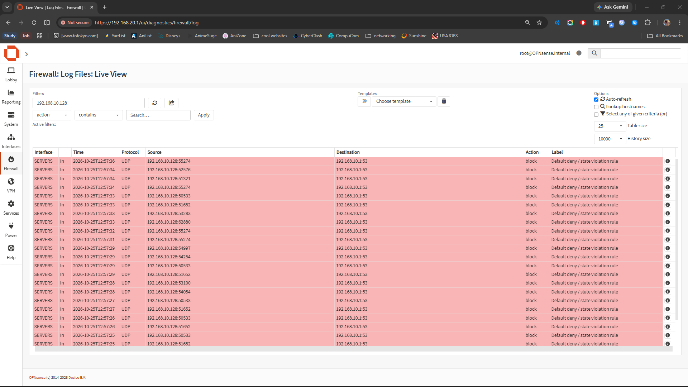

# Networking-Infrastructure-Engineering

Status: In progress

## Project story
This project is a critical initiative in establishing a robust and secure foundational network environment.

---

### 1. Project story

This ongoing project focuses on architecting and implementing a robust networking infrastructure powered by OPNsense, including the integration of dedicated WAN, LAN, and a new SERVERS subnet. The core work involves configuring network interfaces, establishing secure endpoint-to-gateway connectivity across subnets, and rigorously validating firewall enforcement policies. While foundational components have been successfully deployed and initial validation demonstrated, the project is currently addressing a critical stability challenge where network connectivity does not reliably recover after temporary firewall rule modifications. This phase is dedicated to diagnosing and resolving these state management issues to ensure a resilient and secure network environment for future services.

### 2. Key achievements

*   **Multi-Interface OPNsense Deployment:** Successfully configured and validated OPNsense with distinct WAN, LAN, and a newly integrated SERVERS (192.168.10.1/24) virtual network interface.
*   **Verified Endpoint Connectivity:** Demonstrated reliable endpoint-to-gateway communication from test clients on both LAN and the SERVERS subnet, confirming basic network reachability.
*   **Granular Firewall Enforcement:** Validated the capability to implement targeted ICMP blocking rules, with evidence of traffic being successfully blocked and recorded in firewall logs.
*   **Comprehensive Client Validation Framework:** Established a methodical approach to client validation, encompassing gateway connectivity, outbound internet access, DNS resolution, and HTTPS reachability across different network segments.
*   **Initial Documentation Foundation:** Developed foundational project documentation, including network addressing schemas, preliminary firewall rule behavior summaries, and a PowerShell script for automated network validation.

### 3. Lessons learned

*   **Complexity of Firewall State Management:** Removal of temporary firewall rules does not automatically guarantee immediate restoration of connectivity. This highlights the critical need for rigorous verification of firewall state, rule application, and explicit state table cleanup.
*   **Importance of Post-Rule-Removal Validation:** It is crucial to explicitly confirm full connectivity restoration after any firewall rule modification, even if the rule is designed to be temporary. Our definition of done will now explicitly include this step for future changes.
*   **Thorough Documentation Throughout:** The extensive need for detailed documentation (network addressing, firewall behavior, validation results, limitations) underscores its indispensable role in complex network projects, especially when troubleshooting unexpected behavior.
*   **Careful Scoping & Environment Control:** Challenges like initial validation occurring on the host PC (instead of the intended VM) and misinterpretation of PowerShell output emphasize the need for strict test environment control and precise interpretation of diagnostic tools.

### 4. Next steps

*   **Investigate Firewall State Anomaly:** Conduct a deep dive into the OPNsense firewall's persistent state (`pfctl -sr`, `pfctl -si`) to precisely diagnose why connectivity did not restore after temporary rule removal.
*   **Develop Robust Firewall Cleanup Procedures:** Define and document a reliable process for ensuring proper firewall rule cleanup and consistent application of configurations, potentially leveraging OPNsense's lifecycle management features.
*   **Re-validate SERVERS Subnet Connectivity:** Once firewall state issues are resolved, rigorously re-establish and confirm stable endpoint-to-gateway connectivity for the SERVERS subnet, verifying full restoration.
*   **Finalize Validation and Documentation:** Complete any remaining validation steps and refine project documentation, including the network topology, IP scheme, and firewall policy summary, ensuring it accurately reflects the resolved and stable state of the network.

### 5. Proof points

*   **Screenshot:** `Servers Firewall Log`
*   **Screenshot:** `Server Firewall Block Rule (Test)`
*   **Screenshot:** `Lan-Validation`
*   **Screenshot:** `WIN11-CLIENT Installation Complete`
*   **Screenshot:** `Win11 Client01 Single LAN DHCP Verified`
*   **Screenshot:** `Win11 Client01 Outbound Connectivity Test`
*   **Screenshot:** `OPNSense LAN Firewall Rules Baseline`
*   **Screenshot:** `OPNsense ICMP Block Log Evidence`
*   **Screenshot:** `OPNsense Firewall Test Results`
*   **Screenshot:** `OPNSense LAN DHCP Subnet`
*   **Log Entry:** "Validated the OPNsense SERVERS virtual network interface configuration at 192.168.10.1/24."
*   **Log Entry:** "Confirmed successful endpoint-to-gateway connectivity from WIN11-CLIENT01 to OPNsense via ICMP, receiving 4/4 successful replies."
*   **Log Entry:** "Confirmed that traffic was successfully blocked and recorded in the OPNsense firewall logs during the rule's active period."
*   **Log Entry:** "Configured and validated OPNsense WAN, LAN, and SERVERS interfaces."
*   **Log Entry:** "Verified the additional SERVERS subnet and tested gateway reachability."
*   **Log Entry:** "Validated Windows client gateway connectivity and outbound access."
*   **Log Entry:** "Confirmed DNS resolution and HTTPS connectivity for client systems."

## What we shipped
- The project was completed with a clear objective, technical execution, and proof captured in the logs.
- The implementation and project records are documented in the repository for future context.
- The work can be reviewed quickly by anyone familiar with the project.

## Key proof moments
### Highlight: Server Firewall Block Rule Test

This screenshot shows the current configuration or system state being reviewed as part of the active project setup, validation, or troubleshooting work. It highlights the key detail the viewer should notice in this stage of the project.
### Highlight: Servers Firewall Log

This screenshot shows the current configuration or system state being reviewed as part of the active project setup, validation, or troubleshooting work. It highlights the key detail the viewer should notice in this stage of the project.
### Highlight: Opnsense Kea Dhcp Service Status Active

This screenshot shows the working interface or project state that is currently being shaped to communicate the latest status, progress, and story. It highlights the key detail the viewer should notice in this stage of the project.

## Lessons learned
- Keep documentation close to delivery.
- Use screenshots as proof points.
- Write the project story in plain language for future reviewers.

## Next steps
- Continue from the handoff notes and current project status.
- Capture final cleanup or deployment follow-up items as they are completed.
