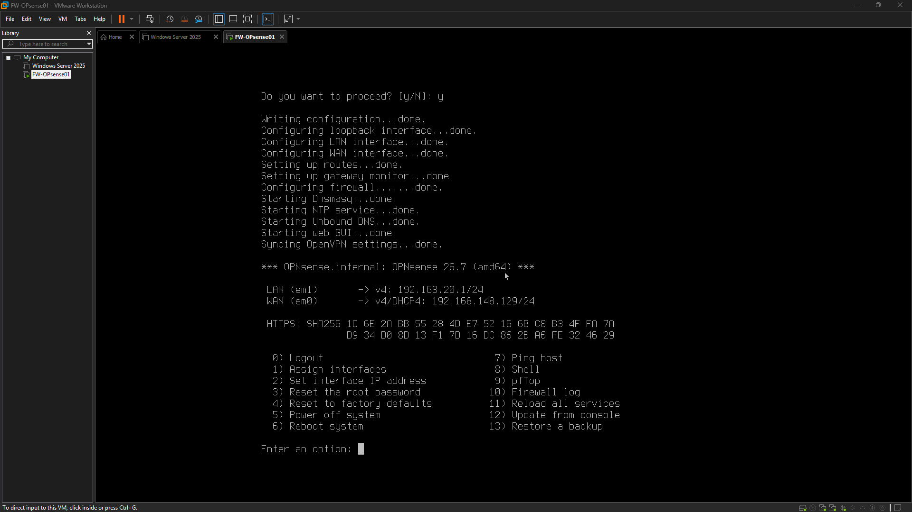
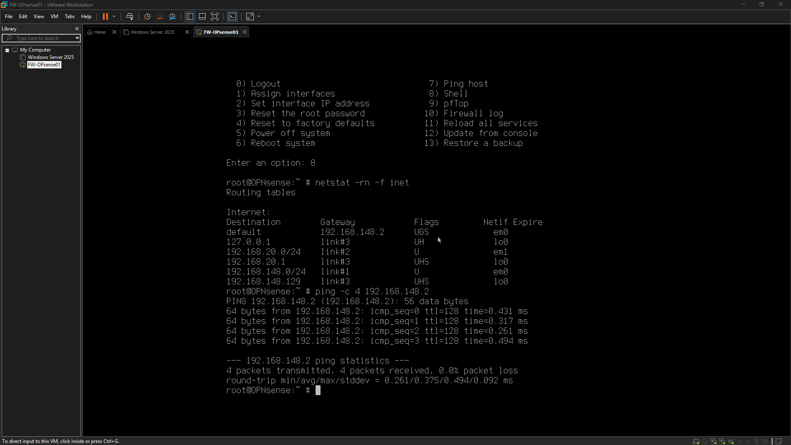

# Engineering Log – 2026-10-13

## Screenshot – WAN DHCP Success

## Screenshot – WAN Default Route Validated

## Screenshot – Network Topology Plan (Current)

## Screenshot – WAN External Connectivity

## Screenshot – WAN DNS Resolution

---

## Session – 14:00 to 14:42
### Goal
Audit the actual VMware and OPNsense network configuration, verify virtual NIC-to-network mappings, analyze the existing WAN DHCP packet capture in Wireshark if available, reassess project progress, establish a revised implementation sequence.

### Definition of Done
Produce a verified or explicitly unresolved topology, distinguish configured capabilities from tested capabilities, record Wireshark findings if the capture is available, identify the next evidence-based action, update the project handoff.

### Goal Achieved
✅ Yes

Summary:
This session successfully addressed and resolved critical network connectivity issues for an OPNsense virtual appliance. The primary cause was identified as an incorrect mapping of VMware virtual network adapters to OPNsense WAN/LAN interfaces. After systematically correcting these assignments, full network functionality was restored. WAN DHCP was successfully obtained, routing verified, and external IP connectivity confirmed. DNS resolution was also validated. The session concluded with a documented network topology, establishing a stable and reproducible foundation for subsequent implementation phases.

Tasks Completed:
*   Audited VMware virtual network adapter assignments for the OPNsense VM.
*   Identified and corrected the incorrect OPNsense WAN/LAN interface mapping:
    *   Reassigned the WAN interface to `em0` on `VMnet8`.
    *   Reassigned the LAN interface to `em1` on `VMnet2`.
*   Successfully obtained a WAN DHCP lease: `192.168.148.129/24`.
*   Verified the default gateway: `192.168.148.2`.
*   Confirmed gateway reachability with 4/4 replies and 0% packet loss.
*   Confirmed external IP connectivity to `1.1.1.1` with 4/4 replies and 0% packet loss.
*   Validated DNS resolution for `example.com` through the local resolver.
*   Documented the current network topology and addressing plan.

Issues Encountered:
*   Initial troubleshooting efforts prematurely focused on DHCP behavior before a complete validation of the network topology, including correlating VMware adapter MAC addresses with OPNsense interface names.
*   Incorrect assumptions were made regarding VMware virtual network adapter ordering and the corresponding OPNsense `emX` interface names.
*   The troubleshooting session extended without predefined time boundaries or clear stopping criteria, leading to prolonged diagnostic attempts and increased fatigue.
*   The troubleshooting sequence was inefficient due to a failure to prioritize a systematic topology audit upfront.

Next Steps:
*   Proceed with the next phase of OPNsense configuration and network implementation, building upon the established and verified network foundation.
*   Implement stricter time boundaries and earlier stopping criteria for future troubleshooting sessions to improve efficiency.

Notes:
This session highlighted the critical importance of a systematic infrastructure troubleshooting methodology, particularly the absolute necessity of validating the complete network topology and interface mappings *before* diving into service-specific issues like DHCP. The key to resolution was identifying and correcting the virtual interface mapping error. Establishing a reproducible topology reference and meticulously documenting the current state are essential for future work and maintaining a stable environment. Lessons learned include prioritizing a comprehensive topology audit, correlating MAC addresses, and implementing better session management practices (e.g., time boxing, defined stopping points) to prevent extended, less effective diagnostic efforts.

### Working Story
Systematic infrastructure troubleshooting, validating network topology before investigating individual services, identifying and correcting a virtual interface mapping error, restoring WAN DHCP and routing, proving gateway reachability and external connectivity, validating DNS resolution, establishing a reproducible topology reference, preserving a working state for the next implementation phase.

### Friction and AI Gaps
Troubleshooting DHCP before validating the complete network topology, incorrect assumptions about VMware adapter ordering and OPNsense interface names, extended troubleshooting without a firm time boundary, fatigue from repeated diagnostic attempts.

### What the AI Missed
The initial troubleshooting sequence focused too long on DHCP behavior before matching VMware adapter MAC addresses to OPNsense interfaces, the topology audit should have been performed first, the session needed stronger time boundaries and earlier stopping criteria.

### AI Peer Review
Status: Approved
Reviewer: human
Reviewed At: 2026-10-13 14:43:35
Reviewer Notes: The initial WAN DHCP failure was traced to a mismatch between VMware virtual network assignments and OPNsense interface roles. MAC address comparison established that em0 corresponded to Adapter 1 on VMnet8 and em1 corresponded to Adapter 2 on VMnet2. Reassigning WAN to em0 and LAN to em1 resolved the WAN addressing issue. The routing table showed a default route through 192.168.148.2, gateway and external IP connectivity tests each returned 4/4 replies, and the DNS query for example.com returned two IPv4 addresses. These results validate the firewall's WAN-side foundation but do not yet establish LAN client connectivity, firewall segmentation, or end-to-end client DNS.

### Duration
42 minutes (Planned: 60 minutes)

### Notes
The existing domain controller NS-DC01 remains at 192.168.148.10 on VMnet8, avoid moving or reconfiguring it during the next phase without a deliberate migration plan, preserve the current working OPNsense configuration, use short sessions with one primary objective and explicit stopping criteria.
